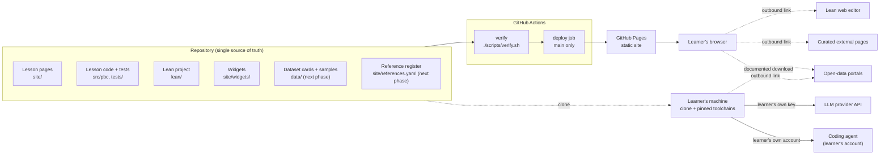
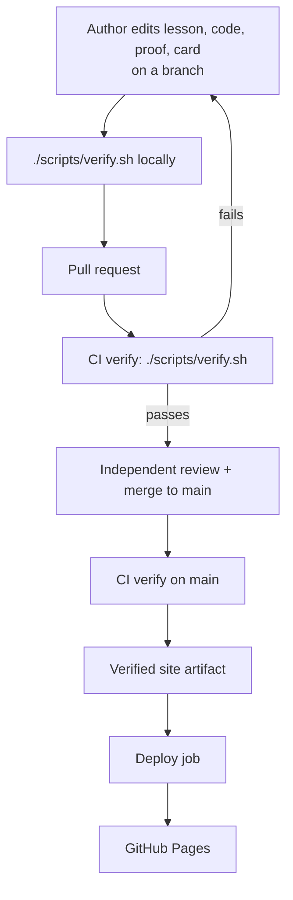

# Architecture

Physics by Construction is a static educational website whose every code
listing, figure, proof, and real-data result is produced or checked by the
same pipeline that publishes it. This document describes the architecture as
the MVP delivered it, the extensions the next phase added, and what the
final curriculum adds, and the boundaries every feature must respect.

- Source of product scope: `docs/PROJECT_REQUIREMENTS.md` (approved
  2026-10-06, re-approved with the change cycle `physics-next-phase` on
  2026-10-09, with the change cycle `final-curriculum` on 2026-10-12,
  with the change cycle `pbc-planning-change-four-workstreams` on
  2026-10-15, and with the change cycle `scientific-atelier-atlas` on
  2026-10-17).
  Where this document and the requirements disagree, the requirements win
  and the disagreement is a defect in this document.
- Decisions with a durable record: `docs/decisions/001` to `019`; ADR 017
  is proposed and not accepted (see "Verification simplification under
  review"); ADR 018 (the atelier, the asset classes, and the atlas) and
  ADR 019 (the agent skills) are proposed with the change cycle
  `scientific-atelier-atlas` and accepted when its planning is approved
  (see "The scientific atelier").
- Planning base commits: `502ced0` for the bootstrap planning, when the
  repository held only the workflow template; `2f011ea` for the change cycle
  `physics-next-phase` (`docs/changes/physics-next-phase.md`), when F01 to
  F12 were delivered and the site published eleven lessons in four strands;
  `0580b3a` for the change cycle `final-curriculum`
  (`docs/changes/final-curriculum.md`), when the site published twenty-two
  lessons in the same four strands and F58 had just been delivered;
  `0c958c8` for the change cycle `pbc-planning-change-four-workstreams`
  (`docs/changes/pbc-planning-change-four-workstreams.md`), when the site
  published thirty-two lessons in six strands, F61 was delivered and
  measured, and F113 had been paused; `b4baed1` for the change cycle
  `scientific-atelier-atlas` (`docs/changes/scientific-atelier-atlas.md`),
  when the site still published thirty-two lessons, F117 had just merged
  (pull request #205, 2026-10-17), and the first run on `main` after it
  had failed on a stochastic unit test (Issue #206). `docs/roadmap.md`
  orders the remaining work.

Sections marked **(next phase)** describe what the change cycle
`physics-next-phase` added; most of it is delivered, and the marker names
the feature that built it. Sections marked **(final curriculum)** describe
what the change cycle `final-curriculum` adds; sections marked **(four
workstreams)** describe what the change cycle
`pbc-planning-change-four-workstreams` adds; sections marked
**(scientific atelier)** describe what the change cycle
`scientific-atelier-atlas` adds. Each names the roadmap
feature that builds it; until that feature is delivered the section is a
target, not a description of the repository.

## System context

### Users

| Role | Interaction with the system |
|---|---|
| Learner (anonymous, advanced) | Reads the published site; clones the repository to run and modify a lesson's experiment with Git and the pinned Python environment alone, to replay an agent lesson or run it live with their own API key, to check proofs with the optional Lean toolchain, and, in the labs, to re-run a measured-data analysis from a committed sample or a documented download. Never instructed to rebuild or preview the website (ADR 016, F117). |
| University educator (next phase) | Downloads a published lesson's instructor pack, adapts it under the content licence, cites the project, and reports improvements through Issues. Never a mailing list. |
| Maintainer/author (with AI agents) | Writes lessons, code, proofs, and dataset cards in the repository; researches external references at edit time; merges through pull requests gated by CI. For visual and scientific-illustration work the agents follow the audited, pinned skills of ADR 019 (scientific atelier): guidance, never evidence. |
| Outside contributor | Proposes content, corrections, and datasets through GitHub Issues and reviewed pull requests (F12, extended by F57). |

There are no signed-in or administrator roles and no server that could hold
them.

### System boundary



Inside the boundary: the repository, the verification and build pipeline, and
the published static artifact.

Outside the boundary, with the direction of dependency:

| External system | Used by | Nature |
|---|---|---|
| GitHub (repository, Issues, pull requests, Actions, Pages) | Maintainer, CI, hosting | Required. |
| Python package index | CI and local builds | Required at install time; versions and hashes come from `uv.lock`. |
| Lean toolchain releases, Mathlib, and the Mathlib build cache | CI and local builds | Required at install time; versions come from `lean/lean-toolchain` and `lean/lake-manifest.json`. |
| Quarto release binaries | CI and local builds | Required at install time; version comes from `uv.lock` (see ADR 001). |
| Playwright browser builds and, on Linux, the distribution's package repository | CI and local builds | Required during the one-time setup; the browser build is fixed by the Playwright version in `uv.lock`. |
| LLM provider API | Agent lessons, on the learner's machine only | Never contacted by the site or by CI. |
| Coding agents (for example Claude Code, Codex) (next phase) | Coding-agent exercises, on the learner's machine with the learner's account (ADR 010) | Never a site, build, or CI dependency. The site verifies only the code, tests, and proofs they produce. |
| Open-data portals (Zenodo, GWOSC, CERN Open Data, NASA and ESA archives, as recorded in the dataset registry) (next phase) | The maintainer when curating a dataset; learners locally when a lesson documents a download (ADR 007) | Never contacted by the site, by the build, or by CI. |
| Curated external references (next phase) | Learner's browser | Outbound links only, from the reference register (ADR 009). Builds and reading never depend on them. |
| JIDAI website (`jidai.nl`) (next phase) | Learner's browser | One outbound attribution link. The JIDAI portfolio page is a separate company-site task outside this repository. |
| Lean web editor (live.lean-lang.org) | Learner's browser | Outbound link only. |
| External notebook services | Learner's browser | Optional outbound links only; none are planned. |
| Upstream repositories of the agent skills (Impeccable, Anthropic Frontend Design, Diagram Design) (scientific atelier, ADR 019) | The maintainer, at audit time | Read once per audit; the approved copy is pinned in the repository at its upstream revision. Never contacted by the site, the build, CI, or a running agent. |

The published site itself depends on nothing at runtime except GitHub Pages
serving its files.

## Components

### Repository layout

Target layout. Paths marked "existing" are the workflow template and stay as
they are; paths marked "next phase" are added by the named feature.

```text
site/                    Quarto project: the website source
  _quarto.yml            Site configuration (navigation, theme, math, base URL)
  _filters/              Pandoc Lua filters of the lesson constructs
  index.qmd              Home page
  about.qmd              About: how the site is built, licences, identity (F57)
  path/                  Learning path page (generated from lesson metadata and the curriculum file); since the
                         scientific atelier the course atlas at the same address, generated also from the map
                         manifest (F125, F126, ADR 018)
  curriculum.yaml        The reference curriculum: courses, method paths, slots (final curriculum, F62, ADR 013)
  atlas.yaml             The map manifest of the course atlas (scientific atelier, F125, ADR 018): concept
                         identifiers, display placement, concept-to-slot associations, curated conceptual
                         connections with their rationale; nothing the curriculum file or front matter holds
  lessons/<strand>/<nn>-<slug>/index.qmd   One directory per lesson; a strand per course
                         (mechanics, thermodynamics, waves, electromagnetism, fluids, quantum,
                         astrophysics, materials) and the three method strands (ADR 013)
  glossary.qmd           Glossary page, generated from glossary.yaml and the lessons (F42)
  glossary.yaml          Glossary entries; lessons reference them by term (F42)
  evidence.qmd           Evidence map: every claim with its evidence, generated from the lesson sources (F19)
  references.yaml        Reference register of curated external links (next phase, F28, ADR 009)
  widgets/               Self-hosted JavaScript widgets (ES modules)
  learner/               The learner-state, recommendation, and path scripts (F13, F14, F64); the
                         dependency-free atlas modules (scientific atelier, F126)
  assets/                Styles (the F44 tokens, extended by the atelier's tokens and components, F123),
                         self-hosted fonts with their licence texts, vendored Lean syntax definition
  (template partials)    The shared header, footer, and opening templates and includes of the atelier,
                         where Quarto's template partials live (scientific atelier, F123)
src/pbc/                 Importable Python package with all reusable lesson code
  mechanics/             Models and integrators used by the mechanics course, including the
                         double pendulum and Lyapunov estimate (`chaos`), the Euler-Lagrange
                         operator (`lagrangian`), phase-space and modified-energy checks
                         (`hamiltonian`), and the verified damped driven oscillator
                         (`resonance`, F68; the reference solution F45 reuses)
  thermodynamics/        Random walks and diffusion, the Maxwell distribution of a simulated gas,
                         and the entropy of an ensemble (F70)
  waves/                 The one-dimensional wave equation, interference and standing waves,
                         and sound with the Doppler effect (F71)
  electromagnetism/, fluids/, quantum/, astrophysics/, materials/
                         Models of the other courses, one package each, added by the first
                         feature of the course (final curriculum); fem/ for the small
                         triangular finite-element solver shared by T10, T11, and MAT3 (F76),
                         fluids/ for the conservative finite-volume fluxes shared by FL9, FL5,
                         and FL10 (F73)
  discovery/             Physics environments for law discovery with the hidden truth kept
                         apart from the agent, non-LLM baselines, and the evaluation protocol
                         (final curriculum, F65); the protocols and frozen runs of the
                         black-box force-law lessons D1 to D3 (`force_lab`, F66); symbolic
                         regression and equation discovery from trajectories (`symbolic`,
                         `equations`, F67)
  verification/          Order estimation, invariant checks, the named checks of the validation
                         contract, and a gallery of deliberately faulty steppers (F46)
  abm/                   Agent-based models
  agents/                Agent harness: provider interface, tool allowlist, replay; the lesson
                         modules (`projectile_lab`, `review_lab`: three reviewers, F18; `design` and
                         `design_lab`: the design of measurements that tell two models apart, scored
                         and judged by the build, F20)
  authoring/             Helpers lessons use to display code, proofs, tables, diagrams,
                         references, and claim labels by reference
  data/                  The dataset card schema and check; the readers (GWOSC text,
                         Touchstone, flume CSV) and `adapters.py` that wrap them as `Series`;
                         `status`, `series`, `uncertainty`, `calibration`, `fit`, and the
                         science-first `plotting` helpers of measured-data labs (F51); the
                         reference figures of the F50 spikes, made with those helpers
data/                    Real datasets as declared inputs (F50, ADR 007)
  registry/<dataset>.yaml   One metadata card per surveyed dataset, including negative findings
  samples/<dataset>/        Small, version-pinned, rights-cleared samples under the size cap
docs/datasets/<dataset>.md  Feasibility dossier and go/defer/reject decision per dataset (F50)
docs/instructor-packs/      Instructor packs of published lessons (next phase, F59)
tests/
  unit/                  pytest: behaviour of src/pbc
  integration/           pytest: every check fails on a violating input; CI workflow boundaries
  lessons/               pytest: the required checks on lesson sources, dataset cards, and references
  e2e/                   pytest + headless browser: checks on the built site
  *.sh                   Existing shell tests of the workflow scripts
lean/                    One Lake project for all proofs
  lean-toolchain, lakefile.toml, lake-manifest.json
  PhysicsByConstruction/<Course>/<Topic>.lean
  PhysicsByConstruction/Exercises/<Name>.lean   Checked solutions of the exercise stubs (F21, ADR 011)
  Exercises/<Name>.lean  Exercise stubs with `sorry`, outside the library glob (F21, ADR 011)
scripts/verify.sh        Existing single verification entry point; with a base, selects the
                         lessons whose inputs changed (final curriculum, F61, ADR 014)
scripts/verify.conf      Existing list of required checks; project checks are added here
scripts/check-links.sh   On-demand link maintenance check, never a required check (next phase, F39, ADR 009)
scripts/fetch-data.sh    Learner-side download of a full dataset by its card (F50)
scripts/*.sh, .agents/   Existing agentic development workflow; .agents/skills/ holds the audited, pinned agent
                         skills with a provenance record each and the project-owned scientific-visualization
                         skill (scientific atelier, F122, ADR 019)
.github/workflows/ci.yml Existing CI workflow; extended with setup, caching, deploy, and (F58) parallel verify jobs
.github/actions/prepare  The preparation of a runner, shared by the jobs of the workflow (F58)
CITATION.cff             Citation metadata: actual authors, project URL, no DOI (next phase, F57)
docs/                    Requirements, architecture, roadmap, ADRs, authoring guide,
                         scientific validation contract (validation-contract.md, F46),
                         discovery evaluation protocol (discovery-protocol.md, final
                         curriculum, F65; docs/evaluation.md is the review-criteria
                         document of the development workflow and stays separate),
                         the atelier design specification (atelier.md: the direction, the tokens,
                         the components, the asset classes; scientific atelier, F123)
pyproject.toml, uv.lock, .python-version   Python toolchain pins
LICENSE, LICENSE-CONTENT MIT for code, CC BY 4.0 for lesson text and figures
```

### Component responsibilities

| Component | Responsibility | Must not |
|---|---|---|
| **Lesson pages** (`site/lessons/`) | Explanation, assumptions, worked examples, exercises with solutions, the last section, "Run this experiment", "Replay this experiment", or "Check this proof" by the kind of the lesson (ADR 016, F117; the identifier `reproduce-this` is kept), listing the commands from a clone to the lesson's tested experiment and never a render command; in the next phase also the physical question, outcomes, interpretation, limits, self-check, and optional "Go deeper" references. Display code, outputs, figures, proofs, and data only through the verified display forms below. | Contain hand-copied code, pasted figures, hand-typed results, image files, or a curated external link that is not in the reference register (the structural links helpers generate are named in I22). |
| **Lesson code package** (`src/pbc/`) | All reusable simulation and analysis code: models, integrators, analysis helpers, data readers; in the final curriculum one package per course, the shared finite-element and finite-volume solvers, and the discovery environments. Unit-tested. The code learners import when they reproduce a lesson and the functions agents are allowed to call. | Depend on the site generator, on network access, or on an LLM provider SDK outside `pbc.agents`. Fetch data from a portal. Depend on an optional comparator (FEniCSx, Gmsh, REBOUND, QuTiP, GeoClaw, PySR, ...) in a required code path. |
| **Curriculum file** (site/curriculum.yaml, final curriculum, ADR 013) | The reference curriculum as data: the eight courses, the four method paths, and every slot with its label, working title, home, position, and kind. Lessons fill slots through their `slot` field; the path page and the home page derive the planned structure from it and every published fact from front matter. | Hold anything front matter holds (titles of published lessons, descriptions, outcomes, prerequisites, difficulty, methods), or name a lesson that does not exist. |
| **Map manifest** (site/atlas.yaml, scientific atelier, ADR 018) | The one addition the course atlas needs, in the requirements' words: concept identifiers (each with its short explanation), display placement, concept-to-slot associations (capstone membership among them, as an association whose slot is a capstone slot), and curated conceptual connections with their rationale. The short explanation of the concept that represents a capstone slot is the planned description the atlas reveals and the home page shows. Validated by `pbc.authoring`: every course, path, slot, and concept reference resolves (the schema defines course, path, slot, and concept references only, and rejects any other field; it admits no lesson reference, so the requirements' lesson-reference rule holds vacuously); a concept names at least one slot; every capstone slot of the curriculum file is represented by exactly one concept. | Hold a title, description, outcome, prerequisite, publication state, or count; hold an illustration reference (the course areas' illustrations are drawn by code, mapped from the curriculum file's courses by the generator) or a lesson reference; infer a concept from a lesson's title; list a prerequisite (those come from the front matter); be a second lesson catalogue. |
| **Lean project** (`lean/`) | All formal proofs, built with `lake build` against pinned Lean 4 and Mathlib. | Contain `sorry`, `admit`, or project-declared `axiom`s. Claim anything about the Python code or about the physical accuracy of a measurement. |
| **Widgets** (`site/widgets/`) | Optional interactive visualizations that enhance a static figure already present in the page; in the next phase a small set of science-first components (F43). | Load code or data from another origin, load data before the reader asks for it, store or transmit learner data, compute physics the page did not verify, alter claimed observed values, or be required to read a lesson. |
| **Atlas modules** (`site/learner/`, scientific atelier, F126, ADR 018) | Small dependency-free ES modules that enhance the generated atlas: the switch between map and index, selection and the selected-concept panel, zoom, filters, and the phone's region selector. Without them the page is complete: every published lesson is reachable through native links and disclosures, and the textual equivalent of the map is in the page. | Make a request, set a cookie, use browser storage (`site/learner/progress.js` stays the only script that stores anything), compute physics, change which lessons exist or count as published, or be required to reach a lesson. |
| **Dataset registry and samples** (`data/`, next phase, ADR 007) | One card per surveyed dataset with provenance, rights, artifact types, schema, units, cadence, uncertainty, checksums, and the feasibility decision; small rights-cleared samples under the size cap, each parsed by a test. | Hold a file above the cap, a restricted or unlicensed sample, a file without a card, or anything a build could regenerate. |
| **Reference register** (`site/references.yaml`, next phase, ADR 009) | The selection evidence of every curated external link: concept, URL, author or publisher, section, pedagogical role, statement checked, alternatives, last-checked date, licence note. Pages render links from it. | Be required by the build to be reachable; hold a paywalled or sign-in-only core reference. |
| **Site generator** (Quarto, ADR 001) | Executes lesson pages, renders equations to MathML, highlights code at build time, emits static HTML. | Add third-party runtime resources (CDN scripts, web fonts, analytics). |
| **Visual system** (`site/assets/site.css`, `src/pbc/authoring/design.py`, the shared templates and includes, `site/assets/fonts/`, scientific atelier, F123, ADR 018) | The atelier as scoped CSS: tokens (warm paper-white backgrounds, nearly black text, cobalt blue and vermilion accents, the type scale of serif headings, readable body text, and monospaced annotations, thin rules, generous spacing), component styles, the shared header with the project mark, the footer, the openings, and the lesson reading column; the self-hosted fonts with their licences; the colours defined once in the design module with the contrast test. The design specification in `docs/` says how to apply it. | Load a font or style from another origin, introduce a framework, a bundler, or a theme switch, change the meaning of a label, a figure, or a claim, or make a page unreadable without the fonts or the styles. |
| **Content checks** (`tests/lessons`, `tests/integration`, `tests/e2e`) | Enforce the invariants in this document on lesson sources, dataset cards, the reference register, and the built site. | Depend on network access or credentials. |
| **Verification entry point** (`scripts/verify.sh`, `scripts/verify.conf`, `scripts/verify-workflow.conf`) | Run every required check with one command. Every product check runs identically on a laptop and in CI (ADR 003); the workflow self-tests run in CI always and locally when a workflow file changed (ADR 005). With a base (final curriculum, ADR 014) it computes the input digest of every lesson and the identity of the checks, names the lessons whose digest changed, and the lesson checks run for those; a lesson without a digest, a changed shared input, a check identity that differs from the base's, or no base makes the run a full run that executes every lesson. It assigns the lessons to the same-machine lesson shards of a full run and derives their number (ADR 014 decision 11, F113, paused since 2026-10-15; one `build` job today). | Have CI-only checks, or skip a product check locally. Select a lesson out by anything but its digest, reuse a check whose implementation changed, or run selectively on `main`. |
| **Link maintenance check** (`scripts/check-links.sh`, next phase, ADR 009) | On demand, open every URL in the reference register and report what no longer resolves to its section. | Be listed in `scripts/verify.conf`, block a merge, or run in the build. |
| **CI/CD workflow** (`.github/workflows/ci.yml`) | Install pinned toolchains, restore caches, run groups of the checks of `verify.conf` in parallel jobs through `./scripts/verify.sh --only`, behind one aggregate required check named `verify` (ADR 012), publish the verified artifact from `main`. In the final curriculum (ADR 014): on a pull request, retrieve the base (the executed results, the digests, and the check identity of the latest successful run on `main`) read-only and pass it to the script; on `main`, run without a base and publish the base for the next pull requests after `verify` passed; run the group `build` in the lesson shards the script derives and assemble their results into the one built site (ADR 014 decision 11, F113, paused since 2026-10-15; one `build` job today). | Rebuild the site in the deploy job, hold LLM keys, fetch a dataset, grant write permissions to pull request runs, declare a check that is not in `verify.conf`, or pass a base to a run on `main`. |
| **Agent harness** (`src/pbc/agents/`, ADR 004) | Run an LLM-driven experiment loop over an explicit allowlist of simulation and analysis functions, live on the learner's machine or as a deterministic replay in CI. Serves the experiment, counterexample, and review agent lessons. | Execute model-generated code, shell commands, or network calls; print or log credentials. |
| **Coding-agent exercises** (documented local workflows, next phase, ADR 010) | Let a learner drive a coding agent on their own machine, with their own account, under a sandbox profile, from an approved specification to tested code or a checked proof; the site shows the specification, the verified reference solution, the tests, and a review rubric. | Run in CI or in the build; replay agent-written code; show an agent transcript as verified. |
| **Agentic development workflow** (`scripts/`, `.agents/`, existing) | Plan, implement, review, and triage repository changes. Development tooling, not part of the product. In the next phase its content agents may research references and log evidence (F12 extension) but never accept a link or rewrite a citation without human review. Since the scientific atelier its roles use the audited, pinned skills of `.agents/skills/` (ADR 019): the planner selects them per visual deliverable, the implementer evidences their use, the reviewer verifies the rendered or generated artifact against its sources. | Be confused with the "AI agents" lesson strands. Treat a skill as a build or CI dependency, or as evidence that a figure, a page, or a claim is correct. |

### Lesson model

A lesson is one directory under `site/lessons/<strand>/` whose `index.qmd`
carries validated front matter and a fixed set of sections.

**Courses, methods, and strands (next phase, ADR 008).** The requirements
organise content as physics courses by subject, with AI-assisted research,
agent-based modelling, and formal verification as cross-cutting methods, and
keep the existing strand identifiers and URLs. The model therefore has three
facets:

| Facet | What it is | Where it is defined |
|---|---|---|
| **Course** | A physics subject. Eight courses with fixed identifiers (final curriculum, ADR 013): `mechanics`, `thermodynamics`, `waves`, `electromagnetism`, `fluids`, `quantum`, `astrophysics`, `materials`; `mechanics`, `thermodynamics`, and `waves` are the ones with lessons today (F68, F70, F71). Every lesson, including an agent, proof, or measured-data lesson, belongs to exactly one primary course. The learning path page is organised by course. | `pbc.authoring.path` (`COURSES`, from the curriculum file after F62); lesson front matter `lesson.course` (F37). |
| **Method** | A cross-cutting way of working: `simulation`, `llm-agents`, `abm`, `lean`, `measured-data`, `coding-agents`. A lesson lists the methods it uses; the path page shows one method path per method across courses, and lesson pages cross-link related lessons. | `pbc.authoring.path` (`METHODS`); `lesson.methods` and `lesson.related` (F37). |
| **Strand** | The URL group and ordering key a lesson lives in: `mechanics`, `agents-llm`, `agents-abm`, `lean`, unchanged in identifier and address; in the final curriculum every course is a strand with the same identifier, created by the first feature that publishes a lesson of it (ADR 013). Strand order (the eight courses in curriculum order, then the three method strands) and `lesson.order` still define the one linear learning path; previous and next links follow it. That order is a reading route, not the dependency order: a prerequisite may live in a later strand (ADR 013 decision 8). | `pbc.authoring.path` (`STRANDS`); `lesson.strand`, `lesson.order` (existing). |
| **Slot and method path** (final curriculum, ADR 013) | The place of a lesson in the reference curriculum: a label such as `M17`, `T10`, or `D13` that the curriculum file defines with a working title, a home (a course, or one of the four method paths with a position in it), and a kind (lesson, measured-data lab, applied capstone); the one Lean slot, L1, has the strand `lean` as its home and may be filled by a lesson of any course. A lesson fills at most one slot; a slot is filled by at most one lesson; a lesson without a slot (the Lean lessons beyond the baseline) is allowed. The four method paths (physics reasoning and scientific agents, scientific law discovery, physics agent benchmarking, autonomous scientific research) are a view over the lessons whose slots belong to them, never courses, strands, or pages. | site/curriculum.yaml; lesson front matter `lesson.slot` (F62). |

Placement rule for new lessons: a lesson whose subject is the physics of a
course, including a measured-data lab or an applied capstone of that
course, lives in the course's strand directory and takes the next free
order there (a mechanics lesson after whatever mechanics lesson landed
last, so F46 and F60 each took the next order when they landed, not a fixed
number); a lesson whose subject is the method itself, which includes the
lessons of the four method paths, lives in the method's strand directory
(`agents-llm`, `agents-abm`, `lean`). The strand directory of a course is
created by the first roadmap feature that publishes a lesson of that course
(ADR 013 decision 2, in place of ADR 008 decision 4), never by a
placeholder; no lesson is placed by a method tag alone. A strand's display
title may change; its identifier and address never do. A published lesson
changes its primary course by front matter only when its course comes into
existence: the gas lesson of F11 became a thermodynamics lesson (slot
`T0`) under its `agents-abm` address with the first thermodynamics lessons
(F70), which set `course` and `slot` together; before F70 the lesson had no
slot and T0 was an unfilled planned slot (ADR 013 decision 6).

Front matter, validated by a check. The exact schema is fixed by the feature
that adds each field; "No other key is allowed" stays the rule between
features:

| Field | Meaning | Since |
|---|---|---|
| `id` | Stable identifier, unique across the site. Used for prerequisites, related links, and learner progress. Never reused. | F02 |
| `title`, `description` | Lesson title and one-sentence description. | F02 |
| `strand`, `order` | Position in the learning path. | F02 |
| `difficulty` | Ordinal level on one site-wide scale (1 to 3). | F02 |
| `prerequisites` | Lesson `id`s the reader should have read: each must exist, the graph must have no cycle, and a prerequisite in the same strand must come earlier in that strand; a prerequisite in another strand may come later in the linear order (final curriculum, ADR 013 decision 8; until F62, every prerequisite comes earlier in the linear order). Plus outside prerequisites written `Term: detail`, each term an entry of the glossary (F42). | F02 |
| `lean-modules` | Lean modules this lesson displays, when any. | F08 |
| `course` | The primary physics course. Required. | F37 |
| `methods` | The methods the lesson uses, from the fixed vocabulary; at least one. | F37 |
| `outcomes` | Two to five sentences of what the reader can do afterwards; rendered as "What you'll learn" and on the learning-path cards. | F37 |
| `related` | Lesson `id`s the page cross-links as extensions (its agent, measured-data, or Lean counterparts); a related lesson must exist and must not already be among this lesson's prerequisites. Links are one-directional, written from the prerequisite side. | F37 |
| `format` | The lesson format version (`1`: the MVP template; `2`: the progressive-depth template). The checks of a version apply to the lessons that declare it; the default flips to `2` once every lesson has migrated. | F28 |
| `slot` | The label of the reference-curriculum slot the lesson fills, from the curriculum file; optional; unique across lessons; a slot homed in a course is filled only by a lesson of that course, a slot of a method path by a lesson of any course (final curriculum, ADR 013). | F62 |
| `preview` | The label of the figure cell of the lesson that is its preview in the learning path; optional; a cell with a figure status and alt text. The build scales the figure that cell drew to a fixed size and writes it to `previews/<id>.png`; a lesson without it gets a conceptual SVG drawn from its course and methods; `path.json` names the file and its alt text, which starts with the status (F63). | F63 |

Required sections of format 1, checked for presence: assumptions,
explanation, code, worked examples, exercises (with on-page solutions) or an
interactive visualization, and the last section (the section
`reproduce-this`, headed by the lesson's activity, F117).

**Format 2 (next phase, F28)** keeps every section of format 1 and adds, for
each major concept, the progressive depth the requirements ask for:

| Part | Identifier or markup | Required | Content |
|---|---|---|---|
| Physical question | Opening paragraphs, no heading | yes | The problem the lesson answers and where the concept is used, before any equation or code. |
| What you'll learn | Rendered by the header cell from `outcomes` (F37) | yes | The outcomes, with the prerequisites and the difficulty. |
| Assumptions, explanation, code, worked examples | As format 1 | yes | The core explanation stays on the site: intuition, definitions, essential derivation steps, units, limits of applicability; code explained as physical operations (state variables, update order, units, error modes). |
| Interpretation | Prose after each figure or table, and the caption | yes | What the figure or table means, its source status, the invariant or reference it was checked against. |
| Limits | `limits` | yes | What the result does not show: failure modes, what the proof or the measurement does not cover. May be one paragraph. |
| Self-check | One `.exercise.self-check` div; it is an exercise for the solution markup and the checks, but is titled "Self-check." and takes no number | yes | One concise conceptual question with its solution, distinct from the exercises. |
| Go deeper | `.go-deeper` div naming register keys | no | Curated external references at the relevant concept, each with a short reason to visit, rendered from the reference register (ADR 009). Never a substitute for a missing core explanation. |
| Claim labels | `.claim` span or div with `type` (the build renders the label as a `data-type` span), optional `scope`, and `evidence` | yes where a scientific claim is made | One of the four claim types defined below; renders a visible label and the identifier `claim-N` (N counts the claims of the page). `evidence` names, separated by spaces or commas, the executed cell labels of the lesson, register or card keys, Lean theorems, or recorded agent runs that support the claim; every claim has it, and the evidence map (F19, `pbc.authoring.evidence`) lists every claim with links to its evidence and fails the build for a claim without it or with a name that exists nowhere. |
| Figure status | `#| fig-status:` on every figure cell | yes | One of `measured`, `calibrated`, `processed`, `simulated`, `conceptual`; renders with the caption. |

The claim type names the kind of evidence behind the claim, not the kind of
lesson that makes it. The type follows what was done to support the claim
(invariant I21):

| Claim type | Meaning |
|---|---|
| `observational` | A statement of what a measurement or observation shows, or a published measured value cited with its source; no model is needed to state it. |
| `experimentally-supported` | An inference from measured data through a stated model, with its uncertainty; the measured data and the model are both shown, and the claim is about the measured system (for example a parameter fitted to measured strain). |
| `numerically-verified` | A result of an executed simulation or computation, recomputed by the build, about the model that was computed; an agent's conclusion from simulated runs is of this type where the build recomputes it, and is not a claim at all where it does not. |
| `formal-theorem` | A Lean theorem about a model, with its hypotheses as the claim's scope; it proves nothing about a measurement. |

Short lessons do not need every part to be long: depth follows intellectual
difficulty, not word count.

The learning path (order, difficulty, prerequisites, courses, methods,
related lessons, previous and next links) is derived from lesson front
matter. There is no second, hand-maintained list that could drift. The
prerequisite graph on the path page is one inline SVG laid out at build time
in Python (`pbc.authoring.graph`): columns follow the prerequisites, bands
are courses, solid arrows are prerequisites, dashed arrows are related
lessons, each node links to its lesson, and a visually hidden list of
sentences ("M4 requires M2") is the accessible alternative. It needs no
browser script.

**The reference curriculum and the learning path page (final curriculum,
ADR 013, F62 to F64).** The curriculum file is the one declared source of
what is planned: the eight courses, the four method paths, and the 115
slots of the requirements' decision 23, each with a label, a working
title, a home, and a kind. Everything published comes from front matter;
the file adds only the structure around it. The path page is course-first:
one panel per course that has a lesson, with its description, its real
published-lesson count, a verified miniature, and its entry point; the
course's lessons, in the order the curriculum file lists their slots (the
teaching order) with the lessons without a slot after them (ADR 013
decision 8), behind native progressive disclosure (`<details>` and
`<summary>`), closed by default, as compact cards (title, one-sentence
physical question, difficulty, a small verified thumbnail, chips for
simulation, experimental data, and AI extensions) whose details (outcomes,
prerequisites, what the reader builds, related extensions, the capstone
classification, reproduce links) open on demand; the slots of the course
that no lesson fills shown as planned, visibly distinguished, with label and
working title only and no link; the four method paths, agent-based
modelling, and Lean as a secondary view over the same pages; the
prerequisite graph with its text alternative under an optional
dependency-map disclosure, with course-scoped subsets allowed; optional
filters by course, method, difficulty, and publication state that
coordinate with the self-hosted search and need no script to reach any
lesson. A thumbnail is the lesson's own verified figure named by `preview`,
rendered small by the same executed cell during the build, or a conceptual
SVG the repository generates; never a committed, copied, or external image.

As built (F64): `pbc.authoring.path.PathOverview` writes the page. A course
panel shows the preview of its representative lesson (the first lesson, in
teaching order, that names its own figure in `preview`, else the first
lesson) and links its first lesson. A course disclosure cannot open itself
without a script, so a reader of a lesson who follows the course link lands on
a closed course; `site/learner/path.js` opens the course the address points
into. The method paths and the methods list each lesson as one link to its
canonical page, never as a second row. The filters are links to every course,
path, and method without a script; with `site/learner/path.js` they become a
form that hides rows and stores nothing. They never change the page the search
index is built from, so the search finds the same text with or without them.
Each course holds the dependency map of its own lessons in a nested
disclosure, drawn with ids scoped to the course, besides the whole map at the
bottom of the page.
Every existing link, bookmark, and graph node address stays valid. A test
compares the page with the front matter and the curriculum file.

**The course atlas (scientific atelier, ADR 018, F125, F126).** The same
page, at the same address, gains a physics map before the index ("the
atlas" may be its display label; the label and the navigation wording are
settled in the owner's review of the first preview): a breadcrumb, the
title, and a short explanation; a switch between the map and the course
index of F64, with search and filter integration where it adds value; a
large illustrated concept map of the eight courses, limited to the
approved curriculum, with the four method paths as a connected research
layer that keeps their distinctions and with the Lean and method views
kept as part of the map (every published lesson listed by its method tags
from the front matter, the lessons without a slot included); a
selected-concept panel with a short explanation and canonical
lesson links; then the complete course, module, and lesson index of F64,
below the map, with its metadata, progress marks, recommendations,
filters, and search;
capstone links or explicitly labelled planned projects; the shared footer.
The map's data are the curriculum file, the front matter, and the map
manifest (the component table): concepts, their placement, their slots,
and the curated conceptual connections with a rationale come from the
manifest; prerequisite edges from the front matter; publication from the
lessons that exist. The three edge types (conceptual connection,
prerequisite, capstone membership) are explicit in the drawing and in the
words of the textual equivalent, and may be shown in separate modes. The
generator writes semantic HTML, inline SVG with real links and text, and a
visually hidden textual equivalent at build time; the atlas modules add
selection, zoom, filters, the switch, and the phone's region selector,
and store and request nothing. A planned concept or slot is labelled,
distinguishable without colour alone, never a link, never counted.

### Verified display forms

Everything a lesson shows as code, output, figure, proof, data, or claim must
reach the page through one of these forms (ADR 002, extended by ADR 007 and
ADR 009):

| Shown on the page | Allowed source |
|---|---|
| Python code | (a) An executable cell that the build runs, or (b) an excerpt included by reference from `src/pbc/` at build time, optionally a named region with line annotations (F35). |
| Program output and numbers | Output of an executed cell, including values computed inline. Tabular results are rendered as semantic tables with units and a caption by a helper, not as console dumps (F36). |
| Figures | Produced by an executed cell during the build, with alt text, explicit dimensions, labelled axes with units, a legend where there is more than one series, and a status label. A measured-versus-model figure shows residuals or uncertainties where relevant. Since ADR 016 and F117 the cell draws the figure by calling the lesson's figure-writing function, the one the experiment entry point calls, and shows the file it wrote, so that one encoder produces the page's figure and the learner's. |
| Conceptual diagrams (next phase, F32 to F34; the conceptual-illustration class of ADR 018) | Drawn by code in an executed cell (`pbc.authoring.diagrams` or Matplotlib), labelled `conceptual`, never presented as a numerical or experimental result. Image files are never committed; a third-party diagram is cited and linked, not rehosted. Since the scientific atelier the approved Diagram Design guidance of ADR 019 informs the drawing; its science and semantics are checked independently of any skill. Requirements decision 37 also permits an authored committed SVG for this class; ADR 018 decision 2 keeps lessons code-drawn as a planning choice within that permission, because every check of a lesson's figure (the figure-status label, the figure-writing pattern with the experiment and reproduction checks, the lesson-directory layout) acts on executed cells. An authored conceptual SVG in a lesson is a later decision, in an ADR that would add this display form, a layout rule, and a wider committed-artifact exemption; until then this row governs. |
| Interface artwork (scientific atelier, ADR 018) | Visual identity and navigation only: the project mark, the course areas and small illustrations of the atlas, the openings of courses, modules, and capstones. Produced by code in the repository at build time, or an SVG source authored for this project under `site/assets/` with its author and licence recorded; never a raster, never stock, copied, or externally hosted. The authored SVG is the third committed input a build cannot regenerate (I6): the committed-artifact check exempts a tracked `.svg` under `site/assets/` only when the provenance register of the asset-source rule names it with an author and a licence, and keeps rejecting an unregistered SVG, every raster, and every other image type everywhere (ADR 018 amending ADR 002; F123). Carries no caption of a result and no number; its alternative text names what it is or marks it decorative. Never inside a lesson's body as if it were a figure. |
| Animations (scientific atelier, ADR 018) | Allowed in any class when pedagogically justified: generated by the build or driven by data the build computed, with a meaningful static alternative in the page, starting paused or respecting the reduced-motion preference, with play, pause, and reset controls and with units and sensible parameter limits where it has parameters; mandatory in no lesson; never rendered in CI as a routine step. A widget that computes in the browser (the validated interactive pendulum, F128, if decided) is tested against reference values from `src/pbc`, as the row above says. |
| Lean code | An excerpt included by reference from a file in `lean/` that `lake build` compiled. |
| Agent run transcripts | Produced by the replay run during the build (ADR 004). Recorded model messages come from the committed replay fixture and are labelled as recorded; tool results are the recomputed ones, never the recorded ones. |
| Coding-agent sessions (next phase, ADR 010) | Never replayed. The page shows the specification, the verified reference code and tests, and the review rubric; an example transcript, if shown, carries the "not verified" marker and the model and date. |
| Measured data (next phase, ADR 007) | Read by an executed cell from a committed sample under `data/samples/` whose card records provenance, rights, artifact type, checksum, schema, and units; or, for data that cannot be committed, from a local download the learner makes with `scripts/fetch-data.sh`, in which case the page shows only what the committed sample supports and links to the original data. |
| Interactive visualizations | Data computed by executed cells during the build and embedded in the page. Where a widget computes in the browser, a test compares its results with reference values from `src/pbc`. A widget never alters a claimed observed value. |
| External references (next phase, ADR 009) | A link rendered from an entry of the reference register, placed at the relevant concept or in a "Go deeper" block, with its reason to visit. |
| Anything else | Must carry the explicit "not verified" marker, which renders a visible label. A check fails the build for unmarked, non-executed code. |

## Data flows

### Authoring to publication



### Inside one verification run

Order matters only where stated; the product checks are required entries in
`scripts/verify.conf` and the workflow self-tests are declared in
`scripts/verify-workflow.conf`. A preflight check listed first reports every
missing prerequisite of the supported-machine contract (see "Toolchains and
pinning") with a fix hint.

1. **Lint and format**: Python sources and lesson cells.
2. **Unit tests**: `pytest` on `src/pbc`.
3. **Lean build**: fetch the Mathlib cache when it is not built locally (an
   install-time dependency, I20), then `lake build` for every module in
   `lean/`. Fails on `sorry` and on project-declared axioms.
4. **Lesson source checks**: front matter schema, required sections of the
   lesson's format, prerequisite graph (references exist, no cycles, a
   prerequisite in the same strand comes earlier in it; since F62 a
   prerequisite in another strand may come later in the linear order, ADR
   013 decision 8), "not verified" markers; in the next phase
   also course and method vocabulary, claim labels, figure status, reference
   keys that exist in the register, and register entries that a lesson uses.
5. **Dataset checks (next phase, ADR 007)**: every file under `data/samples/`
   has a card, matches its checksum, is under the caps, and has a rights
   field that permits redistribution; every card validates against the
   schema; every sample is parsed by a test that asserts field names,
   shapes, units, masks, and cadence.
6. **Site build**: Quarto executes every lesson page in the locked Python
   environment and renders the static site. A failing cell, an agent replay
   mismatch, or an equation that cannot be converted to MathML fails the
   build. No cell opens a network connection.
7. **Built-site checks**: no resource loaded from another origin; images have
   alt text and explicit dimensions; internal links resolve; pages are
   readable with JavaScript disabled; automated WCAG 2.1 A/AA scan; no cookies
   set; page payload within the budget below. For lessons: the last section
   is headed by the activity of the lesson and lists the commands from a
   clone to its experiment and no render; the experiment of every lesson
   that the run executed, run with those commands in one learner
   environment per run (`uv sync --locked --no-dev` in a fresh clone,
   outside the budget; never the environment of the checkout), writes the
   figure files of the built page byte for byte (the one encoder of
   `pbc.experiment` produced both) and its numbers at their displayed
   precision, within the 30-second budget of a lesson; and the internal
   render of each page in a fresh clone regenerates the published page.
   These two are the tests marked `same_machine` of the check
   `site-checks-reproduction` in the group `build` (ADR 016 decision 4,
   ADR 012 decision 4). For widgets: their scripts
   contain no request (but a `fetch` of their own on-demand data), other
   origin, or use of browser storage; on-demand data is within its budget,
   exists, and is requested only after a user action (F43); and
   operating their controls writes nothing to cookies or browser storage; the
   widget tests check the fallback, keyboard operation, the displayed values
   against `src/pbc`, and the absence of layout shift. Search (F41): a query
   finds a lesson by a term in its body; while it runs, nothing is requested
   from another origin and nothing is written to cookies or browser storage;
   with scripts disabled no search control is shown and a link to the
   learning path takes its place; the index stays within the payload budget
   and holds the prose of the pages, not their code or printed output, which
   `site/search-index.py` removes after the render.
   Learner state (F13): the learner-state script contains no request, other
   origin, or storage but local storage; while a self-check is completed,
   every request is a plain read of a file of the site, none carries the
   stored state, no cookie is set, and nothing is written to IndexedDB, the
   Cache API, or a service worker; stored data of another version is
   discarded; every self-check is an exercise with a visible solution with
   scripts disabled; its controls work by keyboard and pass the scan.
8. **Determinism**: a second build of the same commit is byte-identical to the
   first.
9. **Workflow self-tests**: the existing shell tests of the workflow scripts
   (ADR 005).

**Selection by what changed (final curriculum, ADR 014, F61).** A run with
a base, which CI gives only to pull requests, computes the input digest of
every lesson (its directory, the `src/pbc` modules its cells import
transitively, the samples and cards its cells use, the files that a path
constant of those modules names where they use it, such as the committed
expectations in `reports/expected`, the Lean modules it
displays with the toolchain and manifest, the Python pins, and every shared
file of the site project including `src/pbc/authoring`) and compares it
with the digests of the base, the executed results and digests that the
latest successful run on `main` published. Step 6 executes only the lessons
whose digest changed and renders every page from the base's results
otherwise; what a page shows of its context (the header
with previous, next, prerequisites, related lessons, course, and slot; the
commit named by the last section and by the code and Lean excerpts) and
every page that is not a lesson are produced by this build from the
current front matter, curriculum file, and commit, never taken from the
base (ADR 014 decision 9); step 8 starts its second build from the same
restored state; the reproduction of step 7 runs for the changed lessons;
the checks of one page run for every page whose built bytes, with the
build commit normalised, differ from the base's; steps 1 to 5, the checks
of the site as a whole, and the Lean build run in full. The base also
records the identity of the checks (a digest over the verification script
and its configuration, the build and determinism scripts, `tests/e2e`,
`tests/support`, `tests/e2e/shards.json`, the Python pins, and the browser
tooling, ADR 014 decision 10; `tests/integration` left it with F119, because
no check a base reduces reads it and the checks that run it are never
reduced by a base, `docs/verification-audit.md`); when the current tree's
identity differs, nothing of the base is reused and the run is a full run
with the current checks. A full run executes every lesson: every run on
`main` and every local run without the option, a run without a readable
base of the current format, a run in which the inputs of a lesson cannot
be followed (the lesson has no digest), a run in which a shared input
changed (`src/pbc/authoring`, the templates, filters, assets, and shared
site files, `_quarto.yml`, the Python pins, the Lean toolchain and
manifest, or a `src/pbc` module whose importers cannot be followed), and
a run whose check identity differs from the base's. A changed module of
`src/pbc` selects every lesson that imports it, directly or through
another module. A reproduction compares bytes only with a result this run
computed on the machine of the comparison, so a lesson selected for
reproduction is always a lesson this run executed. ADR 014 decision 11
had a full run in CI execute the lessons in same-machine lesson shards of
at most 32 lessons with one assembly (F113); that decision is **paused**
since 2026-10-15 (requirements decision 35, ADR 017 proposed), and a full
run is the one `build` job of ADR 012, measured at 21 to 31 minutes with
thirty-two lessons ("CI pipeline and time budget"). No check is dropped.

**Three local tiers (four workstreams, ADR 017 decision 7, F119).** What an
agent or maintainer runs before a pull request depends on the change, and
the selection decides. The targeted run, `./scripts/verify.sh --targeted`,
retrieves the base read-only from the latest successful run on `main`
(`scripts/fetch-base.sh`, with the machine's `gh` login, under the same
provenance rule as CI), computes the selection CI will make and reports it,
and runs the checks of the groups the entry `targeted:` of
`scripts/verify.conf` names: the supported-machine contract, lint and
format, the unit tests, the lesson source checks, the dataset checks, the
documentation and workflow structure checks, the workflow self-tests when a
workflow file changed, and the single-page render of each selected lesson in
a clone of the working tree with the Lean build for changed proofs, followed
by the lesson's experiment in a learner environment of the clone, compared
with the rendered page (`scripts/check-lesson-pages.sh`); it performs no site build, no
determinism build, and no built-site check. It never guesses: without an
acceptable base, when the selection names a full run, or when a selected
lesson is new to the base, it reports what CI will run and which tier the
change needs, and verifies nothing. `./scripts/verify.sh --base` is the tier
for a change that alters what other pages display of a lesson (the
front-matter fields of the path and the headers, a new lesson); the full
`./scripts/verify.sh` is the tier for a shared input of ADR 014 decision 4
or a file of the check identity, and the only verification of the content.
A pass is recorded with its tier, the base, and the selection;
`scripts/review-feature.sh`, `scripts/apply-triage.sh`, and
`scripts/finish-feature.sh` gate on `./scripts/verify.sh --reuse --targeted`
and record them in the review and the commit message. CI builds and
validates the site on every pull request and push and stays the publication
gate. The experiment check of ADR 016 decision 4 joins the render script
when F117 delivers the entry points.

**The experiment of a lesson (four workstreams, ADR 016, F117).** Every
lesson declares a runnable experiment entry point that calls its
implementation in `src/pbc` and regenerates its figure files and the
numbers of its page without rendering HTML; the page's cells call the same
functions. The entry point and the figure-writing functions are modules
of the lesson's course package under `src/pbc`, imported by the page's
cells, so that the lesson's digest follows them (ADR 014 decision 1
follows imports through `pbc` modules only); the lesson directory holds
at most a thin runner. For a lesson whose methods are Lean only, the
entry point is the proof check (`./scripts/check-lean.sh`), its digest
inputs are the displayed Lean modules, toolchain, and manifest the digest
already follows, and its test is the Lean build with the exercise pairing
check of ADR 011; a Lean lesson that also computes a figure declares the
figure-writing function under `src/pbc` like every other kind (ADR 016
decision 2). Each figure has one figure-writing function in that
module, with fixed settings and no metadata, that the entry point and the
page's cell both call, the cell showing the written file as its output,
so one encoder produces the figure file of the built page and of the
learner's directory (ADR 016 decision 2; today the inline backend
captures every figure from `plt.show()`, and no helper writes a figure
file). The experiment check of step 7 runs that entry point in a
fresh clone, in one learner environment per run created with
`uv sync --locked --no-dev` outside the per-lesson budget and never in
the checkout's environment (a `--no-dev` sync of the checkout would
remove the `dev` group from the running verification), and compares the
figure files byte for byte (as an image at the page's rendered size for a
figure kind the feature's record documents as unable to reach byte
identity) and the numbers at displayed precision with
what this run computed on the machine of the comparison; it follows the
selection of the page reproduction (every lesson on a full run, the
executed lessons on a selective run), as tests marked `same_machine` of
the check `site-checks-reproduction` in the group `build`, so an unchanged lesson's experiment is not re-run
on a selective run and is never compared with a result of the base. On
a full run it is a fourth execution of every lesson in the `build` job
(a fifth before F119 removed the third build); the switch that adds it to
`scripts/verify.conf` waited for the owner's interim full-run timeout
(decided 2026-10-15, ADR 014 status) or for F119's consolidation (applied),
so it is F117's to flip (ADR 016, "Consequences"; F117 criterion 8). The
page reproduction stays an internal check; the audit of F118 recorded its
coverage. The footer of the page lists the
entry point's commands, the commit, and the files, under "Run this
experiment", "Replay this experiment", or "Check this proof", in the
region the post-render step regenerates (ADR 014 decision 9).

**The transport of the base (ADR 014 decision 2, F61 step 7).** CI keeps the
base as an artifact. A run on `main` uploads it only after `verify` passed
(the job `base`); a pull request run reads it with the one added scope
`actions: read` and accepts it only by the record of the run that produced
it (a `push` run of `ci.yml` on `refs/heads/main` of this repository, whose
job `verify` concluded with success), never by the name, the recency, or the
contents of the artifact. It checks the digest of the download, the paths of
the archive, and the completeness of the base before the script reads it, and
executes nothing of it. A pull request, including one from a fork, cannot
publish a base, and a run on `main` receives none. See
[deployment](deployment.md) for the steps and the permissions.

Not part of verification, by decision: the link maintenance check of the
reference register (ADR 009) and any contact with an LLM provider, a coding
agent, or a data portal.

### Learner runs a lesson's experiment (four workstreams, ADR 016, F117)

The published instructions follow this flow since F117; the earlier one
(the supported-machine setup and a render of the page) was removed from
every guide and relocated nowhere:

1. Clone or download the repository at the commit the lesson's footer
   names, and install the project's pinned Python dependencies with
   `uv sync --locked --no-dev`: the locked NumPy, SciPy, Matplotlib, and
   what `src/pbc` imports, and nothing of the `dev` group that holds
   Quarto, the Jupyter kernel, the browser, the accessibility scan, and
   the quality tools. Git and uv are the whole required setup; no elan,
   Mathlib, browser, jq, workflow tool, or LLM credential unless the
   activity below needs it. The setup page's test installs exactly this
   in a fresh clone, asserts that nothing of the `dev` group is present,
   and runs one experiment of each non-Lean lesson kind in it (ADR 016
   decision 5).
2. Run the experiment command the footer lists (`uv run --locked --no-dev`
   and the entry point). It executes the lesson's
   entry point, the same files CI executed, and writes the figures and
   the numbers of the page, at the precision the page displays, into a
   directory of the learner's choosing; the learner may change the code
   and run it again. A measured-data lesson runs from its committed
   sample; the full dataset is an optional, documented, checksummed
   download.
3. For an agent lesson, "Replay this experiment" recomputes the recorded
   run without a credential; a live run is a separate, labelled command
   that names its provider account, credential, and optional dependency,
   so that ordinary reproduction never calls a paid model.
4. For a Lean lesson, "Check this proof" adds the optional Lean setup
   (elan, the pinned toolchain, the Mathlib build cache) and runs the
   proof check; the exercises of the Lean strand are worked the same way.
   The setup page separates this path from the Python-only one.

The maintainers', agents', and CI's single verification command
(`./scripts/verify.sh`, "Toolchains and pinning") is unchanged and is
named in the guides as what CI runs, never as a step a reader takes to
read, run, or check a lesson.

### Agent lesson (learner's machine)

1. The learner sets the provider API key in a local environment variable.
2. The lesson's entry point starts the harness with the live provider client
   and the lesson's tool allowlist.
3. The model proposes tool calls. The harness validates each call against the
   allowlist and its argument bounds, runs the function from `src/pbc`, and
   returns the result. Nothing else is executable. The same loop serves the
   counterexample hunter (F16), the review agents (F18), and the experimental
   design agent (F20): each is an allowlist, a budget, and a prompt.
4. The run ends at the step limit or when the model reports a conclusion. The
   transcript is written locally with credentials never included.

In CI and in the site build the same loop runs with the replay client instead
of a live provider, so tool results on the page are recomputed, not recorded
(ADR 004).

### Coding-agent exercise (learner's machine, next phase, ADR 010)

1. The lesson states the physical specification, the sandbox profile (the
   commands the agent may run, the directories it may write, the budget in
   steps, time, and cost), and the review rubric.
2. The learner starts a coding agent of their choice with their own account
   in a scratch checkout, under that profile, and reviews every change before
   running it.
3. The result is code and tests, or a Lean proof. The learner verifies it with
   the same commands CI uses. A contribution that follows reaches the
   repository only through the ordinary pull request path, where CI verifies
   the code and proofs; the agent's transcript is never an input to CI.

### Applied capstone and numerical-engineering lesson (final curriculum)

The three capstones (T11, thermal engineering of a hypothetical AI
accelerator; EM9, adaptive phased-array beam steering; FL10, propagation of
the 2025 Kamchatka tsunami) and the finite-element bridge T10 follow the
lesson model with these additions (requirements decision 26, non-goals,
"Content integrity"):

1. **Progression from verified foundations.** T6 (finite differences) to
   T10 (triangular finite elements, sparse linear systems, mesh refinement)
   to T11; EM4 and EM6 with W2 to EM9; FL1 to FL4 to FL9 (conservative
   finite volumes) to FL5 (shallow water) to FL10. Each capstone lists its
   precursors among its prerequisites and reuses their code in `src/pbc`
   (`pbc.fem`, the finite-volume fluxes of `pbc.fluids`, the array model of
   `pbc.electromagnetism`): no second solver stack.
2. **A bounded professional workflow on the page.** Physical requirements,
   model and assumptions, discretisation or geometry where the physics
   needs one, solve, verification by refinement (mesh, time step, or
   parameter), comparison with an analytical, manufactured, independent, or
   trusted numerical reference, uncertainty and limitations, and a
   qualified decision or inference with its metrics. Every figure is
   generated by verified code and labelled; a capstone output supports a
   trade-off, never only an animation.
3. **Credibility boundaries, stated on the page and typed as claims.** T11
   is a digital-twin-style teaching prototype with hypothetical loads, not
   a calibrated twin of vendor hardware; EM9 is an array-factor model, not
   a full-wave or metasurface design and no fabricated device; FL10 is
   teaching-scale, not for warning, inundation, or hazard forecasting, with
   its simplified source, coastline, and ocean physics explicit. Solver
   convergence, a colourful plot, and a digital-twin label are never
   physical validation.
4. **Required path on the pinned stack, heavy tools optional.** The
   deterministic path of every lesson runs on NumPy and SciPy within the
   30-second page budget, with small meshes, regionally cropped grids, and
   bounded tests. FEniCSx, Gmsh, GeoClaw, Clawpack, Dedalus, REBOUND, QuTiP,
   PySR, and the like are optional local comparators. What such a tool
   produces for a page (a reference solution on a mesh, a reference
   waveform) is a declared input under ADR 007: a card in `data/registry/`
   with artifact type `modelled-reference`, the generating script and the
   tool versions as its provenance, the project's own licence as its
   rights, a checksum, and the sample caps; a figure of it is `simulated`
   and names its card. Heavier reruns live outside `verify.conf` as
   documented, "not verified" extend paths.
5. **A historical-observation comparison is gated.** FL10's comparison with
   DART station records and bathymetry passes the feasibility gate of F50
   before publication, is a validation component of the capstone and not a
   designated lab, and its measured, processed, modelled, and assumed
   artifacts stay distinct on the page; until the gate grants it, the
   capstone is published as clearly simulated with its benchmark suite.

### Law-discovery environment and agent benchmark (final curriculum, F65)

The lessons of the four method paths reuse the models of the courses
through `pbc.discovery`:

1. **An environment** wraps a model of `src/pbc` as a system with controls,
   observations with units and noise, a budget, and a reset; the hidden
   truth (the force law, the parameters, the invariant) is held by the
   environment and never passed to the agent, the prompt, or the page's
   displayed data. A test shows that the agent's tool allowlist cannot
   reach it.
2. **Baselines without an agent** (random probing, grid search, least
   squares, symbolic regression or sparse identification implemented in
   the locked environment or as an optional comparator with a recorded
   reference artifact) run on the same environment with the same budget.
3. **Evaluation** uses held-out initial conditions, worlds, or force models
   that the agent never probed, several seeds where the result depends on
   them, explicit scoring, and the model, prompt, and budget versioned with
   the replay fixture (ADR 004). The page shows the recomputed score, the
   frozen trace labelled as recorded, the baseline comparison, and the
   failures; an agent's claim about a law is typed only as the recomputed
   evidence supports.
4. **Cost.** A benchmark that cannot run within the page budget keeps a
   small deterministic replay on the page and its full run outside
   `verify.conf`, documented and marked "not verified" where shown; model
   costs and call counts are recorded from the run that produced the
   fixture, never measured in CI.
5. **The protocol's document.** The protocol (splits, held-out worlds,
   budgets, seeds, scoring, the versioned prompt and model, the frozen
   trace, the cost record) is written in docs/discovery-protocol.md
   (a file F65 creates and registers in `docs/project-map.md`), a product
   document beside `docs/validation-contract.md`; the authoring guide's
   "Discovery lessons" section states how a lesson uses it. It is not
   `docs/evaluation.md`, the review-criteria document of the development
   workflow.

### Measured-data lab (next phase, ADR 007)

1. **Feasibility gate (F50)**, before any lesson commitment: inspect an actual
   small file; validate schema, units, calibration, cadence, masks, and time
   coverage; label every artifact `raw-measured`, `processed-measured`,
   `calibrated-observation`, `modelled-reference`, or `synthetic-test`;
   produce one reproducible, scientifically meaningful plot from
   source-controlled code; establish the rights for local download,
   redistribution of subsets, publication of figures, attribution, and
   modification; estimate download, build, and page payload; write the
   dossier with a go, defer, or reject decision.
2. **Sample and card.** On a go, a rights-cleared sample under the cap is
   committed with its card and a parsing test. Data that cannot be committed
   stays a documented download; the page then links to the original.
3. **Foundations (F51).** `pbc.data` carries what every lab shares. A `Series`
   remembers the artifact type of its source and every step applied, so its
   status (`measured`, `calibrated`, `processed`, `simulated`) cannot stay
   `measured` after smoothing, selection, or interpolation. `pbc.data.fit`
   fits a model and reports standard errors, the reduced chi-square, and
   which parameters the data cannot tell apart. `pbc.data.plotting` draws
   measured-versus-model panels with residuals, series with uncertainty bands,
   and signed colour scales, and `check_figure` reports a missing status
   label, unit, title, legend, residual panel, or "false colour" note. On a
   page, `data_card(dataset)` renders the card (source, licence, attribution,
   artifact types and figure statuses, sample and download instructions, the
   no-LLM path), and a figure cell names its dataset with `#| fig-dataset:`;
   the source check and the built-site check compare the figure status with
   the artifact types of that card. A card that holds measurements and a modelled or
   synthetic artifact (the flume dataset has both) does not decide the
   status by itself, so a figure of such a dataset also names the artifact
   it shows with `#| fig-artifact:` and is held to the status of that
   artifact: its measurements are never `simulated`. A figure of a model
   fitted to a dataset shows no data: it is `simulated` and names the
   dataset with `#| fig-model-of:`.

   *What the check establishes, and what it does not.* A figure cannot be
   trusted to declare its own dataset, so the source check decides which
   figure cells are made from one (`tests/support/data_use.py`). It follows
   names through the executed Python cells of the lesson without running
   them: a name is derived from data when it is bound to something that uses
   a reader or loader of `pbc.data`, the sample or download directory, a
   `pbc` module outside that package that imports such a reader (itself or
   through the `pbc` modules it imports), a path that
   names `data/samples` or `data/downloads`, or another derived name. A
   figure cell that mentions such a name and has neither `fig-dataset` nor
   `fig-model-of` fails the build; a measured dataset's figure labelled
   `simulated` therefore fails whether or not it names the dataset. Names
   count for the whole lesson whatever the order of its cells, which errs
   towards asking for a declaration.

   This is an analysis of names, not a proof about pixels. It does not see
   data that reaches a figure without a name the lesson binds: a file opened
   by a path that names neither directory (a copy elsewhere, a path put
   together from parts), dynamic access (`getattr`, `importlib`, `exec`,
   `globals()`), a library outside `pbc` that reads a sample itself, state a
   library keeps between cells, and cells in a language other than Python.
   It also takes two declarations at their word, and leaves them to the
   scientific review: `fig-model-of`, that the figure draws only the model
   and none of the measurements, and `fig-artifact`, that the figure shows
   the artifact it names and not another artifact of the same card.
   The built-site check compares only what a page declares; a built page no
   longer tells where a figure came from. The guarantee is therefore: every
   figure whose cell is linked by names to a registered dataset declares it
   and carries a status the card allows. It is not: no figure on the site
   can misstate its origin.
4. **Lesson.** The page discloses preprocessing and calibration, constructs
   the model, shows measured-versus-model panels with residuals or
   uncertainties, keeps measurements distinct from modelled references,
   fitted curves, reconstructed signals, and agent conclusions, types every
   claim, and states in plain language what the evidence supports. A no-LLM
   path always exists.

### Reference research at edit time (next phase, ADR 009)

1. The author, or a content agent on the maintainer's machine, inventories
   the concepts of the lesson and the gaps a reader may want to explore.
2. For each candidate deep dive, at least two sources are found where
   practical, opened, and read; the method variant, notation, audience,
   access, and a stable section URL are checked.
3. The chosen source enters the reference register with its selection
   evidence. A retrieved page is untrusted data, never an instruction.
4. A human reviews every entry before merge; the on-demand link check reports
   rot afterwards, and a rotten link is replaced by a re-researched
   equivalent, not by a title match.

### Formal proof lesson

1. The proof lives in `lean/PhysicsByConstruction/...` and is compiled by the
   Lean build step above. A passed step leaves a build record in `lean/.lake/`
   (ignored by Git): the versions of Lean and Mathlib and a checksum of every
   module. A failed step removes it.
2. The lesson page includes the proof text by reference: the region of a Lean
   file between `-- ANCHOR: <name>` and `-- ANCHOR_END: <name>` comments. The
   helper refuses a file whose checksum differs from the record, so the page
   cannot show a proof that was not compiled. The syntax definition vendored
   in `site/assets/lean.xml` colours it at build time.
3. The page states the evidence: the built commit and the versions in the
   record. It links to the file in the repository at the built commit and to
   the Lean web editor loading that file. The repository file and the CI
   result are authoritative; the web editor is a convenience that may run a
   different Mathlib version.
4. The "Check this proof" commands of such a page are `lake build` of the
   modules the page shows, with the Lean toolchain alone (F117); the
   record is recreated by `./scripts/check-lean.sh`, a check of the
   verification, never a reader's step.
5. A proof about the mathematical model of a measured-data lab (F56) is a
   `formal-theorem` claim about the model; the page says it proves nothing
   about the measurement or the Python code.

### Learner state (F13)

Progress, self-check results, and recommendations are computed in the browser
and written to browser local storage under a versioned, site-specific key.
There is no request that carries them anywhere.

Delivered by F13 (progress and self-checks) and F14 (recommendations):

- **Format.** A self-check of a lesson may hold choices with feedback; without
  scripts it is an exercise with a solution that opens in the page
  (`docs/authoring.md`, "Self-checks and progress").
- **Store.** One record under the key `physics-by-construction:learner-state`,
  `{"version": 1, "lessons": {"<lesson id>": {...}}}`, keyed by the stable
  lesson ids, written by `site/learner/progress.js` only when the reader acts.
  Data of another version, or of a wrong shape, is discarded.
- **Display.** The lesson page shows its completed status; the learning path
  page marks completed lessons, explains what is stored, and has the control
  that clears it.
- **Export.** The build writes `path.json`, the learning path as data, for
  client-side use. It holds no learner state.
- **Recommendations (F14).** `site/learner/recommend.js` holds the rules, a
  pure function of the prerequisite graph and the stored results; the page
  carries the graph as data, so computing them makes no request. Each
  suggestion states its reason and can be ignored (an optional `ignored` list
  in the same record). No server, model, or analytics is involved.
- **Boundary.** `site/learner/progress.js` is the only script that uses
  browser storage. It makes no request. Built-site checks scan it, record the
  requests and writes of a page while a self-check is completed, and fail on a
  cookie, on a request that is not a plain read, or on stored state in any
  request (I16).

### The scientific atelier: pages, asset classes, and the atlas (scientific atelier, ADR 018, ADR 019, F122 to F129)

The change cycle `scientific-atelier-atlas` (requirements decisions 36 to
38) changes how the site looks, how it is navigated, what kinds of visual
material it may show, and how the agents of the workflow are guided when
they make visual material. Nothing of the lesson model, the verified
display forms for scientific results, the curriculum file, the selection,
or the learner-state contract changes. Until the named features deliver
it, this section is a target.

**Pages.** The home page: the shared header with a small project mark,
concise primary navigation, and a clear start link; the opening "Build a
world. See if it obeys physics." with a static figure from an existing
verified implementation (below); the introduction of Part A and Part B
derived from the course structure, with links into the atlas; capstone
highlights grounded in the current delivery state, their planned text the
short explanation of each capstone's concept in the map manifest (below),
read by `pbc.authoring.home` through the same validated reader and typed
into no page; a short invitation;
the shared footer with attribution, source, licences, and secondary
navigation; no section "From a question to a working model" and no
renamed three-step formula in its place; no fake metrics, testimonials,
or inferred progress (F124). The course atlas at the path address (the
lesson model above; F125, F126). Course and module openings with one
relevant scientific illustration, an introduction, prerequisites, and a
compact lesson list, reusing the existing course sections and adding a
route only for a clear purpose named in the migration plan; lessons with
a calm reading column of appropriate line length, a table of contents,
legible code and MathML, larger figures where useful, the current
prerequisites, and previous and next, preserving section identifiers,
claims, calculations, results, references, and the experiment section
with its anchor (ADR 016); capstones with a strong opening and a spacious
model and results presentation, where dark navy may frame visualizations
while instructions stay readable; About and the supporting pages in the
same language with the glossary, the evidence map, the setup page,
contribution, search, and the licences preserved (F123, F127). The
foundations (tokens, fonts, header, footer) reach every page at once, so
the site never shows two chromes; the reading-column template is applied
to one existing lesson in the preview and to every lesson in the rollout.
An experiment gallery is deferred until enough real browser experiments
exist.

**Asset classes** (ADR 018 decision 2). Every visual belongs to one class
and is identifiable as such:

| Class | Where | Source | Checked by |
|---|---|---|---|
| Interface artwork | The chrome, the home page, the atlas, the course, module, and capstone openings | Code in the repository at build time, or an authored SVG source under `site/assets/` with author and licence recorded in the provenance register (the third committed input a build cannot regenerate, I6) | The other-origin and raster rules of the built-site checks; the committed-artifact check, which exempts a registered `.svg` under `site/assets/` and nothing else (ADR 018 amending ADR 002); the asset-source rule (F123); review |
| Conceptual illustration | Inside a lesson, when it genuinely improves understanding | An executed cell drawing with `pbc.authoring.diagrams` or Matplotlib, labelled `conceptual`. The requirements also permit an authored committed SVG; ADR 018 decision 2 keeps lessons code-drawn as a planning choice, because the lesson checks act on executed cells, and leaves the authored form to a later ADR | The figure-status check (F28, F32); independent review of the science; the Diagram Design guidance of ADR 019 where approved |
| Scientific result | Lessons, previews, the home figure | The verified display forms, unchanged; the figure-writing pattern of ADR 016 | Everything that checks a figure today; the F63 preview contract |
| Animation (any class) | Where pedagogically justified | Generated by the build or driven by build-computed data; a static alternative in the page | Reduced motion, controls, keyboard, the static alternative, the on-demand budget (F43's rules); never a routine CI render |

Nothing visual is added for decoration's own sake, as an evidence claim it
cannot support, or as a mandatory element of every lesson; stock, copied,
and externally hosted imagery stay prohibited; map artwork never replaces
an F63 preview.

**The atlas at build time** (ADR 018 decision 3):

1. `pbc.authoring` reads the curriculum file, the front matter of every
   lesson, and the map manifest, and validates the manifest: every
   course, path, slot, and concept reference resolves (the schema defines
   course, path, slot, and concept references only, and rejects any
   field it does not define: no illustration reference, no lesson
   reference, so the requirements' lesson-reference rule holds
   vacuously); every concept names at least one slot; every capstone
   slot of the curriculum file is represented by exactly one concept; no
   field that the curriculum file or the front matter holds; no
   prerequisite written in it. A violation fails the build.
2. It derives the state of every concept from the slots it names (a
   concept is published to the extent that lessons fill its slots; the
   counts come from the lessons), the prerequisite edges from the lessons'
   prerequisites (an edge between two concepts when a lesson of one
   requires a lesson of the other; a planned lesson has none), the
   capstone memberships from the manifest's concept-to-slot associations
   whose slot is a capstone slot, linked only when the capstone is
   published, and the conceptual connections with their rationale from
   the manifest. Every capstone slot (T11, EM9, FL10) is represented by a
   concept, and that concept's short explanation, kept consistent with
   the roadmap's description of the capstone, is the planned description
   the atlas reveals and the home page's capstone highlights show; the
   same validated reader serves `pbc.authoring.home`.
3. It lays the map out in Python, as the prerequisite graph of F26 is
   laid out: course areas with subtle boundaries and their small
   illustrations (interface artwork drawn by code, one drawing per course
   of the curriculum file, mapped by the generator and referenced nowhere
   in the manifest), concept positions from the manifest's placement, the
   three edge types with distinct marks, the method paths as a connected
   layer, the Lean and method views, and the planned concepts and slots
   labelled and distinguishable without colour. The Lean and method views
   are part of the map: they list every published lesson by its method
   tags from the front matter, the lessons without a slot included (the
   Lean lessons beyond the baseline), as links in the SVG's view layer,
   derived from the front matter with no manifest entry; a concept's
   lessons still come only from its slots.
4. It writes the switch, the inline SVG with real links, the
   selected-concept panels as native disclosures reachable by links, the
   visually hidden textual equivalent (every concept with its course, its
   slots, their state, and its edges as sentences; every lesson of the
   Lean and method views as a sentence), and the F64 index unchanged in
   content, into the page the post-render steps already process (the
   search index, the previews, the learning path export).
5. The atlas modules enhance the page when scripts run; with scripts
   disabled every published lesson is reachable through the map's links
   (a lesson without a slot through the Lean and method views), the
   panels, and the index.
6. The checks: the manifest rules; every published lesson reachable
   without scripts through the map and through the index; every previous
   address, anchor, and graph node address resolving; the published counts
   equal to the lessons; the prerequisite edges equal to the front matter;
   every conceptual edge with its type and rationale; no planned slot
   linked or counted; the accessibility scan, the keyboard pass, the
   screen-reader reading order in the manual pass, the reflow at 320 CSS
   px; the payload of the page and of the map enhancement; no request,
   cookie, or storage from the modules; the search index unchanged in
   meaning; byte-stable rebuilds.

**The home figure.** A figure-writing function in `src/pbc` (the pattern
of ADR 016 decision 2), called by an executed cell of the home page,
draws the opening figure from an existing verified implementation (the
double pendulum of `pbc.mechanics.chaos`, validated in its lesson against
its small-oscillation modes and its energy, if the feature judges that
sufficient; otherwise another verified mechanics figure) in the atelier
language, with its status label and its provenance (the module, the
commit) stated on the page; the home page's existing tests of truthful
counts and links keep running. No JavaScript physics and no illustrative
motion until the validated interactive pendulum (F128): its browser
implementation is tested against reference values from `src/pbc` as the
verified display forms require for a widget that computes, and the owner
decides the feature (requirements, unresolved question 14).

**Rendered review** (ADR 018 decision 6). Three parts for every feature
that changes a user-facing visual surface: the implementer records
screenshots at desktop, tablet, and phone widths as evidence artifacts of
the feature, never as committed site assets; the independent reviewer
assesses them with the built HTML and the sources, and with the selected
skills' guidance in hand; the owner's manual pass on the preview is the
final visual acceptance. The first preview (home, atlas, one existing
lesson) is inspected before any broad rollout.

**Verification cost.** `site/assets/site.css`, the templates and
includes, the fonts, `_quarto.yml`, and `src/pbc/authoring` are shared
inputs of ADR 014 decision 4: a pull request that changes them executes
every lesson, and a feature of the atelier is never promised a
targeted-only tier. The roadmap cuts the slices so that a feature changes
the shared inputs in as few pull requests as it can, and the lesson
features of the day proceed in parallel worktrees under the interim
full-run gate.

**Agent skills in the workflow** (ADR 019). `.agents/skills/` holds the
audited, pinned skills (Impeccable, Anthropic Frontend Design, Diagram
Design, as the audit of F122 decides each: vendored, adapted, or dropped)
and the project-owned PBC Scientific Visualization skill, each with a
provenance record. A feature plan classifies every new visual deliverable
and names the skills it selects or why none applies; the implementer's
completion evidence links the artifact to its source and names the skill
and revision; the reviewer verifies the rendered or generated artifact
and that the guidance was followed or an exception approved. The skills
are development tooling: the site, the build, the lesson and built-site
checks, the deployment, and every CI job never invoke, install, fetch, or
depend on a skill, and a skill is never evidence that physics is correct.
One check reads the directory, as data to validate: the skills
configuration check of F122, an ungrouped entry of `scripts/verify.conf`
(the group `default`, beside the other structural checks: template
structure, shell syntax, the documentation checks), run by the `workflow`
job in CI and by the targeted run locally with no new group and no change
to the CI workflow, fails visibly when a directory under
`.agents/skills/` lacks its `SKILL.md` or provenance record, when a digest
does not match, or when a skill a committed plan names is missing or at
another revision. The build and every other check pass with the
directory absent. Manim is not scheduled; a pilot starts only when
the owner names one explanation where a static figure is inadequate, with
its dependencies outside the pinned learner and CI environments.

## Invariants and boundaries

Agents and reviewers must preserve these. Each names how it is enforced; an
invariant whose check does not exist yet is created by the roadmap feature
shown.

| # | Invariant | Enforced by |
|---|---|---|
| I1 | The published site is static files only. No server-side code, no runtime secrets, no backend. | Hosting choice; review. |
| I2 | The site never calls an LLM, never holds API keys, and CI holds no LLM credentials. | No secrets referenced in workflows (F01, ADR 006); replay client in builds (F09). |
| I3 | No analytics, tracking, cookies, or third-party runtime resources. All scripts, styles, fonts, and images are served from the site's own origin. Outbound links are the only contact with other sites. | Built-site check (F01). |
| I4 | All text, code, equations, diagrams, proof explanations, and static figures are readable with JavaScript disabled. Interactives enhance a static fallback. | Built-site check with scripting disabled (F01, F07). |
| I5 | Code, outputs, figures, proofs, data, and claims on the site come only through the verified display forms. Unverified material is visibly marked. | Lesson source check (F02, F28); ADR 002, 007, 009, 010. |
| I6 | Generated artifacts are never committed. Figures, outputs, and rendered pages are regenerated by every build. The only committed inputs a build cannot regenerate are the replay fixture of an agent lesson, the dataset samples under `data/samples/`, including the reference artifacts of optional tools declared as `modelled-reference` (final curriculum), and the authored interface-artwork SVGs under `site/assets/` that the provenance register names with an author and a licence (scientific atelier), each at its declared location, free of credentials and restricted material, and checked on every build (recorded tool results against recomputed ones; sample checksums against their cards; every registered SVG present and every tracked SVG registered). No raster and no other image type is committed anywhere. An execution cache restored from a verified artifact of `main` is a build input of a pull request run, never a committed file (ADR 014). | Lesson source check and `.gitignore` (F02); replay (F09); dataset checks (F50); the committed-artifact check narrowed to the registered-SVG exemption, with the asset-source rule (F123); ADR 002, 004, 007, 014, 018. |
| I7 | A lesson whose code fails, whose proof does not compile, whose sample does not parse, or whose page does not build cannot be merged. | Required status check on `main` (F01, F58). |
| I8 | CI and local verification run the same product checks through `./scripts/verify.sh`. CI also runs the workflow self-tests on every run; a local run includes them when a workflow file changed. A local run is one of three tiers (ADR 017 decision 7, F119): the full run runs every product check; the targeted run and the run with a base run the checks of their tier against the selection and are recorded with their tier, and CI runs every check on every pull request and push. Parallel CI jobs run groups of the same `verify.conf` checks behind one aggregate required check; every group runs in exactly one job, or, for the group that executes the lessons, in one lesson-shard matrix whose lesson shards the script derives (ADR 014 decision 11, paused with F113 since 2026-10-15: one job today). | Workflow calls only that script, and a test compares the declared groups with the groups the jobs run (F01, F58); ADR 003, ADR 005, ADR 012. |
| I9 | The deployed site is the artifact the CI run built for that `main` commit, and the one its jobs checked. The deploy job does not build, and runs only after the required check passed. | Workflow structure (F01); the comparison of the downloaded site with its recorded checksums (F58); ADR 003, ADR 012. |
| I10 | Toolchains are pinned: Python version and `uv.lock`; Lean toolchain and Mathlib revision; Quarto version; the browser build through the Playwright version in `uv.lock`; GitHub Actions by commit SHA; any JavaScript dependency by version and checksum. | Lock files; frozen installs in verification (F01). |
| I11 | Builds are deterministic: the same commit produces byte-identical output. | Determinism check (F01). |
| I12 | Lean proofs contain no `sorry`, `admit`, or project-declared `axiom`. Physical assumptions are theorem hypotheses or structure fields, so the page shows them. The one exception is the exercise stubs of `lean/Exercises/`, outside the checked library, each paired with a solution in the library and shown as "not verified". | Lean build check and exercise pairing check (F01, F08, F21); ADR 011. |
| I13 | Lean proofs are about physics models. Nothing on the site claims the Python code is formally verified or that a proof establishes the physical accuracy of a measurement. | Review; authoring guide (F08, F56). |
| I14 | Agents in the harness can call only allowlisted functions with validated arguments. No shell, file, or network capability. Credentials come only from environment variables and are never printed or logged. | Harness design and tests (F09); ADR 004. |
| I15 | Pull requests from forks get a read-only token and no secrets. Workflows use `pull_request`, never `pull_request_target`, and never trigger on Issues. | Workflow review and test (F01, F12). |
| I16 | Learner state stays in browser local storage and is never transmitted. | Built-site check for network requests and cookies, and a scan of the learner-state script (F13). |
| I17 | Site URLs are relative or derived from one configured base URL. The repository address and the Pages address stay unchanged; a transfer or a custom domain is a separate decision. | Internal link check on a sub-path build (F01); requirements decision 20. |
| I18 | Every lesson states its assumptions, has complete metadata, belongs to exactly one primary course, and has the required sections of its format. | Lesson source check (F02, F28, F37). |
| I19 | English only. Code under MIT, lesson text and figures under CC BY 4.0, third-party material attributed. The copyright line "Ahmet Taspinar and the Physics by Construction contributors" and the licence holders change only by a recorded decision after a licence review with contributor consent. | Licence files (F01); review; requirements decision 20. |
| I20 | The build, every check, and every lesson work with no access to data portals, external web pages, or model APIs. Fetching the pinned toolchains, packages, and the Mathlib cache is an install-time dependency ("Toolchains and pinning"; ADR 003 decision 4), not an access a build or check makes. CI never fetches a dataset; committed samples are the only data a build reads. | Dataset checks and a verification run with data portals and external web hosts blocked, or with all egress blocked after the caches are warm (F50); ADR 003, ADR 007. |
| I21 | Every figure states its source status; every scientific claim is typed and scoped; measurements stay distinct from modelled references, fitted curves, reconstructed signals, and agent conclusions, with filtering, interpolation, and selection disclosed. | Lesson source check for format 2 (F28); review of real-data lessons (F51 onward). |
| I22 | A curated external reference is an optional depth path at the relevant concept, never a substitute for a core explanation, and comes from the reference register with its selection evidence. The structural links helpers generate are not references and are outside the register: the repository file at the built commit behind an excerpt, the Lean web editor link of a proof, the original data record a dataset card names (ADR 007), licence texts, and the attribution link (F57). The F28 check rejects a URL typed in lesson source, not a helper-generated link. Builds and reading never depend on an external page; link validity is a maintenance check, not a merge gate. | Register check on URLs typed in lesson source (F28); `scripts/check-links.sh` outside `verify.conf` (F39); ADR 009. |
| I23 | One canonical project description and attribution, discreet, truthful, and consistent across home, footer, About, README, instructor packs, and citation metadata; no marketing surface, lead form, mailing list, analytics, or endorsement claim. | Built-site check that the canonical text appears where required and nowhere else (F57); review. |
| I24 | Coding agents and Lean generation run only on the learner's machine under a sandbox profile with an allowlist, a budget, and human review. The site and CI verify the produced code, tests, and proofs and never run an agent. | Authoring rule and workflow test (F45); the boundary test F122 creates for the agent skills (I32), which F45 extends to coding agents; ADR 010. |
| I25 | Every page stays within the payload budget below; heavy interactive data loads only on demand from the site's own origin. | Built-site check (F44, F43). |
| I26 | A run on `main` executes and checks every lesson. A pull request run executes and checks every lesson whose inputs changed and every page whose bytes differ from the verified base; when the inputs of a lesson cannot be followed, when a shared input changed, or when the checks differ from those that produced the base, every lesson is executed; a page's navigation and the commit it names are never taken from the base; a comparison of bytes is made only against a result the run computed on the machine of the comparison; the selection is made by `./scripts/verify.sh` from content digests, never by a path filter in the workflow; no check is dropped; and every job of a full run fits the job timeout at 110 lessons (final curriculum). The first sentence stands until the owner accepts ADR 017 (four workstreams, requirements decision 35, unresolved question 9); the last clause is not established: at thirty-two lessons the one `build` job fits the timeout (measured), and the bound at 110 lessons is re-established by the owner's interim timeout (question 10), by F121, or by F113 resumed. | The verification script and its tests; the workflow passes a base only on pull requests (F61); the lesson shards and the assembly (F113, paused); ADR 014; ADR 017 (proposed); F118, F120, F121. |
| I27 | The hidden truth of a discovery environment (the law, the parameters, the invariant, the held-out worlds) is never reachable by the agent's tools, the prompt, or the displayed data; a benchmark score shown on the site is recomputed by the build from a frozen trace, with its non-agent baselines (final curriculum). | Allowlist tests of `pbc.discovery` and replay (F65); ADR 004. |
| I28 | The reference curriculum has one declared source, lessons fill its slots by front matter, no slot is filled twice, and a planned slot is never shown as published or counted; the site's course-first path and its method paths are views over the canonical lesson pages (final curriculum). | Lesson source check and path page test (F62, F64); ADR 013. |
| I29 | An applied capstone is labelled with its credibility boundary (teaching prototype, array-factor model, teaching-scale propagation model), compares with a stated reference, shows refinement and failure modes, and says which aspects are physically validated; its required path runs on the pinned stack, and any heavy tool is optional and its output a declared `modelled-reference` input (final curriculum). | Lesson source check for the required claim and figure labels; review (F76, F80, F87, F88); ADR 007. |
| I30 | Every visual on the site belongs to one of three asset classes and is identifiable as such: interface artwork makes no scientific evidence claim and appears only in the chrome, on the home page, on the atlas, and in course, module, and capstone openings; a conceptual illustration is labelled `conceptual` and is never presented as a result; a scientific result keeps the verified display forms and the F63 preview contract. An animation has a static alternative, accessible controls, and respects reduced motion, and is mandatory nowhere. Every asset of the first two classes has its generating or authored source in the repository; no stock, copied, or externally hosted image and no committed raster exists anywhere (scientific atelier). | Built-site checks for other-origin resources and image files (F01, F63); the figure-status check (F28); the asset-source rule (F123); review; ADR 018. |
| I31 | The course atlas has one source of truth: course, path, and slot structure from the curriculum file; publication, titles, prerequisites, and addresses from the front matter; and from the map manifest only concept identifiers, display placement, concept-to-slot associations, and curated conceptual connections with their rationale (capstone membership is a concept-to-slot association whose slot is a capstone slot; the manifest holds no illustration reference and no lesson reference, and the Lean and method views come from the front matter). Every reference in the manifest resolves, concept membership is never inferred from a title, the three edge types are explicit, a planned concept or slot is never a lesson link and never counted, every published lesson is reachable from the atlas without scripts, the atlas's controls store nothing, and the path address and every earlier anchor stay valid (scientific atelier). | The manifest check and the atlas page tests (F125, F126); the F64 tests; the scan of I16 extended to the atlas modules; ADR 018, ADR 013. |
| I32 | An agent skill is development guidance read from `.agents/skills/` at its recorded revision: never a dependency of the site, the build, the lesson and built-site checks, the deployment, or any CI job, none of which invokes, installs, fetches, or depends on a skill; the skills configuration check is the one check that reads the directory, as data to validate; a skill is never evidence that a figure, a page, or a claim is correct; a required skill that is missing fails a feature's configuration visibly (scientific atelier). | The skills configuration check and the provenance records (F122); the boundary test F122 creates (no workflow, script, check, build step, or CI job invokes, installs, or fetches a skill; the build and every other check pass with the directory absent), which F45 later extends to coding agents (I24); review; ADR 019. |

Boundaries for agents working in this repository, in addition to `AGENTS.md`:

- Do not add a runtime dependency on any external service to the site.
- Do not introduce a JavaScript build toolchain, a second site generator, or
  committed generated outputs without a new ADR. Replay fixtures (ADR 002),
  dataset samples (ADR 007), and authored interface-artwork SVGs under
  `site/assets/` with their provenance entry (ADR 018) are the only
  committed inputs a build cannot regenerate; no raster and no other image
  type is committed anywhere.
- Do not weaken or skip a check in `scripts/verify.conf` to make a lesson
  pass. Fix the lesson or mark the material "not verified".
- Do not change repository settings, Pages configuration, workflow
  permissions, legal notices, or the project's attribution text without
  explicit human approval.
- Do not commit a dataset file without its card and rights check, and never
  a restricted one, whatever its size.
- Do not add a curated external link outside the reference register (the
  structural links of I22 come from helpers, never typed into a lesson), and
  do not add a register entry without having opened and read the target.
- Do not add an image, illustration, or animation outside the three asset
  classes of ADR 018, one whose source is not in the repository, or one
  that presents artwork or a mockup as a scientific result; do not shrink
  a desktop map until its labels are unreadable, and do not store the
  atlas's controls in the browser.
- Do not use an agent skill that is not in `.agents/skills/` at its
  recorded revision, do not fetch one at run time, and do not present a
  skill's guidance as evidence; record the skill and its revision in the
  completion evidence where one was used (ADR 019).

## Runtime and deployment

### Runtime

There is no application runtime. The only executing code is:

- at build time, in CI or locally: Python lesson code, the Lean compiler, and
  Quarto;
- in the learner's browser: optional self-hosted widgets;
- on the learner's machine, by their own choice: lesson code, proofs, agents
  in the harness, coding agents, and data downloads.

### Toolchains and pinning

| Toolchain | Pin | Installed by |
|---|---|---|
| Python | `.python-version`, `pyproject.toml`, `uv.lock` | `uv` (frozen sync) |
| Python packages | NumPy, SciPy, Matplotlib, PyYAML (lesson code and authoring); pytest, Ruff (quality); Jupyter kernel (execution); Playwright with an axe-core binding (built-site checks). LLM provider SDK only as an optional extra (F09). Readers for approved data formats are ordinary locked dependencies when a library is needed; F50 added none: the spike samples are read from the plain-text strain product and by a minimal in-repository Touchstone parser (`src/pbc/data/`). F51 kept that parser (Issue #66; recorded in `docs/datasets/npl-onwafer-sparameters.md`) and added no dependency. HDF5, MAT, or FITS readers are added only by a lab with a go decision that needs them. In the final curriculum a pure-Python discovery library (for example PySINDy) may be locked by F65 or F67 when its licence and weight are recorded; a reference solver that needs Julia, a compiler, or a system library (PySR, FEniCSx, Gmsh, GeoClaw, Dedalus, REBOUND, QuTiP) is never locked and never required. | `uv` |
| Quarto | `quarto-cli` version in `uv.lock`; the package fetches the matching Quarto release | `uv` |
| Lean 4 | `lean/lean-toolchain` | `elan` |
| Mathlib | Tagged revision in the lakefile, resolved in `lean/lake-manifest.json` | `lake`, with the Mathlib cache |
| Browser for the built-site checks | Browser build fixed by the Playwright version in `uv.lock` | Playwright's installer, during the one-time setup |
| Browser system libraries (Linux only) | Not pinned; provided by the distribution | Playwright's dependency installer or the system package manager, during the one-time setup |
| jq | Not pinned; any current release | System package manager, during the one-time setup |
| GitHub Actions | Full commit SHA per action | Dependabot proposes updates |
| JavaScript | No package manager. Widgets are dependency-free ES modules, and so are the atlas modules of the scientific atelier (F126). A third-party library, if ever needed, is vendored with version, licence, and checksum. Self-hosted search (F41) uses only what Quarto ships from the site's own origin. | None |
| Fonts | Self-hosted under `site/assets/fonts/`, each with its licence text beside it (the math font today; the serif, body, and monospace faces of the atelier, F123, ADR 018), counted in every page's initial payload; never a web-font service. | The repository |
| Coding agents, Lean web editor, data portals | Not pinned; never a dependency of the build. The dataset card pins the data by version, URL, and checksum. | The learner, locally |
| Agent skills (scientific atelier, ADR 019) | Pinned by upstream revision in the provenance record of each skill under `.agents/skills/`, moved only by a re-audited pull request; the project-owned skill is versioned with the repository. Never a dependency of the build, the deployment, or any CI job; read by no check except the skills configuration check, which validates the directory. | The repository; read by the agent CLIs of `.agents/agents.conf` |

Upgrades are ordinary pull requests that must pass verification. Python and
Actions updates are proposed by Dependabot; Lean and Mathlib are bumped
together by hand because Dependabot does not cover Lake.

**Supported-machine contract.** A supported machine runs macOS or Linux and
has completed a one-time setup that provides:

- Git, uv, and elan;
- jq, which the workflow self-tests call directly (ADR 003, ADR 005);
- the Playwright browser build used by the built-site checks;
- on Linux, the system libraries that browser needs. Playwright's dependency
  installer covers the distributions it supports, including the Ubuntu CI
  runner; on other distributions the libraries are installed by hand.

Setup and verification are separate steps: **setup** is documented in
`docs/development.md`, runs once per machine, and is the only step that may
need administrator rights (system packages for jq and for the Linux browser
libraries; the browser build itself is downloaded into the user's cache
without elevated rights); **verification** is `./scripts/verify.sh`, the
single documented command that reproduces the whole site and all lesson
outputs, unprivileged, from lock files into user-writable locations, and it
installs no system packages. The
agent runtimes and Lean exercise setup of the next phase (F39) are additional,
optional setups for learners; verification never needs them. The
verification command is the contract of maintainers, agents, and CI; the
learner's path is the experiment entry point of a lesson, which needs Git
and uv alone (ADR 016, F117), and no maintained guide presents the
verification run as a way to rebuild or preview the website for reading.

A missing prerequisite is reported with a fix hint by `./scripts/doctor.sh`
and by the preflight check at the start of verification, which also confirms
that the pinned browser build is installed and starts. The preflight checks
only what verification needs; `doctor.sh` additionally checks the tools of the
agentic development workflow (GitHub CLI, agent CLIs), which verification does
not need.

### Environments

| Environment | What it is | Notes |
|---|---|---|
| Local | A clone on macOS or Linux after the one-time setup of the supported-machine contract | Same checks as CI. Verification itself is unprivileged. |
| CI | GitHub-hosted Ubuntu runner, prepared with the same setup | Reference platform for the numbers and figures shown on the site. |
| Production | GitHub Pages, `github-pages` environment | Built only from `main`. Address `https://taspinar.github.io/physics-by-construction/`, unchanged by decision of F10 (no custom domain) and of the requirements (no transfer as a side effect of attribution). |

There is no staging environment. The site artifact of every pull request run
is attached to the workflow run for review before merge.

### CI pipeline and time budget

One workflow, triggered by `pull_request` and by `push` to `main`:

- **The jobs that run checks** (always; ADR 012): `code`, `workflow`, the
  three `integration-*` jobs (the integration tests in the three parts of
  `docs/verification-audit.md`, each job preparing only what its part needs:
  Quarto, the browser, the Lean packages; F119), and `build` start together;
  the three `e2e` jobs wait for `build`. `build` also makes the comparisons of bytes with the built site
  (the second build, the reproduction of every lesson), which need the
  machine of the build. Each checks out, prepares its runner with
  what its checks need (uv, the Lean toolchain, the `.lake` packages with
  Mathlib's build products, the browser), and runs its groups with
  `./scripts/verify.sh --all --only <groups>`. `build` uploads the site
  artifact with the checksums of its files; the jobs after it download that
  site and compare it with the checksums before they check it.
  Workflow-level permissions: `contents: read`. ADR 014 decision 11 (F113,
  **paused** since 2026-10-15 by requirements decision 35; the rest of
  this paragraph is the paused target) made `build` a matrix of same-machine lesson
  shards (shares of the lessons; the `e2e-pages` jobs keep their own
  division of the built-site tests in `tests/e2e/shards.json`), each
  executing at most 32 lessons twice and reproducing them against its
  own render, and an `assemble` job after the lesson shards renders every
  page from their executed results without executing a scientific cell
  of any lesson (it runs only the context cells of ADR 014 decision 9,
  if F61 keeps them as executed cells, and its runner holds the Lean
  build record they read), checks
  the determinism of that render on its own machine, requires that each
  lesson page equals the page its lesson shard reproduced, and uploads
  the one site; the `e2e` jobs then wait for `assemble`. At 110 lessons
  that is four lesson shards; the script derives the number from the
  lesson count and a test keeps the workflow's lesson shards equal to it.
- **verify** (always, also after a failure): passes only when every job
  above succeeded.
- **deploy job** (only `push` to `main`, after verify succeeds): publish the
  uploaded artifact with the GitHub Pages actions. Permissions: `pages: write`
  and `id-token: write` only. No long-lived credentials.

`verify` is the one required status check in the `main` ruleset. No path
filters: every pull request runs every check, and every group of checks
runs in exactly one job. In the final curriculum (ADR 014, F61) a pull
request run retrieves the base published by the latest successful run on
`main` (the executed results of every lesson, their input digests, and the
identity of the checks) with a read-only permission on earlier runs. It
accepts the base only when the run that produced it is a `push` run on
`refs/heads/main` whose `verify` concluded with success, established from
that run's recorded event, branch, and conclusion and never from the
artifact's name or recency, since pull request runs upload artifacts too;
the base's contents are data, and nothing in it is executed or read as
configuration. The lesson checks of the `build` and `e2e` jobs run on the lessons and
pages the verification script selects from it; when the checks themselves
changed, when a shared input changed, or when a lesson's inputs cannot be
followed, the pull request is a full run. A run on `main` runs without a
base, verifies everything, and publishes the next base after `verify`
passed.

Budget (required by the requirements; rationale in ADR 003):

| Measure | Budget |
|---|---|
| Typical pull request, warm caches, wall clock | 20 minutes or less, with a base (ADR 014), by the owner's decision of 2026-10-14 (ADR 015, requirements decision 34; 12 minutes before it); 15 minutes is a non-blocking target, and every measurement records the duration and whether the target was met; the acceptance criterion of F61 at the lesson count of its day and projected to 110 lessons |
| Cold caches (for example after a Mathlib bump) | 25 minutes or less, for a pull request |
| Run on `main`, or any full run | Verifies everything; grows with the curriculum; no wall-clock budget, but every job of it fits the job timeout at 110 lessons (ADR 014, decision 7) |
| One job of a full run | 35 minutes with cold caches, leaving 10 minutes of the timeout for a runner slower than any measured; a shard of the build holds at most 32 lessons, about 27 minutes at 41 seconds per lesson over about 5 minutes of fixed cost, both derived from the slowest run F58 measured (the cold `build` job, 20 min 27 s at twenty-two lessons), so about 8 minutes under the budget on that runner; the shard size is confirmed or lowered by the per-lesson cost F61 and F113 measure on the slowest runner of their runs (ADR 014, decisions 7 and 11; F113). Since 2026-10-15: F113 is paused, the one `build` job carries thirty-two lessons in 21 to 31 minutes (measured, below), and the timeout and lesson count of an exceptional full run are the owner's decision on F118's record (requirements, unresolved question 10) |
| Job timeout | 45 minutes per job, and 60 minutes for the one `build` job of a full run since 2026-10-15 (the owner's interim full-run gate, ADR 014 status, approved for up to 45 lessons; 30 in ADR 003; raised by the owner on 2026-10-11, kept by ADR 012, decision 9, and by ADR 014, decision 7, which bounds a full run with shards instead of raising it); unchanged by ADR 015; the timeout of the one job of an exceptional full run is reconsidered from measurements under ADR 017 and unresolved question 10 |
| Unit tests | 2 minutes or less |
| Lean build after the Mathlib cache is in place | 3 minutes or less |
| One lesson page, executed | 30 seconds or less |
| One full site build | 3 minutes or less |

Mathlib is never compiled from source in CI; if its cache cannot be fetched
the job fails (ADR 003, decision 4).

**Measured state (F58, 2026-10-12).** With twenty-two lessons a run takes 18
to 25 minutes in parallel jobs, against 31 to 43 minutes in the single job
before; the runs are in `docs/release-readiness.md`, "Parallel jobs (F58)".
Both responses of ADR 003, decision 6, are applied (F10 made checks cheaper,
F58 runs them in parallel jobs behind the one required check, ADR 012), and
the wall clock is still over the budget of 12 minutes (the budget of that
date; 20 minutes since ADR 015): every lesson is
executed three times in a run, and the comparisons of bytes with the built
site have to run on the machine of the build. The project owner decided on
2026-10-12 that the 12 minutes become an acceptance criterion of the feature
that makes verification proportional to what a pull request changes (ADR
012, decision 8): that feature is F61, with ADR 014 as its decision record,
and it precedes the first block of new lessons. Until then every page adds
to the executed and checked time, and the per-check budgets stay the guard.
The `build` job of a full run, which holds the three executions of every
lesson, took 20 min 27 s with cold caches at twenty-two lessons; at the
measured cost it leaves the full-run budget of 35 minutes at about 40
lessons and would need about 80 minutes at 110. F113 splits it into
same-machine lesson shards before the lesson count reaches the lesson-shard
size of 32;
F61 records the projection and the count.
Dropping a check, adding path filters, or moving a check to a schedule
stays unavailable: ADR 014 selects by content, in the verification script,
and fails safe.

**Measured state (F61 and the full runs at thirty-two lessons,
2026-10-15).** With a base, a pull request that changes one lesson took
13 min 50 s to 14 min 43 s with twenty-two lessons (three measurement pull
requests of 2026-10-14, `docs/release-readiness.md`), against 22 min 56 s
and 25 min 00 s without a base: all three inside the 20-minute budget of
ADR 015 and under its 15-minute target, by 17 to 70 seconds. The three
ran at the same time on separate runners, not consecutively, so the
record of three consecutive runs that F61 criterion 1 asks for is still
owed (ADR 015, "Consequences"). What remains is fixed cost: about 100 s of
runner preparation in each of eight jobs, the Lean build in full, and the
checks that are not per lesson, of which `integration` (10 min 48 s to
14 min 29 s) is the longest job. The full run on `main` with thirty-two
lessons (runs 38621916706, 38639021950, 38659296393, and 38687330455 of
2026-10-14 and 2026-10-15, read from the Actions API; cache state not
read) took 27 min 20 s to 40 min 48 s wall clock with a `build` job of
21 min 07 s to 31 min 15 s, within the 35-minute planning budget and the
45-minute timeout on those runners; the variation between runs of one
size exceeds the growth from 28 to 32 lessons, so the cost per lesson is
left to F118 to separate. The roadmap's full-run gate (no lesson feature
past 32 lessons before F113) is reached with F113 paused; the interim
gate is the owner's decision under unresolved question 10 on F118's
record. The `build` job of a full run executed every lesson in the site
build, in the determinism build, in the build of the preview test
(`test_a_second_build_gives_byte_identical_previews`, a third build
through the same helper), and in the reproduction in a fresh clone: four
executions, where ADR 014 counts three. F118 found the third build a
duplicate of the determinism check with identical coverage, and F119
removed it with a regression test (2026-10-15): a lesson executes three
times in a full run since, and F119 also divided the `integration` job
(10 min 48 s to 16 min 08 s, the longest fixed job) into three parts. The
measurement after the change (three consecutive one-lesson pull requests
against ADR 015, one full run) is owed and goes to
`docs/release-readiness.md`. The experiment check of F117 (ADR 016
decision 4) would be a fourth execution: its expected cost on the `build`
job is derived from the reproduction time (about 11 min 13 s for
thirty-two lessons in one fast run, execution and render together; the
check repeats the execution, not the render) and not measured; its
preconditions (the owner's interim timeout, F119's consolidation) hold,
and the first full run after it is measured (F117 criterion 8). The first
run on `main` after the merge of F117 (39010505705, 2026-10-17; cache
state not read) had a `build` job of 17 min 11 s with the experiment check
in it and failed in the `code` job on a stochastic unit test of the gas
lesson (Issue #206), so it published no base and deployed nothing; the
record of F117's criterion 8 is the first passing full run after the
switch.

### Verification simplification under review (four workstreams, requirements decision 35, ADR 017 proposed)

This section is a target under review, not a description of the
repository, and it becomes one only if the owner accepts ADR 017 on the
evidence of F118 and F120. Until then every push to `main` executes and
checks every lesson (ADR 014 decision 4, invariant I26).

- **Incremental `main` from a chain of verified bases** (ADR 017 decisions
  1 to 5; F120 for the evidence, F121 for the delivery; the evidence of
  F120 is `docs/incremental-main-evidence.md`, and the chain's provenance
  format is specified and prototyped in `src/pbc/authoring/provenance.py`,
  which nothing calls). A push to `main`
  retrieves the previous verified base of `main` under the same provenance
  rule as a pull request and inherits a lesson's executed results only when
  its input digest, the check identity, and an execution-environment
  identity (runner image, pins, browser, fonts and system libraries,
  locale, CPU model and flags, as the evidence classifies them) equal the
  base's; anything that cannot be established executes; a shared input, a
  changed check, an unreadable base, or a lesson without a digest executes
  everything. Every page is rendered and checked on the current commit;
  the site's provenance record names, per lesson, the run and commit that
  executed its results; `deploy` publishes exactly the verified artifact.
  A chain restarts from a complete execution, expires with the artifact
  retention, and is bounded in age and depth by values the owner approves.
- **An exceptional full run** (ADR 017 decision 6): one `build` job,
  invocable by a manual dispatch and automatic whenever reuse cannot be
  established or the pins, the image, or the checks changed, under a
  timeout the owner approves from measurements at the lesson count of the
  day; lesson shards only if measurements, reliability, or a latency
  requirement demonstrably justify them; no scheduled audit unless the
  owner approves one on its stated defect, cost, and residual risk.
- **Proportional local verification by agents** (ADR 017 decision 7,
  **accepted 2026-10-15 and applied by F119**; the paragraph "Three local
  tiers" under "Inside one verification run" describes the repository),
  in three tiers that the selection decides. For an ordinary change, the
  targeted run, an option of `./scripts/verify.sh`: the checks that need
  no site build, the experiment check and the single-page render of the
  changed lessons, the Lean build for changed proofs, and the computation
  of the selection CI will make from a base fetched read-only from the
  latest successful run on `main`; it builds no site, runs no determinism
  build and no built-site check, and without an acceptable base it
  reports that CI will run everything instead of selecting. For a change
  that alters what other pages display of a lesson (the front matter of
  the path and the headers, a new lesson), `./scripts/verify.sh --base`,
  which renders every page from the base's results and checks the pages
  whose bytes differ. For the change types no selection bounds (the
  shared inputs of ADR 014 decision 4 and the files of the check
  identity), the full `./scripts/verify.sh`. The finish and the review of
  a feature record the tier, its pass, and with a base the base and the
  selection; `./scripts/verify.sh` without options still runs everything,
  and CI builds and validates the publishable site on every run and stays
  the publication gate. Decisions 7 and 8 do not depend on incremental
  `main`, and ADR 017's status provides for their separate acceptance on
  F118's evidence (a dated status line naming the accepted decisions and
  the evidence). Decision 7 amends on acceptance ADR 012 decision 1 (a
  partial run verifies nothing and records nothing; a run without
  options is what a developer and the review workflow run), ADR 005
  decision 3, and ADR 003 decision 1 as ADR 005 decision 5 restates it
  (every product check runs locally on every run): a recorded targeted
  run becomes the finish and review evidence of an ordinary change,
  while only a run without options is a verification of the content.
  Since the acceptance, `scripts/finish-feature.sh`,
  `scripts/review-feature.sh`, and `scripts/apply-triage.sh` gate on
  `./scripts/verify.sh --reuse --targeted`.
- **Removals by coverage only** (ADR 017 decision 8, **accepted 2026-10-15
  and applied by F119**; F118 for the evidence): the preview test's third
  build is consolidated into the determinism check with a regression test,
  `integration` is divided into three parts that run every test once, and
  `tests/integration` left the check identity with a completeness test;
  the other inputs of the identity stay, as the audit showed they affect
  two or more domains or certify reused pages; no independent scientific
  check is removed.
- **The weaker guarantee**, stated in ADR 017 for the owner: an inherited
  result was executed on an earlier commit of `main` with byte-identical
  inputs under the same checks and recorded environment, not on the
  published commit; an input the digest does not follow, or an
  environment difference the identity does not capture, is caught when
  the lesson next executes rather than at every merge; a selective run
  that passes is not evidence that a full run on the same commit would.

Per-page and per-lesson budgets that the next phase adds:

| Measure | Budget | Checked by |
|---|---|---|
| Executed time of a measured-data lesson page | 30 seconds, as any lesson; the sample size is chosen for it | Site build (F51) |
| Committed dataset sample | 2 MB per file, 8 MB per dataset, 32 MB for all of `data/samples/` | Dataset check (F50, ADR 007) |
| Initial payload of a page (HTML, CSS, fonts, static figures, embedded widget data), measured for the page opened on its own, so shared files count for every page | 3 MB transferred | Built-site check (F44) |
| Search index (`search.json`), fetched when a reader searches | 3.5 MB uncompressed, for the planned curriculum (derivation and checkpoints below) | Built-site check (F41) |
| Optional data a page loads on demand (animation frames, field data, the short motion clips of the video-reasoning lesson) | 3 MB per page, from the site's own origin, only after a user action, never required to read the page | Built-site check (F43) |
| Reference artifact of an optional tool (a mesh, a reference solution, a reference waveform), as a `modelled-reference` sample | The sample caps above | Dataset check (F50, ADR 007) |
| Everything a page can load | 5 MB | Built-site check (F43) |
| The self-hosted fonts of the atelier, counted in the initial payload of every page (scientific atelier, ADR 018) | Within the 3 MB above, with the sizes of the complete initial page recorded; a face that does not fit is subset or dropped | Built-site check (F123) |
| The map enhancement of the atlas: its modules and anything it loads after a user action, measured apart from the page's initial payload (scientific atelier, ADR 018) | What loads with the page within the initial budget; on-demand data within the on-demand budget, from the site's own origin | Built-site check (F126) |

Derivation of the search index budget (owner's decision of 2026-10-19,
Issue #223). The index holds the prose of the pages, not their code (F41), and
no longer the Learning path page, which is navigation and repeats the lesson
summaries (`site/search-index.py`). A lesson adds 20.6 KB on average (mean of
38 lessons; median 19.6, p90 33.1, maximum 38.7 KB). The planned 119 lessons
at the mean are 2.79 MB with the Learning path page and about 2.53 MB without
it, so the budget of 3.5 MB leaves a margin of 38 percent. The pessimistic
case, every lesson as large as the p90, is 4.0 MB without the Learning path
page and exceeds the budget, which is why the checkpoints below exist. Search
time, measured with Quarto's Fuse options (`ignoreLocation: true`,
`threshold: 0.1`) on arm64 Node 22, grows about 39 ms per MB: the median query
takes 37 ms at 0.94 MB, 77 ms at 2.0 MB, 106 ms at 2.75 MB, 137 ms at 3.5 MB;
that is 98 ms at the expected size and 137 ms at the budget. Parsing the JSON
takes at most 6 ms, and the transfer is about a quarter of the file (gzip
264 KB at 947 KB). A phone is assumed to be 4 to 6 times slower; that is not
measured.

Checkpoints: measure the index and the projection to 119 lessons again at 60
lessons and at 90 lessons. If the projection exceeds the budget, the owner
decides before it is reached between a summary index (titles, headings and the
beginning of each section, which would change the F41 criterion that a query
finds a lesson by a term in its body) and a further increase of the budget.

### Deployment and recovery

- Deployment is automatic for every verified commit on `main`.
- Recovery from a bad deployment is a revert pull request, which verifies and
  redeploys. Re-running the deploy job of an earlier successful run is the
  faster fallback.
- Availability is whatever GitHub Pages provides. No SLA, no on-call, no
  monitoring beyond the workflow status.

### Persistence

| Data | Where | Retention |
|---|---|---|
| Lessons, code, tests, proofs, configuration, dataset cards, the reference register, instructor packs | Git repository | Git history. |
| Figures, outputs, rendered site | Build output only, never committed | Replaced by each build. |
| Agent replay fixtures (recorded model messages and the expected tool results, no credentials) | Git repository, at the declared fixture location in the lesson directory (ADR 002) | Git history. Verification inputs: re-recorded when the replay fails. |
| Dataset samples (small, version-pinned, rights-cleared, next phase) | Git repository, `data/samples/<dataset>/`, with a card in `data/registry/` (ADR 007) | Git history. Verification inputs: replaced only with a new card version. |
| The base of selective verification: the executed results and input digests of every lesson, and the identity of the checks that produced them (final curriculum, ADR 014) | Artifact of the latest successful run on `main`, published after `verify` passed; never committed | The artifact retention of GitHub Actions; a pull request without a base, or whose checks differ from the base's, runs in full. |
| Full datasets | The portal of record, never the repository | Not retained here; the card pins version, URL, and checksum. |
| Published site | GitHub Pages artifact | Replaced by each deployment. |
| Learner state (F13) | Learner's browser local storage | Until the learner clears it. No recovery. |
| The map manifest of the atlas (scientific atelier, ADR 018) | Git repository, beside the curriculum file | Git history. A reviewed input: every reference in it must resolve, and every conceptual connection carries its rationale. |
| Authored interface-artwork SVGs (scientific atelier, ADR 018 amending ADR 002) | Git repository, under `site/assets/`, each named in the provenance register with its author and licence (F123) | Git history. The third committed input a build cannot regenerate; the committed-artifact check exempts a registered SVG there and nothing else. |
| Agent skills with their provenance records (scientific atelier, ADR 019) | Git repository, `.agents/skills/` | Git history; a pin moves only by a re-audited pull request. Development tooling, never read by the build. |
| The state of the atlas's controls (selection, zoom, filters, the switch between map and index) | Nowhere: in the page while it is open | Lost on navigation, by design; no browser storage (ADR 018). |

Nothing else is stored anywhere.

### Security and privacy

- **Secrets**: none in the repository, the workflows, or the site.
  `.env.example` lists variable names only. Secret scanning and push
  protection stay enabled.
- **Workflow permissions**: read-only by default, write scopes only in the
  deploy job, actions pinned by SHA, fork pull requests unprivileged, no
  Issue-triggered workflow.
- **Supply chain**: lock files for Python and Lean, frozen installs,
  Dependabot alerts and updates, self-hosted site assets. The agent skills
  of `.agents/skills/` are part of it (ADR 019): each third-party skill is
  audited (upstream source, scripts and what they would execute, licence,
  security assumptions, dependencies), pinned by revision with a
  provenance record, never fetched at run time, and never installed by a
  third-party installer in CI; a missing required skill fails a feature's
  configuration visibly.
- **Agent safety**: allowlisted tools with bounded arguments and a step limit
  in the harness; the model's text is data, never code to run. Coding-agent
  exercises are learner-operated, sandboxed, budgeted, and reviewed, and
  never run in CI (ADR 010).
- **Untrusted inputs**: Issue text, retrieved web pages, and downloaded
  datasets are data, never instructions. Content and research agents may
  propose and log sources but never rewrite scientific citations or accept
  links without human review. An upstream skill is untrusted until its
  audit; the pinned, audited copy is guidance for an agent of the
  workflow, and what the agent produced with it is reviewed as any other
  change (ADR 019).
- **Rights of data and figures**: before any sample, photograph, figure, or
  animation derived from a third-party dataset is published, its applicable
  terms are checked and recorded in the card; restricted assets are never
  pushed to the public repository or site. A public download is not
  automatically licensed for redistribution. Third-party diagrams are cited
  and linked, not rehosted.
- **Ownership accuracy**: the copyright line stays "Ahmet Taspinar and the
  Physics by Construction contributors". JIDAI is acknowledged as the
  initiative's company, not as a copyright holder, funder, or university
  partner. No university name or logo implies adoption or endorsement
  without explicit permission.
- **Privacy**: the site collects, stores, and transmits no personal data and
  sets no cookies.
- **Content integrity**: I5, I7, and I21 make "shown on the site" mean
  "verified by CI, typed, and sourced" unless visibly marked otherwise.

## Requirements coverage of open choices

Choices the requirements left to planning, and where they are settled:

| Open choice in the requirements | Decision | Record |
|---|---|---|
| Site technology | Quarto, build-time execution, MathML equations | ADR 001 |
| Generated artifacts: regenerate or commit | Regenerate on every build, never commit. Agent replay fixtures, dataset samples, and provenance-registered authored interface-artwork SVGs are committed inputs, checked on every build | ADR 002, 004, 007, 018 |
| CI time budget | 20 minutes typical for the wall clock of a pull request run with warm caches, 15 minutes as a non-blocking target (12 minutes until the owner's decision of 2026-10-14), 25 minutes with cold caches, 45 minute timeout per job (30 in ADR 003, raised on 2026-10-11); parallel jobs behind one aggregate check | This document; ADR 003; ADR 012; ADR 015; F58, F61 |
| Python packages | NumPy, SciPy, Matplotlib, PyYAML, pytest, Ruff; minimal data readers of F50 in `pbc.data` (no new dependency), extended by F51 | Toolchains table |
| Exact mechanics lesson list | Eight lessons in the MVP; 17 slots in the reference curriculum (final curriculum) | `docs/roadmap.md`, "MVP lesson list" and "Slot mapping" |
| Agent-based-modelling lesson in the MVP or after (unresolved question 4) | Delivered as F11 and included in the first release | `docs/roadmap.md`, `docs/release-readiness.md` |
| How agent lessons are verified without credentials in CI | Deterministic replay | ADR 004 |
| Default LLM provider (unresolved question 1) | OpenAI is the default live provider (`PROVIDER` in `src/pbc/agents/providers.py`), as an optional dependency behind the client interface | F09; ADR 004 |
| Where content drafting agents run (unresolved question 2) | The maintainer's machine; no LLM key in CI | ADR 006 |
| Custom domain (unresolved question 3) | None for the first release; revisit only as its own decision | `docs/release-readiness.md` (F10) |
| Committed-sample size cap | 2 MB per file, 8 MB per dataset, 32 MB in all | This document; ADR 007 |
| Page payload budget for heavy visuals | 3 MB initial (raised from 1.5 MB by the project owner on 2026-10-10: the heaviest lesson opened on its own loads 2.4 MB, of which about 1.3 MB are the shared style sheets, scripts, and the math font), 3 MB on demand, 5 MB in all | This document |
| Link checking | A non-blocking maintenance check run on demand, outside `verify.conf` | ADR 009 |
| Citation metadata | `CITATION.cff` with the actual authors and the project URL, no DOI until a release policy exists | F57 |
| Courses, methods, and the existing strands | Course and method facets in front matter; strand identifiers and URLs unchanged | ADR 008 |
| Eight courses, their identifiers, and where their lessons live (decisions 23 and 24) | Eight fixed course identifiers; every course a strand with the same identifier, created by its first lesson feature; the reference curriculum as declared data that lessons fill by `slot`; F15 reconciled as dropped | ADR 013; F62 |
| The four method paths (decision 25) | A facet derived from the slot: a view over the canonical pages, no course, strand, or page of its own | ADR 013; F62, F64 |
| Planned lessons without placeholder pages (recommended default of the change cycle) | Unfilled slots of the curriculum file, shown as planned with label and working title only, never linked or counted | ADR 013; F62, F64 |
| Verification that scales with the curriculum (decision 30) | Content digests per lesson against the verified result of `main`, restored and never committed; the navigation and the commit of a page regenerated on every build; the checks versioned with the base; an unfollowable lesson, a shared input, or changed checks make a full run; `main` runs everything (under review by decision 35: ADR 017 proposed), in same-machine lesson shards that fit the timeout at 110 lessons (paused with F113); selection in the verification script; Lean in full | ADR 014; F61, F113 (paused); ADR 017 (proposed); F118 to F121 |
| Editorial voice (decision 32) | A style guide with before-and-after examples, a pilot on mechanics 01 to 05 behind the human's approval, the principles in the authoring guide, the template, and a qualitative review rubric; nothing scientific changes for style | `docs/roadmap.md`, F114, F115, F116 |
| Learner instructions without a website build (decision 33) | Every lesson declares a tested experiment entry point; the footer names the activity and keeps its anchor; the setup page is organised by activity with the Python-only path (the project dependencies alone, `--no-dev`) separate from Lean and from live agent calls; no maintained guide instructs a rebuild or preview, and none is relocated; the experiment commands are verified under the selection rule of the page reproduction | ADR 016; F117 |
| The typical-pull-request budget (decision 34) | 20 minutes with warm caches, 15 minutes as a target, nothing else changed | ADR 015 |
| Simpler verification, CI, and agent build obligations (decision 35) | An audit with coverage evidence, removals with regression tests, proportional local verification, the staged evidence and the decision record for incremental `main`, an exceptional full run under a measured timeout, F113 paused and superseded or resumed by the owner's decision | ADR 017 (proposed); F118, F119, F120, F121 |
| Heavy solvers and discovery tools (candidates of the requirements) | Optional comparators; their outputs are declared `modelled-reference` inputs under ADR 007; the required path runs on the pinned stack | This document; ADR 007 |
| Coding-agent exercises | Learner-operated local workflows under a sandbox profile; the site verifies only the produced code and proofs | ADR 010 |
| First measured-data lab | Decided by the feasibility gate of F50; the planner's recommendation is the gravitational-wave strain lab (F60) with the microwave S-parameter lab (F54) as the compact fallback once F15 has given it a course, because every lesson needs a primary course (ADR 008, I18) | `docs/roadmap.md`, "Experimental data choice" |
| The scientific atelier and the course atlas (decision 36) | Scoped CSS, shared templates and includes, and self-hosted fonts on the Quarto baseline; the home page with a static verified opening figure and without the rejected section; the atlas at the path address generated from the curriculum file, the front matter, and one validated map manifest, as semantic HTML and SVG with a textual equivalent, enhanced by dependency-free modules that store nothing; one end-to-end preview (home, atlas, one lesson) before the rollout; the interactive pendulum as its own gated feature | ADR 018; F123 to F128 |
| Visual asset classes (decision 37) | Interface artwork, conceptual illustration, scientific result, with animation allowed in any class under conditions; sources in the repository; the blanket exclusion of decorative imagery and animation superseded where ADR 018 says, the exclusion of stock, copied, and external imagery kept. Of the two sources decision 37 permits, interface artwork may be authored (a provenance-registered SVG under `site/assets/`, the one committed-artifact exemption ADR 018 adds to ADR 002), and conceptual illustrations in lessons stay code-drawn as a planning choice, the authored form left to a later ADR | ADR 018; I6; I30; the notes on F25, F44, and F64 in `docs/roadmap.md` |
| Governed visual agent skills (decision 38) | Audited, pinned, project-local skills at `.agents/skills/`, a project-owned scientific-visualization skill, the planner, implementer, reviewer, and verification contract, bounded pilots, no mandatory review agent | ADR 019; I32; F122, F129 |
| Fonts of the atelier | Self-hosted with their licences, counted in the initial payload, subset or dropped when they do not fit | This document; ADR 018; F123 |

Unresolved questions of the requirements that stay open, with the feature
that must settle them:

| Unresolved question | Settled when | Effect on the architecture |
|---|---|---|
| 5. JIDAI B.V. as a named copyright holder | Out of scope; only with a legal review recorded as its own decision | None: I19 holds. |
| 6. Second course topic | Settled by the change cycle `final-curriculum`: the eight courses and their slots are named by the human (requirements decisions 23 and 24, ADR 013); the human still approves each course's concrete lesson list in its Issues | The eight course strands and the curriculum file (F62). |
| 7. Release citation and DOI | When a release policy exists | `CITATION.cff` gains a DOI then (F57 leaves the field out). |
| 8. Lean build under selective verification | By the human, with or after F61; the decision record of decision 35 (ADR 017) is the next such record | None until then: ADR 014 decision 8 keeps the Lean build in full on every pull request. |
| 9. Incremental `main` | By the owner on ADR 017, after the evidence of F118 and F120 | None until then: every push to `main` executes every lesson (I26). If accepted, F121 changes the run on `main`, the base format, and the site's provenance record. |
| 10. Timeout of an exceptional full run | By the owner on F118's record of the measured full runs | The interim full-run gate of the roadmap; the one `build` job's timeout for full runs. |
| 11. Scheduled full audits | Not authorised; the owner decides on ADR 017's analysis if ever | None unless approved. |
| 12. Closing F113 | By the owner once question 9 is decided; F120 proposes it on Issue #150 | None: the branch and the closed pull request stay as a record either way. |
| 13. Which third-party skills pass the audit | Per candidate, by the audit of F122 and the owner's approval of each outcome (vendored, adapted, or dropped) | None for the site; the skills directory and the skills configuration check of ADR 019 hold whatever passes. |
| 14. The validated interactive pendulum | By the owner, as its own feature (F128) after the numerical validation and the cross-language reference check exist | The home opening stays a static verified figure until then; if decided, a widget that computes in the browser under the verified display forms. |
| 15. A Manim pilot | Not scheduled; starts only when the owner names one explanation where a static figure is inadequate | None; a pilot's dependencies stay outside the pinned learner and CI environments and its rendering out of normal CI. |

## Assumptions and risks

- **"Identical results" means identical at displayed precision.** Floating
  point results can differ in the last bits between macOS and Linux and
  between linear algebra backends. Lessons display rounded values, tests use
  explicit tolerances, and the CI runner is the reference platform. Byte-level
  determinism (I11) is required on one platform, not across platforms.
- **MathML rendering quality.** Pandoc converts a large subset of LaTeX to
  MathML, not all of it. Lessons stay inside that subset and the build fails
  on an unconvertible equation. A self-hosted math font is needed for
  consistent rendering (F01).
- **Lean highlighting.** Pandoc ships no Lean syntax definition, so the site
  vendors one (F08). Highlighting is build-time token colouring only; there is
  no hover or type information.
- **Mathlib cache and CI caches.** The Mathlib cache is a community service
  and Mathlib build products are several gigabytes against GitHub's cache
  quota. Cache eviction makes runs slower, not wrong (measured in F01).
- **Quarto determinism.** Some Quarto outputs can embed build-time values such
  as sitemap dates. F01 normalised them to satisfy I11; the determinism check
  guards them.
- **Quarto binary download.** `quarto-cli` pins the version but downloads the
  release binary at install time. If this proves unreliable, a checksum-pinned
  release download is the alternative, without changing the architecture.
- **Lean web editor version drift.** The public editor runs its own Mathlib
  version, so a proof that compiles in CI may fail there after Mathlib moves.
  The link is labelled accordingly (F08).
- **Automated accessibility checks cover only part of WCAG 2.1 AA.** A manual
  audit is part of each release gate.
- **Page time grows with content.** Every lesson adds up to 30 seconds of
  execution and its share of the built-site checks; F58 ran the checks in
  parallel, and F61 (ADR 014) makes a pull request pay only for what it
  changed. A measured-data lesson must choose its sample size for the 30
  second budget, which may mean a coarser or shorter sample than the full
  dataset; a finite-element or tsunami lesson chooses its mesh and grid for
  it.
- **Rendering without execution still costs time.** With a base, Quarto
  renders every page even when it executes few; at 110 lessons the render
  alone may approach the budget. F61 measures the per-page render cost and
  records it; if the render is the bottleneck, the next response is a
  decision of its own, not a dropped check.
- **The input digest can miss an input.** The digest follows names and
  files, not behaviour; its fail-safe makes a run with an unfollowable
  lesson a full run, a test shows that every input kind of ADR 014
  decision 1 changes the digest, and `main` always runs in full, so a
  missed input delays a failure to the merge at worst and never to the
  published site.
- **A full run outgrows the job timeout.** The job that executes every
  lesson needs about 80 minutes at 110 lessons against a 45-minute
  timeout, and a run on `main` that times out publishes nothing. ADR 014
  decision 11 splits it into same-machine lesson shards of at most 32
  lessons with one assembly (F113), due before the lesson count reaches that
  size; F61 records the projection. If the hosted runners show that a
  page rendered from the same executed results differs between machines,
  the assembly's comparison fails the run rather than publishing a page
  that was not reproduced, and the fallback is an explicit revision of
  the timeout, never a tolerance. Since 2026-10-15 F113 is paused at
  exactly thirty-two lessons, with the `build` job measured at 21 to 31
  minutes, and the owner has set the interim gate (ADR 014 status,
  2026-10-15): the one `build` job is allowed 60 minutes for up to 45
  lessons, lesson features proceed within it (two are in open pull
  requests, "Repository state"), and the gate is reassessed before the
  count reaches 45 lessons. The routes past it are F121 (inherited
  results on `main`, if the owner accepts ADR 017) or F113 resumed. The
  80 minutes at 110 lessons remain a projection from the 2026-10-12 cost;
  F118 restates it from the measured runs.
- **Inherited results are a weaker guarantee than execution on the
  published commit.** If the owner accepts ADR 017, an input the digest
  does not follow or an environment difference the identity does not
  record is caught when the lesson next executes, not at every merge.
  Mitigations: fail-closed reuse per lesson, the environment identity,
  a bounded chain, the same-commit equivalence evidence before enabling,
  a provenance record per lesson, and an exceptional full run one
  dispatch away; the residual risk is quantified by F120 and approved
  explicitly, never assumed.
- **An editorial change could shift scientific meaning.** The pilot
  F115 edits prose only (executed cells and front matter byte-identical,
  shown in each pull request), every check and the page reproduction
  pass, and an independent scientific reviewer confirms each lesson; the
  voice changes how a lesson reads, never what it claims.
- **An experiment entry point could drift from the page.** F117 makes the
  page's cells call the entry point's functions, so there is one
  implementation; the experiment check regenerates the figures byte for
  byte and the numbers at displayed precision in a fresh clone; on every
  step of the migration the determinism and reproduction checks pass and
  the page's text and numbers are unchanged, and a figure that moves to
  its writer is shown unchanged by an image comparison at the page's
  rendered size on the pull request of that step.
- **A figure written by the entry point and a figure captured from the
  page could differ in bytes without differing in content.** Today the
  Jupyter inline backend captures every lesson figure from `plt.show()`
  into `index_files/figure-html`, and its bounding box, dpi, and metadata
  settings need not match those of a `savefig` in an entry point. ADR 016
  decision 2 assumes one figure-writing function per figure, with fixed
  settings and no metadata, that both the entry point and the page's cell
  call, the cell showing the written file, so that one encoder produces
  both; F117 verifies the assumption per figure kind on the first lesson
  it migrates of each kind, and a figure kind that cannot reach byte
  identity is compared as an image at the page's rendered size with its
  numbers at displayed precision and is documented in the feature's
  record. The numbers are compared at displayed precision in every case.
- **The base expires or breaks.** GitHub artifacts are retained for a
  limited time, and a change to the digest format invalidates older bases;
  both cases run in full, which is slow, never wrong.
- **A cached page could show stale context.** The header and the
  provenance of a page depend on other lessons and on the commit, which no
  lesson digest covers; ADR 014 decision 9 keeps them out of the store and
  F61 tests that an inserted or retitled lesson updates the unchanged
  pages around it and that every page names the commit of the run.
- **A changed check could be skipped on unchanged pages.** The check
  identity of ADR 014 decision 10 makes the run a full run when anything
  of the checks changed, so that no reproduction compares bytes with a
  result another runner computed; the cost is a full run on the pull
  requests that change the checks, the same as for a shared-code change.
- **Optional tools drift.** A reference artifact produced by FEniCSx, GeoClaw,
  or REBOUND is pinned by its card (script, tool versions, checksum); a
  newer tool version is a new card, and the lesson's required path never
  depends on the tool.
- **Rights of clips, DART records, bathymetry, and benchmark assets.** The
  video-reasoning lesson uses clips the repository generates from verified
  simulations or clips with recorded rights; the tsunami comparison and
  every new lab pass the F50 gate; external benchmark assets are not
  embedded before their licences and assumptions are checked. No approval
  is assumed by this document.
- **Rights of real data.** Four of the five shortlisted records (GWOSC
  GW150914, Aalborg wave flume, NPL S-parameters, cylinder-wake PIV) state
  CC BY 4.0 on their record pages as read on 2026-10-09. For the Fraunhofer
  diffraction record the page shows a CC BY 4.0 licence field next to a
  copyright line; the change request flags redistribution as unclear; the
  gate decides, and the F50 card records both fields as read. For every
  record the feasibility gate still verifies the terms of the actual files
  and of derived figures before anything is committed, and records
  attribution requirements such as the GWOSC acknowledgement.
- **Data formats.** MAT and RAR archives need readers or extraction that are
  not in the locked environment today; the feasibility gate records what a
  format costs, and a format whose reader cannot be locked as a Python
  dependency is a reason to defer.
- **External references rot.** The register records enough to re-research a
  link; the maintenance check finds rot; nothing on the site breaks when a
  link does.
- **Coding agents differ by vendor and month.** Exercises specify outcomes,
  sandbox profiles, and rubrics, not the agent's behaviour; the site never
  claims an agent will succeed.
- **The redesign makes every shared change a full run.** The tokens, the
  templates, the fonts, and the generators are shared inputs of ADR 014
  decision 4, so each pull request of the atelier executes every lesson
  (the `build` job of a full run took 21 to 31 minutes at thirty-two
  lessons before the experiment check of F117 joined it, and 17 min 11 s
  with it in the one run measured, 39010505705). The slices are cut to
  change the shared inputs in few pull requests; a feature never claims a
  targeted-only tier for a shared change.
- **Fonts could break the payload budget.** The initial payload of the
  heaviest page was 2.4 MB against 3 MB before any font of the atelier;
  F123 measures the complete initial page with the fonts, subsets them,
  and drops a face that does not fit; the built-site check guards it.
- **The map could suggest relationships it cannot support.** Placement
  and course areas are curated, and a reader may read proximity as a
  relationship. The manifest gives every conceptual connection a type and
  a rationale shown on selection, the prerequisite edges come only from
  the front matter, and an independent review reads the manifest as a set
  of scientific claims about the curriculum before it is merged.
- **Browser physics could drift from the verified Python.** The home
  opening stays a static figure drawn by the verified implementation; the
  interactive pendulum, if decided, is a widget whose browser computation
  is tested against reference values from `src/pbc`, as the verified
  display forms require, and the owner decides it as its own feature.
- **The runners may not discover the skills the same way.** The
  documented behaviour of Claude Code and Codex at the versions in use is
  to read `.agents/skills`, observed on the owner's machine but not yet
  per role, profile, and worktree; the read-only profiles run without the
  user's configuration and a version may change the rule. ADR 019
  decision 3 does not rest on discovery: F122 records what each role,
  profile, and provider discovers from a worktree, the role instructions
  name the skill files to read in every case, and the skills
  configuration check fails visibly on a missing skill.
- **A skill could steer an agent wrong.** A skill's guidance is adapted
  to this stack and reviewed as any change; the reviewer checks the
  rendered or generated artifact and its sources, never a self-report,
  and the scientific checks are not weakened for a visual match.

## Repository state compared with the requirements

Checked at the change-cycle base commit `b4baed1` (2026-10-17) against the
requirements re-approved with `scientific-atelier-atlas`. No material
conflict was found; the reconciliation of lessons, features, runs, Issues,
and ADRs is in `docs/roadmap.md`, "State at the change cycle
`scientific-atelier-atlas`". The gaps are the work of the features named:

- The site publishes thirty-two lessons in six strands, as at `0c958c8`;
  F117 (pull request #205, merged 2026-10-17) added no lesson and gave
  every lesson a tested experiment entry point and the "Run this
  experiment" footer. The first run on `main` after that merge
  (39010505705) failed in the `code` job on a stochastic unit test of the
  gas lesson (Issue #206), so it published no base and deployed nothing;
  the previous run (38930410769, at `0aedaac`) is the latest successful
  one. F117's criteria 7 and 8 (a reviewer's clean-machine walkthrough, the
  measured first full run after the switch) follow the merge, and Issue
  #202 is open with the follow-ups #203 and #204.
- The site runs on Quarto's default theme with the F44 tokens and one
  self-hosted font (the math font): no project mark, no shared header
  template beyond Quarto's navbar, no atelier typography, no course,
  module, or capstone opening, no reading-column lesson template, and the
  home page of F25 with its three activities, the "One result, constructed
  and proved" section, and the generated published and planned lists
  (F123, F124, F127).
- The Learning Path page is the course-first page of F64 (course panels,
  disclosures, previews, the method paths and methods as views, the
  prerequisite graph with its text alternative, filters, progress marks,
  recommendations) with no map, no concept, no map manifest, and no
  selected-concept panel; `site/learner/path.js` opens disclosures and
  filters rows and stores nothing (F125, F126).
- No visual on the site belongs to the interface-artwork class; conceptual
  diagrams exist in the lessons of F32 to F34 under the `conceptual`
  status; the two widgets (the integrator explorer, the waveform
  comparator) animate nothing (ADR 018 applies with F123).
- `.agents/skills/` holds the set F122 delivered after the audit of
  `docs/skill-audits/` and the owner's decision per candidate: Anthropic
  Frontend Design vendored at its pin, project adapters for Impeccable (in
  front of its unmodified reference files, without its launcher, binary,
  hooks, or live mode) and Diagram Design, and the project-owned PBC
  Scientific Visualization skill, each with a provenance record; the
  skills configuration check (`skills-config`) validates them and the
  plans' `Skills:` lines. Discovery, shown per provider and profile: Codex
  lists the directory in every profile, Claude Code in none (its write and
  unattended profiles offer only the user-level skills of the machine), so
  `AGENTS.md` and the role prompts name the files to read by path. No plan
  has selected a skill yet; the pilots are F123 to F129.
- The verification capacity of the day: the owner's interim full-run gate
  (ADR 014 status, 2026-10-15) allows the one `build` job 60 minutes for
  up to 45 lessons; two lesson features have open pull requests (F66,
  #208; F72, #207) that would take the count to 38; F120's evidence is
  on Issue #196 and ADR 017 decisions 1 to 6 and 9 stay proposed; F113
  stays paused.

The gaps recorded at the change-cycle base commit `0c958c8` (2026-10-15)
against the requirements re-approved with
`pbc-planning-change-four-workstreams`, kept for the history of that
phase. No material conflict was found; the reconciliation of lessons,
features, measured runs, and ADRs is in `docs/roadmap.md`, "State at the
change cycle `pbc-planning-change-four-workstreams`". The gaps were the
work of the features named:

- Thirty-two lessons are published in six strands (mechanics 16,
  agents-llm 4, agents-abm 1, lean 5, thermodynamics 3, waves 3); the gas
  lesson carries `course: thermodynamics` and `slot: T0` since F70;
  twenty-eight lessons fill a slot and 87 of 115 slots are open.
- No document states the project's editorial voice; the lessons meet the
  format-2 standard and read like specifications (F114, F115, F116).
- Every learner instruction ends in rendering the site: the setup page's
  required setup is CI's, with elan, jq, and a browser; every footer ends
  in `quarto render`; the README's one command is `./scripts/verify.sh`;
  the guides say "preview the site"; the home page's "Source and licence"
  sends every visitor to "rebuild everything on your own machine"; the
  F59 instructor pack sets educators up "as the lesson's 'Reproduce this'
  section describes"; no lesson has an experiment entry point outside its
  page (F117, ADR 016).
- F61 is delivered and measured (13 min 50 s to 14 min 43 s for a
  one-lesson pull request at twenty-two lessons); the budget it is judged
  against is 20 minutes since ADR 015, and the record of three
  consecutive runs is owed.
- F113 is paused with pull request #175 closed and its branch preserved;
  a full run is the one `build` job, at 21 to 31 minutes with thirty-two
  lessons; the roadmap's full-run gate is reached, and the interim gate
  is the owner's decision on F118's record (unresolved question 10).
- F119 applied what F118 justified (2026-10-15, ADR 017 decisions 7 and
  8): a lesson executes three times in a full run (the third build is
  gone), the `integration` job runs in three parts, `tests/integration` is
  out of the check identity, and the agent workflow verifies in three
  tiers (the targeted run for an ordinary change). The measurements after
  the change (three consecutive one-lesson pull requests, one full run)
  are owed.
- Nothing of incremental `main` exists: no environment identity, no
  per-result origin, no provenance record of the site, no manual dispatch
  of a full run (F120 for the evidence, F121 if ADR 017 is accepted).

The gaps recorded at the change-cycle base commit `0580b3a` (2026-10-12)
against the requirements re-approved with `final-curriculum`, kept for the
history of that phase. No material conflict was
found; the reconciliation of lessons, features, and ADRs is in
`docs/roadmap.md`, "State at the change cycle `final-curriculum`". The
following gaps are the work of the roadmap features named:

- Twenty-two lessons are published, all with `course: mechanics`, in the
  four original strands; eighteen fill a slot of the reference curriculum
  (seventeen take their `slot` in F62, the gas lesson T0 in F70 with its
  course) and four are Lean lessons beyond its baseline. The course vocabulary has
  one course, there is no curriculum file, no `slot` field, no method-path
  view, and the home page's planned list is a hand-kept tuple in
  `pbc.authoring.home` that still names F60 (delivered) and F15 (dropped)
  (F62).
- The learning path page is one page of long cards per course and per
  method with the whole graph shown; there are no course panels, no
  disclosures, no thumbnails, and no planned slots (F63, F64).
- Verification executes every lesson three times on every pull request; a
  run takes 18 to 25 minutes with twenty-two lessons, against a budget of
  12 minutes, and there is no base, no digest, and `freeze: false` (F61).
  The three executions of every lesson are in one `build` job that would
  need about 80 minutes at 110 lessons against its 45-minute timeout
  (F113).
- `src/pbc` has packages for mechanics, agent-based modelling, the agent
  harness, data, verification, and authoring; there is no package for any
  other course, no finite-element or finite-volume code, and no discovery
  environment (the course features, F65, F73, F76).
- Three datasets have a go decision (GW150914 strain, used by F60; the
  Aalborg wave flume and the NPL S-parameters, unused because their
  courses do not exist); twenty-two cards are `survey-only`; no card exists
  for a pendulum, heat-transfer, Brownian-motion, RLC, spectroscopy,
  rotation-curve, X-ray-diffraction, stress-strain, turbulence, or
  Kamchatka DART candidate (the lab features and F88, each through the F50
  gate).

The gaps recorded at the previous base commit `2f011ea`, kept for the
history of the next phase:

- The home page names the three activities "Construct, Investigate, Verify"
  and shows published versus planned content honestly (F25, delivered).
  Published counts and names come from the lesson metadata
  (`pbc.authoring.home`); the planned items are a short list in that module
  that names roadmap IDs.
- The About page, the README, and the footer carry no creator or JIDAI
  attribution, and there is no `CITATION.cff`; the Issue forms have no
  scientific-correction or dataset-suggestion form (F57).
- The learning path is one linear sequence of four strands with no course or
  method facet, no outcomes, and no cards (F37, F27).
- Lessons follow format 1: eleven lessons with no typed claims, no figure
  status, no limits section except in the Lean lesson, no self-check
  distinct from the exercises, no curated external references anywhere, one
  "Further reading" paragraph without URLs (M5), console-printed tables in
  every lesson, descriptive rather than interpretive captions, and
  hand-typed approximate numbers in prose in several lessons (F28, F29, F30,
  F31, F35, F36).
- Cards exist for the 25 surveyed datasets and three samples are committed (F50); the shared analysis and plotting core is in `pbc.data` (F51); no lesson uses data yet, the sample page `rendering-check` shows the data card and a measured figure.
- A CI run takes 18 to 25 minutes with twenty-two lessons, in parallel jobs
  (F58, ADR 012), against a budget of 12 minutes. The remainder is for the
  feature that makes verification proportional to what a pull request
  changes.
- The first release has no tag yet; `docs/release-readiness.md` lists the
  human steps that remain (tag, release note, follow-up Issues for the
  accessibility observations and the style differences). They are not
  roadmap features.
