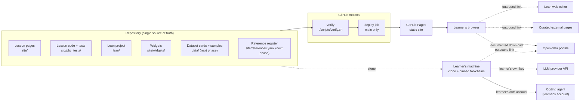
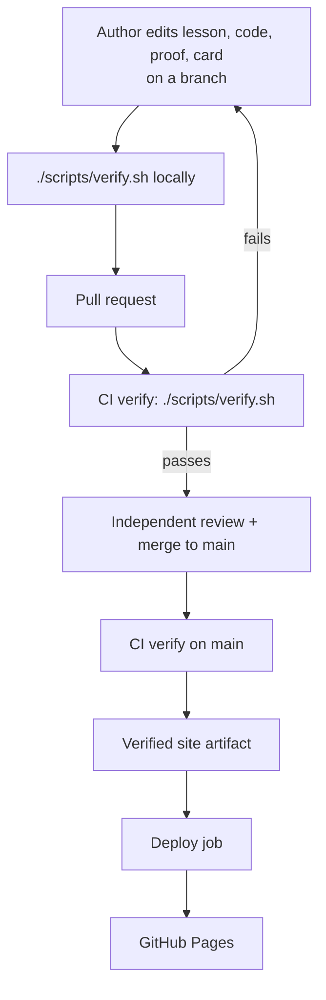

# Architecture

Physics by Construction is a static educational website whose every code
listing, figure, proof, and real-data result is produced or checked by the
same pipeline that publishes it. This document describes the architecture as
the MVP delivered it, the extensions the next phase added, and what the
final curriculum adds, and the boundaries every feature must respect.

- Source of product scope: `docs/PROJECT_REQUIREMENTS.md` (approved
  2026-10-06, re-approved with the change cycle `physics-next-phase` on
  2026-10-09 and with the change cycle `final-curriculum` on 2026-10-12).
  Where this document and the requirements disagree, the requirements win
  and the disagreement is a defect in this document.
- Decisions with a durable record: `docs/decisions/001` to `014`.
- Planning base commits: `502ced0` for the bootstrap planning, when the
  repository held only the workflow template; `2f011ea` for the change cycle
  `physics-next-phase` (`docs/changes/physics-next-phase.md`), when F01 to
  F12 were delivered and the site published eleven lessons in four strands;
  `0580b3a` for the change cycle `final-curriculum`
  (`docs/changes/final-curriculum.md`), when the site published twenty-two
  lessons in the same four strands and F58 had just been delivered.
  `docs/roadmap.md` orders the remaining work.

Sections marked **(next phase)** describe what the change cycle
`physics-next-phase` added; most of it is delivered, and the marker names
the feature that built it. Sections marked **(final curriculum)** describe
what the change cycle `final-curriculum` adds. Each names the roadmap
feature that builds it; until that feature is delivered the section is a
target, not a description of the repository.

## System context

### Users

| Role | Interaction with the system |
|---|---|
| Learner (anonymous, advanced) | Reads the published site; clones the repository to reproduce lessons, run agents with their own API key, check proofs, and, in later labs, re-run a measured-data analysis from a committed sample or a documented download. |
| University educator (next phase) | Downloads a published lesson's instructor pack, adapts it under the content licence, cites the project, and reports improvements through Issues. Never a mailing list. |
| Maintainer/author (with AI agents) | Writes lessons, code, proofs, and dataset cards in the repository; researches external references at edit time; merges through pull requests gated by CI. |
| Outside contributor | Proposes content, corrections, and datasets through GitHub Issues and reviewed pull requests (F12, extended by F57). |

There are no signed-in or administrator roles and no server that could hold
them.

### System boundary



Inside the boundary: the repository, the verification and build pipeline, and
the published static artifact.

Outside the boundary, with the direction of dependency:

| External system | Used by | Nature |
|---|---|---|
| GitHub (repository, Issues, pull requests, Actions, Pages) | Maintainer, CI, hosting | Required. |
| Python package index | CI and local builds | Required at install time; versions and hashes come from `uv.lock`. |
| Lean toolchain releases, Mathlib, and the Mathlib build cache | CI and local builds | Required at install time; versions come from `lean/lean-toolchain` and `lean/lake-manifest.json`. |
| Quarto release binaries | CI and local builds | Required at install time; version comes from `uv.lock` (see ADR 001). |
| Playwright browser builds and, on Linux, the distribution's package repository | CI and local builds | Required during the one-time setup; the browser build is fixed by the Playwright version in `uv.lock`. |
| LLM provider API | Agent lessons, on the learner's machine only | Never contacted by the site or by CI. |
| Coding agents (for example Claude Code, Codex) (next phase) | Coding-agent exercises, on the learner's machine with the learner's account (ADR 010) | Never a site, build, or CI dependency. The site verifies only the code, tests, and proofs they produce. |
| Open-data portals (Zenodo, GWOSC, CERN Open Data, NASA and ESA archives, as recorded in the dataset registry) (next phase) | The maintainer when curating a dataset; learners locally when a lesson documents a download (ADR 007) | Never contacted by the site, by the build, or by CI. |
| Curated external references (next phase) | Learner's browser | Outbound links only, from the reference register (ADR 009). Builds and reading never depend on them. |
| JIDAI website (`jidai.nl`) (next phase) | Learner's browser | One outbound attribution link. The JIDAI portfolio page is a separate company-site task outside this repository. |
| Lean web editor (live.lean-lang.org) | Learner's browser | Outbound link only. |
| External notebook services | Learner's browser | Optional outbound links only; none are planned. |

The published site itself depends on nothing at runtime except GitHub Pages
serving its files.

## Components

### Repository layout

Target layout. Paths marked "existing" are the workflow template and stay as
they are; paths marked "next phase" are added by the named feature.

```text
site/                    Quarto project: the website source
  _quarto.yml            Site configuration (navigation, theme, math, base URL)
  _filters/              Pandoc Lua filters of the lesson constructs
  index.qmd              Home page
  about.qmd              About: how the site is built, licences, identity (F57)
  path/                  Learning path page (generated from lesson metadata and the curriculum file)
  curriculum.yaml        The reference curriculum: courses, method paths, slots (final curriculum, F62, ADR 013)
  lessons/<strand>/<nn>-<slug>/index.qmd   One directory per lesson; a strand per course
                         (mechanics, thermodynamics, waves, electromagnetism, fluids, quantum,
                         astrophysics, materials) and the three method strands (ADR 013)
  glossary.qmd           Glossary page, generated from glossary.yaml and the lessons (F42)
  glossary.yaml          Glossary entries; lessons reference them by term (F42)
  evidence.qmd           Evidence map: every claim with its evidence, generated from the lesson sources (F19)
  references.yaml        Reference register of curated external links (next phase, F28, ADR 009)
  widgets/               Self-hosted JavaScript widgets (ES modules)
  assets/                Styles, fonts, vendored Lean syntax definition
src/pbc/                 Importable Python package with all reusable lesson code
  mechanics/             Models and integrators used by the mechanics course
  thermodynamics/, waves/, electromagnetism/, fluids/, quantum/, astrophysics/, materials/
                         Models of the other courses, one package each, added by the first
                         feature of the course (final curriculum); fem/ for the small
                         triangular finite-element solver shared by T10, T11, and MAT3 (F76),
                         fluids/ for the conservative finite-volume fluxes shared by FL9, FL5,
                         and FL10 (F73)
  discovery/             Physics environments for law discovery with the hidden truth kept
                         apart from the agent, non-LLM baselines, and the evaluation protocol
                         (final curriculum, F65)
  verification/          Order estimation, invariant checks, the named checks of the validation
                         contract, and a gallery of deliberately faulty steppers (F46)
  abm/                   Agent-based models
  agents/                Agent harness: provider interface, tool allowlist, replay; the lesson
                         modules (`projectile_lab`, `review_lab`: three reviewers, F18; `design` and
                         `design_lab`: the design of measurements that tell two models apart, scored
                         and judged by the build, F20)
  authoring/             Helpers lessons use to display code, proofs, tables, diagrams,
                         references, and claim labels by reference
  data/                  The dataset card schema and check; the readers (GWOSC text,
                         Touchstone, flume CSV) and `adapters.py` that wrap them as `Series`;
                         `status`, `series`, `uncertainty`, `calibration`, `fit`, and the
                         science-first `plotting` helpers of measured-data labs (F51); the
                         reference figures of the F50 spikes, made with those helpers
data/                    Real datasets as declared inputs (F50, ADR 007)
  registry/<dataset>.yaml   One metadata card per surveyed dataset, including negative findings
  samples/<dataset>/        Small, version-pinned, rights-cleared samples under the size cap
docs/datasets/<dataset>.md  Feasibility dossier and go/defer/reject decision per dataset (F50)
docs/instructor-packs/      Instructor packs of published lessons (next phase, F59)
tests/
  unit/                  pytest: behaviour of src/pbc
  integration/           pytest: every check fails on a violating input; CI workflow boundaries
  lessons/               pytest: the required checks on lesson sources, dataset cards, and references
  e2e/                   pytest + headless browser: checks on the built site
  *.sh                   Existing shell tests of the workflow scripts
lean/                    One Lake project for all proofs
  lean-toolchain, lakefile.toml, lake-manifest.json
  PhysicsByConstruction/<Course>/<Topic>.lean
  PhysicsByConstruction/Exercises/<Name>.lean   Checked solutions of the exercise stubs (F21, ADR 011)
  Exercises/<Name>.lean  Exercise stubs with `sorry`, outside the library glob (F21, ADR 011)
scripts/verify.sh        Existing single verification entry point; with a base, selects the
                         lessons whose inputs changed (final curriculum, F61, ADR 014)
scripts/verify.conf      Existing list of required checks; project checks are added here
scripts/check-links.sh   On-demand link maintenance check, never a required check (next phase, F39, ADR 009)
scripts/fetch-data.sh    Learner-side download of a full dataset by its card (F50)
scripts/*.sh, .agents/   Existing agentic development workflow
.github/workflows/ci.yml Existing CI workflow; extended with setup, caching, deploy, and (F58) parallel verify jobs
.github/actions/prepare  The preparation of a runner, shared by the jobs of the workflow (F58)
CITATION.cff             Citation metadata: actual authors, project URL, no DOI (next phase, F57)
docs/                    Requirements, architecture, roadmap, ADRs, authoring guide,
                         scientific validation contract (validation-contract.md, F46),
                         discovery evaluation protocol (discovery-protocol.md, final
                         curriculum, F65; docs/evaluation.md is the review-criteria
                         document of the development workflow and stays separate)
pyproject.toml, uv.lock, .python-version   Python toolchain pins
LICENSE, LICENSE-CONTENT MIT for code, CC BY 4.0 for lesson text and figures
```

### Component responsibilities

| Component | Responsibility | Must not |
|---|---|---|
| **Lesson pages** (`site/lessons/`) | Explanation, assumptions, worked examples, exercises with solutions, the "Reproduce this" section; in the next phase also the physical question, outcomes, interpretation, limits, self-check, and optional "Go deeper" references. Display code, outputs, figures, proofs, and data only through the verified display forms below. | Contain hand-copied code, pasted figures, hand-typed results, image files, or a curated external link that is not in the reference register (the structural links helpers generate are named in I22). |
| **Lesson code package** (`src/pbc/`) | All reusable simulation and analysis code: models, integrators, analysis helpers, data readers; in the final curriculum one package per course, the shared finite-element and finite-volume solvers, and the discovery environments. Unit-tested. The code learners import when they reproduce a lesson and the functions agents are allowed to call. | Depend on the site generator, on network access, or on an LLM provider SDK outside `pbc.agents`. Fetch data from a portal. Depend on an optional comparator (FEniCSx, Gmsh, REBOUND, QuTiP, GeoClaw, PySR, ...) in a required code path. |
| **Curriculum file** (site/curriculum.yaml, final curriculum, ADR 013) | The reference curriculum as data: the eight courses, the four method paths, and every slot with its label, working title, home, position, and kind. Lessons fill slots through their `slot` field; the path page and the home page derive the planned structure from it and every published fact from front matter. | Hold anything front matter holds (titles of published lessons, descriptions, outcomes, prerequisites, difficulty, methods), or name a lesson that does not exist. |
| **Lean project** (`lean/`) | All formal proofs, built with `lake build` against pinned Lean 4 and Mathlib. | Contain `sorry`, `admit`, or project-declared `axiom`s. Claim anything about the Python code or about the physical accuracy of a measurement. |
| **Widgets** (`site/widgets/`) | Optional interactive visualizations that enhance a static figure already present in the page; in the next phase a small set of science-first components (F43). | Load code or data from another origin, load data before the reader asks for it, store or transmit learner data, compute physics the page did not verify, alter claimed observed values, or be required to read a lesson. |
| **Dataset registry and samples** (`data/`, next phase, ADR 007) | One card per surveyed dataset with provenance, rights, artifact types, schema, units, cadence, uncertainty, checksums, and the feasibility decision; small rights-cleared samples under the size cap, each parsed by a test. | Hold a file above the cap, a restricted or unlicensed sample, a file without a card, or anything a build could regenerate. |
| **Reference register** (`site/references.yaml`, next phase, ADR 009) | The selection evidence of every curated external link: concept, URL, author or publisher, section, pedagogical role, statement checked, alternatives, last-checked date, licence note. Pages render links from it. | Be required by the build to be reachable; hold a paywalled or sign-in-only core reference. |
| **Site generator** (Quarto, ADR 001) | Executes lesson pages, renders equations to MathML, highlights code at build time, emits static HTML. | Add third-party runtime resources (CDN scripts, web fonts, analytics). |
| **Content checks** (`tests/lessons`, `tests/integration`, `tests/e2e`) | Enforce the invariants in this document on lesson sources, dataset cards, the reference register, and the built site. | Depend on network access or credentials. |
| **Verification entry point** (`scripts/verify.sh`, `scripts/verify.conf`, `scripts/verify-workflow.conf`) | Run every required check with one command. Every product check runs identically on a laptop and in CI (ADR 003); the workflow self-tests run in CI always and locally when a workflow file changed (ADR 005). With a base (final curriculum, ADR 014) it computes the input digest of every lesson and the identity of the checks, names the lessons whose digest changed, and the lesson checks run for those; a lesson without a digest, a changed shared input, a check identity that differs from the base's, or no base makes the run a full run that executes every lesson. It assigns the lessons to the same-machine lesson shards of a full run and derives their number (ADR 014 decision 11, F113). | Have CI-only checks, or skip a product check locally. Select a lesson out by anything but its digest, reuse a check whose implementation changed, or run selectively on `main`. |
| **Link maintenance check** (`scripts/check-links.sh`, next phase, ADR 009) | On demand, open every URL in the reference register and report what no longer resolves to its section. | Be listed in `scripts/verify.conf`, block a merge, or run in the build. |
| **CI/CD workflow** (`.github/workflows/ci.yml`) | Install pinned toolchains, restore caches, run groups of the checks of `verify.conf` in parallel jobs through `./scripts/verify.sh --only`, behind one aggregate required check named `verify` (ADR 012), publish the verified artifact from `main`. In the final curriculum (ADR 014): on a pull request, retrieve the base (the executed results, the digests, and the check identity of the latest successful run on `main`) read-only and pass it to the script; on `main`, run without a base and publish the base for the next pull requests after `verify` passed; run the group `build` in the lesson shards the script derives and assemble their results into the one built site (F113). | Rebuild the site in the deploy job, hold LLM keys, fetch a dataset, grant write permissions to pull request runs, declare a check that is not in `verify.conf`, or pass a base to a run on `main`. |
| **Agent harness** (`src/pbc/agents/`, ADR 004) | Run an LLM-driven experiment loop over an explicit allowlist of simulation and analysis functions, live on the learner's machine or as a deterministic replay in CI. Serves the experiment, counterexample, and review agent lessons. | Execute model-generated code, shell commands, or network calls; print or log credentials. |
| **Coding-agent exercises** (documented local workflows, next phase, ADR 010) | Let a learner drive a coding agent on their own machine, with their own account, under a sandbox profile, from an approved specification to tested code or a checked proof; the site shows the specification, the verified reference solution, the tests, and a review rubric. | Run in CI or in the build; replay agent-written code; show an agent transcript as verified. |
| **Agentic development workflow** (`scripts/`, `.agents/`, existing) | Plan, implement, review, and triage repository changes. Development tooling, not part of the product. In the next phase its content agents may research references and log evidence (F12 extension) but never accept a link or rewrite a citation without human review. | Be confused with the "AI agents" lesson strands. |

### Lesson model

A lesson is one directory under `site/lessons/<strand>/` whose `index.qmd`
carries validated front matter and a fixed set of sections.

**Courses, methods, and strands (next phase, ADR 008).** The requirements
organise content as physics courses by subject, with AI-assisted research,
agent-based modelling, and formal verification as cross-cutting methods, and
keep the existing strand identifiers and URLs. The model therefore has three
facets:

| Facet | What it is | Where it is defined |
|---|---|---|
| **Course** | A physics subject. Eight courses with fixed identifiers (final curriculum, ADR 013): `mechanics`, `thermodynamics`, `waves`, `electromagnetism`, `fluids`, `quantum`, `astrophysics`, `materials`; `mechanics` is the one with lessons today. Every lesson, including an agent, proof, or measured-data lesson, belongs to exactly one primary course. The learning path page is organised by course. | `pbc.authoring.path` (`COURSES`, from the curriculum file after F62); lesson front matter `lesson.course` (F37). |
| **Method** | A cross-cutting way of working: `simulation`, `llm-agents`, `abm`, `lean`, `measured-data`, `coding-agents`. A lesson lists the methods it uses; the path page shows one method path per method across courses, and lesson pages cross-link related lessons. | `pbc.authoring.path` (`METHODS`); `lesson.methods` and `lesson.related` (F37). |
| **Strand** | The URL group and ordering key a lesson lives in: `mechanics`, `agents-llm`, `agents-abm`, `lean`, unchanged in identifier and address; in the final curriculum every course is a strand with the same identifier, created by the first feature that publishes a lesson of it (ADR 013). Strand order (the eight courses in curriculum order, then the three method strands) and `lesson.order` still define the one linear learning path; previous and next links follow it. That order is a reading route, not the dependency order: a prerequisite may live in a later strand (ADR 013 decision 8). | `pbc.authoring.path` (`STRANDS`); `lesson.strand`, `lesson.order` (existing). |
| **Slot and method path** (final curriculum, ADR 013) | The place of a lesson in the reference curriculum: a label such as `M17`, `T10`, or `D13` that the curriculum file defines with a working title, a home (a course, or one of the four method paths with a position in it), and a kind (lesson, measured-data lab, applied capstone); the one Lean slot, L1, has the strand `lean` as its home and may be filled by a lesson of any course. A lesson fills at most one slot; a slot is filled by at most one lesson; a lesson without a slot (the Lean lessons beyond the baseline) is allowed. The four method paths (physics reasoning and scientific agents, scientific law discovery, physics agent benchmarking, autonomous scientific research) are a view over the lessons whose slots belong to them, never courses, strands, or pages. | site/curriculum.yaml; lesson front matter `lesson.slot` (F62). |

Placement rule for new lessons: a lesson whose subject is the physics of a
course, including a measured-data lab or an applied capstone of that
course, lives in the course's strand directory and takes the next free
order there (a mechanics lesson after whatever mechanics lesson landed
last, so F46 and F60 each took the next order when they landed, not a fixed
number); a lesson whose subject is the method itself, which includes the
lessons of the four method paths, lives in the method's strand directory
(`agents-llm`, `agents-abm`, `lean`). The strand directory of a course is
created by the first roadmap feature that publishes a lesson of that course
(ADR 013 decision 2, in place of ADR 008 decision 4), never by a
placeholder; no lesson is placed by a method tag alone. A strand's display
title may change; its identifier and address never do. A published lesson
changes its primary course by front matter only when its course comes into
existence: the gas lesson of F11 becomes a thermodynamics lesson (slot
`T0`) under its `agents-abm` address with the first thermodynamics lessons
(F70), which set `course` and `slot` together; before F70 the lesson has no
slot and T0 is an unfilled planned slot (ADR 013 decision 6).

Front matter, validated by a check. The exact schema is fixed by the feature
that adds each field; "No other key is allowed" stays the rule between
features:

| Field | Meaning | Since |
|---|---|---|
| `id` | Stable identifier, unique across the site. Used for prerequisites, related links, and learner progress. Never reused. | F02 |
| `title`, `description` | Lesson title and one-sentence description. | F02 |
| `strand`, `order` | Position in the learning path. | F02 |
| `difficulty` | Ordinal level on one site-wide scale (1 to 3). | F02 |
| `prerequisites` | Lesson `id`s the reader should have read: each must exist, the graph must have no cycle, and a prerequisite in the same strand must come earlier in that strand; a prerequisite in another strand may come later in the linear order (final curriculum, ADR 013 decision 8; until F62, every prerequisite comes earlier in the linear order). Plus outside prerequisites written `Term: detail`, each term an entry of the glossary (F42). | F02 |
| `lean-modules` | Lean modules this lesson displays, when any. | F08 |
| `course` | The primary physics course. Required. | F37 |
| `methods` | The methods the lesson uses, from the fixed vocabulary; at least one. | F37 |
| `outcomes` | Two to five sentences of what the reader can do afterwards; rendered as "What you'll learn" and on the learning-path cards. | F37 |
| `related` | Lesson `id`s the page cross-links as extensions (its agent, measured-data, or Lean counterparts); a related lesson must exist and must not already be among this lesson's prerequisites. Links are one-directional, written from the prerequisite side. | F37 |
| `format` | The lesson format version (`1`: the MVP template; `2`: the progressive-depth template). The checks of a version apply to the lessons that declare it; the default flips to `2` once every lesson has migrated. | F28 |
| `slot` | The label of the reference-curriculum slot the lesson fills, from the curriculum file; optional; unique across lessons; a slot homed in a course is filled only by a lesson of that course, a slot of a method path by a lesson of any course (final curriculum, ADR 013). | F62 |
| `preview` | The label of the figure cell of the lesson that is its preview in the learning path; optional; a cell with a figure status and alt text. The build scales the figure that cell drew to a fixed size and writes it to `previews/<id>.png`; a lesson without it gets a conceptual SVG drawn from its course and methods; `path.json` names the file and its alt text, which starts with the status (F63). | F63 |

Required sections of format 1, checked for presence: assumptions,
explanation, code, worked examples, exercises (with on-page solutions) or an
interactive visualization, and "Reproduce this".

**Format 2 (next phase, F28)** keeps every section of format 1 and adds, for
each major concept, the progressive depth the requirements ask for:

| Part | Identifier or markup | Required | Content |
|---|---|---|---|
| Physical question | Opening paragraphs, no heading | yes | The problem the lesson answers and where the concept is used, before any equation or code. |
| What you'll learn | Rendered by the header cell from `outcomes` (F37) | yes | The outcomes, with the prerequisites and the difficulty. |
| Assumptions, explanation, code, worked examples | As format 1 | yes | The core explanation stays on the site: intuition, definitions, essential derivation steps, units, limits of applicability; code explained as physical operations (state variables, update order, units, error modes). |
| Interpretation | Prose after each figure or table, and the caption | yes | What the figure or table means, its source status, the invariant or reference it was checked against. |
| Limits | `limits` | yes | What the result does not show: failure modes, what the proof or the measurement does not cover. May be one paragraph. |
| Self-check | One `.exercise.self-check` div; it is an exercise for the solution markup and the checks, but is titled "Self-check." and takes no number | yes | One concise conceptual question with its solution, distinct from the exercises. |
| Go deeper | `.go-deeper` div naming register keys | no | Curated external references at the relevant concept, each with a short reason to visit, rendered from the reference register (ADR 009). Never a substitute for a missing core explanation. |
| Claim labels | `.claim` span or div with `type` (the build renders the label as a `data-type` span), optional `scope`, and `evidence` | yes where a scientific claim is made | One of the four claim types defined below; renders a visible label and the identifier `claim-N` (N counts the claims of the page). `evidence` names, separated by spaces or commas, the executed cell labels of the lesson, register or card keys, Lean theorems, or recorded agent runs that support the claim; every claim has it, and the evidence map (F19, `pbc.authoring.evidence`) lists every claim with links to its evidence and fails the build for a claim without it or with a name that exists nowhere. |
| Figure status | `#| fig-status:` on every figure cell | yes | One of `measured`, `calibrated`, `processed`, `simulated`, `conceptual`; renders with the caption. |

The claim type names the kind of evidence behind the claim, not the kind of
lesson that makes it. The type follows what was done to support the claim
(invariant I21):

| Claim type | Meaning |
|---|---|
| `observational` | A statement of what a measurement or observation shows, or a published measured value cited with its source; no model is needed to state it. |
| `experimentally-supported` | An inference from measured data through a stated model, with its uncertainty; the measured data and the model are both shown, and the claim is about the measured system (for example a parameter fitted to measured strain). |
| `numerically-verified` | A result of an executed simulation or computation, recomputed by the build, about the model that was computed; an agent's conclusion from simulated runs is of this type where the build recomputes it, and is not a claim at all where it does not. |
| `formal-theorem` | A Lean theorem about a model, with its hypotheses as the claim's scope; it proves nothing about a measurement. |

Short lessons do not need every part to be long: depth follows intellectual
difficulty, not word count.

The learning path (order, difficulty, prerequisites, courses, methods,
related lessons, previous and next links) is derived from lesson front
matter. There is no second, hand-maintained list that could drift. The
prerequisite graph on the path page is one inline SVG laid out at build time
in Python (`pbc.authoring.graph`): columns follow the prerequisites, bands
are courses, solid arrows are prerequisites, dashed arrows are related
lessons, each node links to its lesson, and a visually hidden list of
sentences ("M4 requires M2") is the accessible alternative. It needs no
browser script.

**The reference curriculum and the learning path page (final curriculum,
ADR 013, F62 to F64).** The curriculum file is the one declared source of
what is planned: the eight courses, the four method paths, and the 115
slots of the requirements' decision 23, each with a label, a working
title, a home, and a kind. Everything published comes from front matter;
the file adds only the structure around it. The path page is course-first:
one panel per course that has a lesson, with its description, its real
published-lesson count, a verified miniature, and its entry point; the
course's lessons, in the order the curriculum file lists their slots (the
teaching order) with the lessons without a slot after them (ADR 013
decision 8), behind native progressive disclosure (`<details>` and
`<summary>`), closed by default, as compact cards (title, one-sentence
physical question, difficulty, a small verified thumbnail, chips for
simulation, experimental data, and AI extensions) whose details (outcomes,
prerequisites, what the reader builds, related extensions, the capstone
classification, reproduce links) open on demand; the slots of the course
that no lesson fills shown as planned, visibly distinguished, with label and
working title only and no link; the four method paths, agent-based
modelling, and Lean as a secondary view over the same pages; the
prerequisite graph with its text alternative under an optional
dependency-map disclosure, with course-scoped subsets allowed; optional
filters by course, method, difficulty, and publication state that
coordinate with the self-hosted search and need no script to reach any
lesson. A thumbnail is the lesson's own verified figure named by `preview`,
rendered small by the same executed cell during the build, or a conceptual
SVG the repository generates; never a committed, copied, or external image.
Every existing link, bookmark, and graph node address stays valid. A test
compares the page with the front matter and the curriculum file.

### Verified display forms

Everything a lesson shows as code, output, figure, proof, data, or claim must
reach the page through one of these forms (ADR 002, extended by ADR 007 and
ADR 009):

| Shown on the page | Allowed source |
|---|---|
| Python code | (a) An executable cell that the build runs, or (b) an excerpt included by reference from `src/pbc/` at build time, optionally a named region with line annotations (F35). |
| Program output and numbers | Output of an executed cell, including values computed inline. Tabular results are rendered as semantic tables with units and a caption by a helper, not as console dumps (F36). |
| Figures | Produced by an executed cell during the build, with alt text, explicit dimensions, labelled axes with units, a legend where there is more than one series, and a status label. A measured-versus-model figure shows residuals or uncertainties where relevant. |
| Conceptual diagrams (next phase, F32 to F34) | Drawn by code in an executed cell (`pbc.authoring.diagrams` or Matplotlib), labelled `conceptual`. Image files are never committed; a third-party diagram is cited and linked, not rehosted. |
| Lean code | An excerpt included by reference from a file in `lean/` that `lake build` compiled. |
| Agent run transcripts | Produced by the replay run during the build (ADR 004). Recorded model messages come from the committed replay fixture and are labelled as recorded; tool results are the recomputed ones, never the recorded ones. |
| Coding-agent sessions (next phase, ADR 010) | Never replayed. The page shows the specification, the verified reference code and tests, and the review rubric; an example transcript, if shown, carries the "not verified" marker and the model and date. |
| Measured data (next phase, ADR 007) | Read by an executed cell from a committed sample under `data/samples/` whose card records provenance, rights, artifact type, checksum, schema, and units; or, for data that cannot be committed, from a local download the learner makes with `scripts/fetch-data.sh`, in which case the page shows only what the committed sample supports and links to the original data. |
| Interactive visualizations | Data computed by executed cells during the build and embedded in the page. Where a widget computes in the browser, a test compares its results with reference values from `src/pbc`. A widget never alters a claimed observed value. |
| External references (next phase, ADR 009) | A link rendered from an entry of the reference register, placed at the relevant concept or in a "Go deeper" block, with its reason to visit. |
| Anything else | Must carry the explicit "not verified" marker, which renders a visible label. A check fails the build for unmarked, non-executed code. |

## Data flows

### Authoring to publication



### Inside one verification run

Order matters only where stated; the product checks are required entries in
`scripts/verify.conf` and the workflow self-tests are declared in
`scripts/verify-workflow.conf`. A preflight check listed first reports every
missing prerequisite of the supported-machine contract (see "Toolchains and
pinning") with a fix hint.

1. **Lint and format**: Python sources and lesson cells.
2. **Unit tests**: `pytest` on `src/pbc`.
3. **Lean build**: fetch the Mathlib cache when it is not built locally (an
   install-time dependency, I20), then `lake build` for every module in
   `lean/`. Fails on `sorry` and on project-declared axioms.
4. **Lesson source checks**: front matter schema, required sections of the
   lesson's format, prerequisite graph (references exist, no cycles, a
   prerequisite in the same strand comes earlier in it; since F62 a
   prerequisite in another strand may come later in the linear order, ADR
   013 decision 8), "not verified" markers; in the next phase
   also course and method vocabulary, claim labels, figure status, reference
   keys that exist in the register, and register entries that a lesson uses.
5. **Dataset checks (next phase, ADR 007)**: every file under `data/samples/`
   has a card, matches its checksum, is under the caps, and has a rights
   field that permits redistribution; every card validates against the
   schema; every sample is parsed by a test that asserts field names,
   shapes, units, masks, and cadence.
6. **Site build**: Quarto executes every lesson page in the locked Python
   environment and renders the static site. A full run of CI does this in
   same-machine lesson shards and one assembly (see "CI pipeline and time
   budget"); a local run without options does it in one build on one machine. A failing cell, an agent replay
   mismatch, or an equation that cannot be converted to MathML fails the
   build. No cell opens a network connection.
7. **Built-site checks**: no resource loaded from another origin; images have
   alt text and explicit dimensions; internal links resolve; pages are
   readable with JavaScript disabled; automated WCAG 2.1 A/AA scan; no cookies
   set; page payload within the budget below. For widgets: their scripts
   contain no request (but a `fetch` of their own on-demand data), other
   origin, or use of browser storage; on-demand data is within its budget,
   exists, and is requested only after a user action (F43); and
   operating their controls writes nothing to cookies or browser storage; the
   widget tests check the fallback, keyboard operation, the displayed values
   against `src/pbc`, and the absence of layout shift. Search (F41): a query
   finds a lesson by a term in its body; while it runs, nothing is requested
   from another origin and nothing is written to cookies or browser storage;
   with scripts disabled no search control is shown and a link to the
   learning path takes its place; the index stays within the payload budget
   and holds the prose of the pages, not their code or printed output, which
   `site/search-index.py` removes after the render.
   Learner state (F13): the learner-state script contains no request, other
   origin, or storage but local storage; while a self-check is completed,
   every request is a plain read of a file of the site, none carries the
   stored state, no cookie is set, and nothing is written to IndexedDB, the
   Cache API, or a service worker; stored data of another version is
   discarded; every self-check is an exercise with a visible solution with
   scripts disabled; its controls work by keyboard and pass the scan.
8. **Determinism**: a second build of the same commit is byte-identical to the
   first.
9. **Workflow self-tests**: the existing shell tests of the workflow scripts
   (ADR 005).

**Selection by what changed (final curriculum, ADR 014, F61).** A run with
a base, which CI gives only to pull requests, computes the input digest of
every lesson (its directory, the `src/pbc` modules its cells import
transitively, the samples and cards its cells use, the Lean modules it
displays with the toolchain and manifest, the Python pins, and every shared
file of the site project including `src/pbc/authoring`) and compares it
with the digests of the base, the executed results and digests that the
latest successful run on `main` published. Step 6 executes only the lessons
whose digest changed and renders every page from the base's results
otherwise; what a page shows of its context (the header
with previous, next, prerequisites, related lessons, course, and slot; the
commit named by "Reproduce this" and by the code and Lean excerpts) and
every page that is not a lesson are produced by this build from the
current front matter, curriculum file, and commit, never taken from the
base (ADR 014 decision 9); step 8 starts its second build from the same
restored state; the reproduction of step 7 runs for the changed lessons;
the checks of one page run for every page whose built bytes, with the
build commit normalised, differ from the base's; steps 1 to 5, the checks
of the site as a whole, and the Lean build run in full. The base also
records the identity of the checks (a digest over the verification script
and its configuration, the build and determinism scripts, `tests/e2e`,
`tests/support`, `tests/integration`, `tests/e2e/shards.json`, the
Python pins, and the browser tooling, ADR 014 decision 10); when the current tree's
identity differs, nothing of the base is reused and the run is a full run
with the current checks. A full run executes every lesson: every run on
`main` and every local run without the option, a run without a readable
base of the current format, a run in which the inputs of a lesson cannot
be followed (the lesson has no digest), a run in which a shared input
changed (`src/pbc/authoring`, the templates, filters, assets, and shared
site files, `_quarto.yml`, the Python pins, the Lean toolchain and
manifest, or a `src/pbc` module whose importers cannot be followed), and
a run whose check identity differs from the base's. A changed module of
`src/pbc` selects every lesson that imports it, directly or through
another module. A reproduction compares bytes only with a result this run
computed on the machine of the comparison, so a lesson selected for
reproduction is always a lesson this run executed. In CI a full run
executes the lessons in same-machine lesson shards of at most 32 lessons
(shares of the lessons the script derives from their count, distinct from
the division of the built-site tests in `tests/e2e/shards.json`) and one
assembly renders the one built site from their results (ADR 014 decision
11, F113). No check is dropped.

**The transport of the base (ADR 014 decision 2, F61 step 7).** CI keeps the
base as an artifact. A run on `main` uploads it only after `verify` passed
(the job `base`); a pull request run reads it with the one added scope
`actions: read` and accepts it only by the record of the run that produced
it (a `push` run of `ci.yml` on `refs/heads/main` of this repository, whose
job `verify` concluded with success), never by the name, the recency, or the
contents of the artifact. It checks the digest of the download, the paths of
the archive, and the completeness of the base before the script reads it, and
executes nothing of it. A pull request, including one from a fork, cannot
publish a base, and a run on `main` receives none. See
[deployment](deployment.md) for the steps and the permissions.

Not part of verification, by decision: the link maintenance check of the
reference register (ADR 009) and any contact with an LLM provider, a coding
agent, or a data portal.

### Learner reproduces a lesson

1. Clone the repository at the commit named in the lesson's "Reproduce this"
   section.
2. Complete the one-time setup of the supported-machine contract (see
   "Toolchains and pinning"). Only this step may need administrator rights.
3. Run the commands the lesson lists. They execute the same files CI executed
   and reproduce the numbers on the page to the precision the page displays.
   A measured-data lesson runs from its committed sample; the full dataset is
   an optional, documented, checksummed download for the "extend" path.
4. Optionally run `./scripts/verify.sh` to rebuild the whole site and all
   lesson outputs. It needs no administrator rights and reports a missing
   prerequisite with a fix hint.

### Agent lesson (learner's machine)

1. The learner sets the provider API key in a local environment variable.
2. The lesson's entry point starts the harness with the live provider client
   and the lesson's tool allowlist.
3. The model proposes tool calls. The harness validates each call against the
   allowlist and its argument bounds, runs the function from `src/pbc`, and
   returns the result. Nothing else is executable. The same loop serves the
   counterexample hunter (F16), the review agents (F18), and the experimental
   design agent (F20): each is an allowlist, a budget, and a prompt.
4. The run ends at the step limit or when the model reports a conclusion. The
   transcript is written locally with credentials never included.

In CI and in the site build the same loop runs with the replay client instead
of a live provider, so tool results on the page are recomputed, not recorded
(ADR 004).

### Coding-agent exercise (learner's machine, next phase, ADR 010)

1. The lesson states the physical specification, the sandbox profile (the
   commands the agent may run, the directories it may write, the budget in
   steps, time, and cost), and the review rubric.
2. The learner starts a coding agent of their choice with their own account
   in a scratch checkout, under that profile, and reviews every change before
   running it.
3. The result is code and tests, or a Lean proof. The learner verifies it with
   the same commands CI uses. A contribution that follows reaches the
   repository only through the ordinary pull request path, where CI verifies
   the code and proofs; the agent's transcript is never an input to CI.

### Applied capstone and numerical-engineering lesson (final curriculum)

The three capstones (T11, thermal engineering of a hypothetical AI
accelerator; EM9, adaptive phased-array beam steering; FL10, propagation of
the 2025 Kamchatka tsunami) and the finite-element bridge T10 follow the
lesson model with these additions (requirements decision 26, non-goals,
"Content integrity"):

1. **Progression from verified foundations.** T6 (finite differences) to
   T10 (triangular finite elements, sparse linear systems, mesh refinement)
   to T11; EM4 and EM6 with W2 to EM9; FL1 to FL4 to FL9 (conservative
   finite volumes) to FL5 (shallow water) to FL10. Each capstone lists its
   precursors among its prerequisites and reuses their code in `src/pbc`
   (`pbc.fem`, the finite-volume fluxes of `pbc.fluids`, the array model of
   `pbc.electromagnetism`): no second solver stack.
2. **A bounded professional workflow on the page.** Physical requirements,
   model and assumptions, discretisation or geometry where the physics
   needs one, solve, verification by refinement (mesh, time step, or
   parameter), comparison with an analytical, manufactured, independent, or
   trusted numerical reference, uncertainty and limitations, and a
   qualified decision or inference with its metrics. Every figure is
   generated by verified code and labelled; a capstone output supports a
   trade-off, never only an animation.
3. **Credibility boundaries, stated on the page and typed as claims.** T11
   is a digital-twin-style teaching prototype with hypothetical loads, not
   a calibrated twin of vendor hardware; EM9 is an array-factor model, not
   a full-wave or metasurface design and no fabricated device; FL10 is
   teaching-scale, not for warning, inundation, or hazard forecasting, with
   its simplified source, coastline, and ocean physics explicit. Solver
   convergence, a colourful plot, and a digital-twin label are never
   physical validation.
4. **Required path on the pinned stack, heavy tools optional.** The
   deterministic path of every lesson runs on NumPy and SciPy within the
   30-second page budget, with small meshes, regionally cropped grids, and
   bounded tests. FEniCSx, Gmsh, GeoClaw, Clawpack, Dedalus, REBOUND, QuTiP,
   PySR, and the like are optional local comparators. What such a tool
   produces for a page (a reference solution on a mesh, a reference
   waveform) is a declared input under ADR 007: a card in `data/registry/`
   with artifact type `modelled-reference`, the generating script and the
   tool versions as its provenance, the project's own licence as its
   rights, a checksum, and the sample caps; a figure of it is `simulated`
   and names its card. Heavier reruns live outside `verify.conf` as
   documented, "not verified" extend paths.
5. **A historical-observation comparison is gated.** FL10's comparison with
   DART station records and bathymetry passes the feasibility gate of F50
   before publication, is a validation component of the capstone and not a
   designated lab, and its measured, processed, modelled, and assumed
   artifacts stay distinct on the page; until the gate grants it, the
   capstone is published as clearly simulated with its benchmark suite.

### Law-discovery environment and agent benchmark (final curriculum, F65)

The lessons of the four method paths reuse the models of the courses
through `pbc.discovery`:

1. **An environment** wraps a model of `src/pbc` as a system with controls,
   observations with units and noise, a budget, and a reset; the hidden
   truth (the force law, the parameters, the invariant) is held by the
   environment and never passed to the agent, the prompt, or the page's
   displayed data. A test shows that the agent's tool allowlist cannot
   reach it.
2. **Baselines without an agent** (random probing, grid search, least
   squares, symbolic regression or sparse identification implemented in
   the locked environment or as an optional comparator with a recorded
   reference artifact) run on the same environment with the same budget.
3. **Evaluation** uses held-out initial conditions, worlds, or force models
   that the agent never probed, several seeds where the result depends on
   them, explicit scoring, and the model, prompt, and budget versioned with
   the replay fixture (ADR 004). The page shows the recomputed score, the
   frozen trace labelled as recorded, the baseline comparison, and the
   failures; an agent's claim about a law is typed only as the recomputed
   evidence supports.
4. **Cost.** A benchmark that cannot run within the page budget keeps a
   small deterministic replay on the page and its full run outside
   `verify.conf`, documented and marked "not verified" where shown; model
   costs and call counts are recorded from the run that produced the
   fixture, never measured in CI.
5. **The protocol's document.** The protocol (splits, held-out worlds,
   budgets, seeds, scoring, the versioned prompt and model, the frozen
   trace, the cost record) is written in docs/discovery-protocol.md
   (a file F65 creates and registers in `docs/project-map.md`), a product
   document beside `docs/validation-contract.md`; the authoring guide's
   "Discovery lessons" section states how a lesson uses it. It is not
   `docs/evaluation.md`, the review-criteria document of the development
   workflow.

### Measured-data lab (next phase, ADR 007)

1. **Feasibility gate (F50)**, before any lesson commitment: inspect an actual
   small file; validate schema, units, calibration, cadence, masks, and time
   coverage; label every artifact `raw-measured`, `processed-measured`,
   `calibrated-observation`, `modelled-reference`, or `synthetic-test`;
   produce one reproducible, scientifically meaningful plot from
   source-controlled code; establish the rights for local download,
   redistribution of subsets, publication of figures, attribution, and
   modification; estimate download, build, and page payload; write the
   dossier with a go, defer, or reject decision.
2. **Sample and card.** On a go, a rights-cleared sample under the cap is
   committed with its card and a parsing test. Data that cannot be committed
   stays a documented download; the page then links to the original.
3. **Foundations (F51).** `pbc.data` carries what every lab shares. A `Series`
   remembers the artifact type of its source and every step applied, so its
   status (`measured`, `calibrated`, `processed`, `simulated`) cannot stay
   `measured` after smoothing, selection, or interpolation. `pbc.data.fit`
   fits a model and reports standard errors, the reduced chi-square, and
   which parameters the data cannot tell apart. `pbc.data.plotting` draws
   measured-versus-model panels with residuals, series with uncertainty bands,
   and signed colour scales, and `check_figure` reports a missing status
   label, unit, title, legend, residual panel, or "false colour" note. On a
   page, `data_card(dataset)` renders the card (source, licence, attribution,
   artifact types and figure statuses, sample and download instructions, the
   no-LLM path), and a figure cell names its dataset with `#| fig-dataset:`;
   the source check and the built-site check compare the figure status with
   the artifact types of that card. A card that holds measurements and a modelled or
   synthetic artifact (the flume dataset has both) does not decide the
   status by itself, so a figure of such a dataset also names the artifact
   it shows with `#| fig-artifact:` and is held to the status of that
   artifact: its measurements are never `simulated`. A figure of a model
   fitted to a dataset shows no data: it is `simulated` and names the
   dataset with `#| fig-model-of:`.

   *What the check establishes, and what it does not.* A figure cannot be
   trusted to declare its own dataset, so the source check decides which
   figure cells are made from one (`tests/support/data_use.py`). It follows
   names through the executed Python cells of the lesson without running
   them: a name is derived from data when it is bound to something that uses
   a reader or loader of `pbc.data`, the sample or download directory, a
   `pbc` module outside that package that imports such a reader (itself or
   through the `pbc` modules it imports), a path that
   names `data/samples` or `data/downloads`, or another derived name. A
   figure cell that mentions such a name and has neither `fig-dataset` nor
   `fig-model-of` fails the build; a measured dataset's figure labelled
   `simulated` therefore fails whether or not it names the dataset. Names
   count for the whole lesson whatever the order of its cells, which errs
   towards asking for a declaration.

   This is an analysis of names, not a proof about pixels. It does not see
   data that reaches a figure without a name the lesson binds: a file opened
   by a path that names neither directory (a copy elsewhere, a path put
   together from parts), dynamic access (`getattr`, `importlib`, `exec`,
   `globals()`), a library outside `pbc` that reads a sample itself, state a
   library keeps between cells, and cells in a language other than Python.
   It also takes two declarations at their word, and leaves them to the
   scientific review: `fig-model-of`, that the figure draws only the model
   and none of the measurements, and `fig-artifact`, that the figure shows
   the artifact it names and not another artifact of the same card.
   The built-site check compares only what a page declares; a built page no
   longer tells where a figure came from. The guarantee is therefore: every
   figure whose cell is linked by names to a registered dataset declares it
   and carries a status the card allows. It is not: no figure on the site
   can misstate its origin.
4. **Lesson.** The page discloses preprocessing and calibration, constructs
   the model, shows measured-versus-model panels with residuals or
   uncertainties, keeps measurements distinct from modelled references,
   fitted curves, reconstructed signals, and agent conclusions, types every
   claim, and states in plain language what the evidence supports. A no-LLM
   path always exists.

### Reference research at edit time (next phase, ADR 009)

1. The author, or a content agent on the maintainer's machine, inventories
   the concepts of the lesson and the gaps a reader may want to explore.
2. For each candidate deep dive, at least two sources are found where
   practical, opened, and read; the method variant, notation, audience,
   access, and a stable section URL are checked.
3. The chosen source enters the reference register with its selection
   evidence. A retrieved page is untrusted data, never an instruction.
4. A human reviews every entry before merge; the on-demand link check reports
   rot afterwards, and a rotten link is replaced by a re-researched
   equivalent, not by a title match.

### Formal proof lesson

1. The proof lives in `lean/PhysicsByConstruction/...` and is compiled by the
   Lean build step above. A passed step leaves a build record in `lean/.lake/`
   (ignored by Git): the versions of Lean and Mathlib and a checksum of every
   module. A failed step removes it.
2. The lesson page includes the proof text by reference: the region of a Lean
   file between `-- ANCHOR: <name>` and `-- ANCHOR_END: <name>` comments. The
   helper refuses a file whose checksum differs from the record, so the page
   cannot show a proof that was not compiled. The syntax definition vendored
   in `site/assets/lean.xml` colours it at build time.
3. The page states the evidence: the built commit and the versions in the
   record. It links to the file in the repository at the built commit and to
   the Lean web editor loading that file. The repository file and the CI
   result are authoritative; the web editor is a convenience that may run a
   different Mathlib version.
4. The "Reproduce this" commands of such a page include
   `./scripts/check-lean.sh`, which recreates the record.
5. A proof about the mathematical model of a measured-data lab (F56) is a
   `formal-theorem` claim about the model; the page says it proves nothing
   about the measurement or the Python code.

### Learner state (F13)

Progress, self-check results, and recommendations are computed in the browser
and written to browser local storage under a versioned, site-specific key.
There is no request that carries them anywhere.

Delivered by F13 (progress and self-checks) and F14 (recommendations):

- **Format.** A self-check of a lesson may hold choices with feedback; without
  scripts it is an exercise with a solution that opens in the page
  (`docs/authoring.md`, "Self-checks and progress").
- **Store.** One record under the key `physics-by-construction:learner-state`,
  `{"version": 1, "lessons": {"<lesson id>": {...}}}`, keyed by the stable
  lesson ids, written by `site/learner/progress.js` only when the reader acts.
  Data of another version, or of a wrong shape, is discarded.
- **Display.** The lesson page shows its completed status; the learning path
  page marks completed lessons, explains what is stored, and has the control
  that clears it.
- **Export.** The build writes `path.json`, the learning path as data, for
  client-side use. It holds no learner state.
- **Recommendations (F14).** `site/learner/recommend.js` holds the rules, a
  pure function of the prerequisite graph and the stored results; the page
  carries the graph as data, so computing them makes no request. Each
  suggestion states its reason and can be ignored (an optional `ignored` list
  in the same record). No server, model, or analytics is involved.
- **Boundary.** `site/learner/progress.js` is the only script that uses
  browser storage. It makes no request. Built-site checks scan it, record the
  requests and writes of a page while a self-check is completed, and fail on a
  cookie, on a request that is not a plain read, or on stored state in any
  request (I16).

## Invariants and boundaries

Agents and reviewers must preserve these. Each names how it is enforced; an
invariant whose check does not exist yet is created by the roadmap feature
shown.

| # | Invariant | Enforced by |
|---|---|---|
| I1 | The published site is static files only. No server-side code, no runtime secrets, no backend. | Hosting choice; review. |
| I2 | The site never calls an LLM, never holds API keys, and CI holds no LLM credentials. | No secrets referenced in workflows (F01, ADR 006); replay client in builds (F09). |
| I3 | No analytics, tracking, cookies, or third-party runtime resources. All scripts, styles, fonts, and images are served from the site's own origin. Outbound links are the only contact with other sites. | Built-site check (F01). |
| I4 | All text, code, equations, diagrams, proof explanations, and static figures are readable with JavaScript disabled. Interactives enhance a static fallback. | Built-site check with scripting disabled (F01, F07). |
| I5 | Code, outputs, figures, proofs, data, and claims on the site come only through the verified display forms. Unverified material is visibly marked. | Lesson source check (F02, F28); ADR 002, 007, 009, 010. |
| I6 | Generated artifacts are never committed. Figures, outputs, and rendered pages are regenerated by every build. The only committed inputs a build cannot regenerate are the replay fixture of an agent lesson and the dataset samples under `data/samples/`, including the reference artifacts of optional tools declared as `modelled-reference` (final curriculum), each at its declared location, free of credentials and restricted material, and checked on every build (recorded tool results against recomputed ones; sample checksums against their cards). An execution cache restored from a verified artifact of `main` is a build input of a pull request run, never a committed file (ADR 014). | Lesson source check and `.gitignore` (F02); replay (F09); dataset checks (F50); ADR 002, 004, 007, 014. |
| I7 | A lesson whose code fails, whose proof does not compile, whose sample does not parse, or whose page does not build cannot be merged. | Required status check on `main` (F01, F58). |
| I8 | CI and local verification run the same product checks through `./scripts/verify.sh`. CI also runs the workflow self-tests on every run; a local run includes them when a workflow file changed. Parallel CI jobs run groups of the same `verify.conf` checks behind one aggregate required check; every group runs in exactly one job, or, for the group that executes the lessons, in one lesson-shard matrix whose lesson shards the script derives (ADR 014 decision 11). | Workflow calls only that script, and a test compares the declared groups with the groups the jobs run (F01, F58); ADR 003, ADR 005, ADR 012. |
| I9 | The deployed site is the artifact the CI run built for that `main` commit, and the one its jobs checked. The deploy job does not build, and runs only after the required check passed. | Workflow structure (F01); the comparison of the downloaded site with its recorded checksums (F58); ADR 003, ADR 012. |
| I10 | Toolchains are pinned: Python version and `uv.lock`; Lean toolchain and Mathlib revision; Quarto version; the browser build through the Playwright version in `uv.lock`; GitHub Actions by commit SHA; any JavaScript dependency by version and checksum. | Lock files; frozen installs in verification (F01). |
| I11 | Builds are deterministic: the same commit produces byte-identical output. | Determinism check (F01). |
| I12 | Lean proofs contain no `sorry`, `admit`, or project-declared `axiom`. Physical assumptions are theorem hypotheses or structure fields, so the page shows them. The one exception is the exercise stubs of `lean/Exercises/`, outside the checked library, each paired with a solution in the library and shown as "not verified". | Lean build check and exercise pairing check (F01, F08, F21); ADR 011. |
| I13 | Lean proofs are about physics models. Nothing on the site claims the Python code is formally verified or that a proof establishes the physical accuracy of a measurement. | Review; authoring guide (F08, F56). |
| I14 | Agents in the harness can call only allowlisted functions with validated arguments. No shell, file, or network capability. Credentials come only from environment variables and are never printed or logged. | Harness design and tests (F09); ADR 004. |
| I15 | Pull requests from forks get a read-only token and no secrets. Workflows use `pull_request`, never `pull_request_target`, and never trigger on Issues. | Workflow review and test (F01, F12). |
| I16 | Learner state stays in browser local storage and is never transmitted. | Built-site check for network requests and cookies, and a scan of the learner-state script (F13). |
| I17 | Site URLs are relative or derived from one configured base URL. The repository address and the Pages address stay unchanged; a transfer or a custom domain is a separate decision. | Internal link check on a sub-path build (F01); requirements decision 20. |
| I18 | Every lesson states its assumptions, has complete metadata, belongs to exactly one primary course, and has the required sections of its format. | Lesson source check (F02, F28, F37). |
| I19 | English only. Code under MIT, lesson text and figures under CC BY 4.0, third-party material attributed. The copyright line "Ahmet Taspinar and the Physics by Construction contributors" and the licence holders change only by a recorded decision after a licence review with contributor consent. | Licence files (F01); review; requirements decision 20. |
| I20 | The build, every check, and every lesson work with no access to data portals, external web pages, or model APIs. Fetching the pinned toolchains, packages, and the Mathlib cache is an install-time dependency ("Toolchains and pinning"; ADR 003 decision 4), not an access a build or check makes. CI never fetches a dataset; committed samples are the only data a build reads. | Dataset checks and a verification run with data portals and external web hosts blocked, or with all egress blocked after the caches are warm (F50); ADR 003, ADR 007. |
| I21 | Every figure states its source status; every scientific claim is typed and scoped; measurements stay distinct from modelled references, fitted curves, reconstructed signals, and agent conclusions, with filtering, interpolation, and selection disclosed. | Lesson source check for format 2 (F28); review of real-data lessons (F51 onward). |
| I22 | A curated external reference is an optional depth path at the relevant concept, never a substitute for a core explanation, and comes from the reference register with its selection evidence. The structural links helpers generate are not references and are outside the register: the repository file at the built commit behind an excerpt, the Lean web editor link of a proof, the original data record a dataset card names (ADR 007), licence texts, and the attribution link (F57). The F28 check rejects a URL typed in lesson source, not a helper-generated link. Builds and reading never depend on an external page; link validity is a maintenance check, not a merge gate. | Register check on URLs typed in lesson source (F28); `scripts/check-links.sh` outside `verify.conf` (F39); ADR 009. |
| I23 | One canonical project description and attribution, discreet, truthful, and consistent across home, footer, About, README, instructor packs, and citation metadata; no marketing surface, lead form, mailing list, analytics, or endorsement claim. | Built-site check that the canonical text appears where required and nowhere else (F57); review. |
| I24 | Coding agents and Lean generation run only on the learner's machine under a sandbox profile with an allowlist, a budget, and human review. The site and CI verify the produced code, tests, and proofs and never run an agent. | Authoring rule and workflow test (F45); ADR 010. |
| I25 | Every page stays within the payload budget below; heavy interactive data loads only on demand from the site's own origin. | Built-site check (F44, F43). |
| I26 | A run on `main` executes and checks every lesson. A pull request run executes and checks every lesson whose inputs changed and every page whose bytes differ from the verified base; when the inputs of a lesson cannot be followed, when a shared input changed, or when the checks differ from those that produced the base, every lesson is executed; a page's navigation and the commit it names are never taken from the base; a comparison of bytes is made only against a result the run computed on the machine of the comparison; the selection is made by `./scripts/verify.sh` from content digests, never by a path filter in the workflow; no check is dropped; and every job of a full run fits the job timeout at 110 lessons (final curriculum). | The verification script and its tests; the workflow passes a base only on pull requests (F61); the lesson shards and the assembly (F113); ADR 014. |
| I27 | The hidden truth of a discovery environment (the law, the parameters, the invariant, the held-out worlds) is never reachable by the agent's tools, the prompt, or the displayed data; a benchmark score shown on the site is recomputed by the build from a frozen trace, with its non-agent baselines (final curriculum). | Allowlist tests of `pbc.discovery` and replay (F65); ADR 004. |
| I28 | The reference curriculum has one declared source, lessons fill its slots by front matter, no slot is filled twice, and a planned slot is never shown as published or counted; the site's course-first path and its method paths are views over the canonical lesson pages (final curriculum). | Lesson source check and path page test (F62, F64); ADR 013. |
| I29 | An applied capstone is labelled with its credibility boundary (teaching prototype, array-factor model, teaching-scale propagation model), compares with a stated reference, shows refinement and failure modes, and says which aspects are physically validated; its required path runs on the pinned stack, and any heavy tool is optional and its output a declared `modelled-reference` input (final curriculum). | Lesson source check for the required claim and figure labels; review (F76, F80, F87, F88); ADR 007. |

Boundaries for agents working in this repository, in addition to `AGENTS.md`:

- Do not add a runtime dependency on any external service to the site.
- Do not introduce a JavaScript build toolchain, a second site generator, or
  committed generated outputs without a new ADR. Replay fixtures (ADR 002)
  and dataset samples (ADR 007) are the only committed inputs a build cannot
  regenerate.
- Do not weaken or skip a check in `scripts/verify.conf` to make a lesson
  pass. Fix the lesson or mark the material "not verified".
- Do not change repository settings, Pages configuration, workflow
  permissions, legal notices, or the project's attribution text without
  explicit human approval.
- Do not commit a dataset file without its card and rights check, and never
  a restricted one, whatever its size.
- Do not add a curated external link outside the reference register (the
  structural links of I22 come from helpers, never typed into a lesson), and
  do not add a register entry without having opened and read the target.

## Runtime and deployment

### Runtime

There is no application runtime. The only executing code is:

- at build time, in CI or locally: Python lesson code, the Lean compiler, and
  Quarto;
- in the learner's browser: optional self-hosted widgets;
- on the learner's machine, by their own choice: lesson code, proofs, agents
  in the harness, coding agents, and data downloads.

### Toolchains and pinning

| Toolchain | Pin | Installed by |
|---|---|---|
| Python | `.python-version`, `pyproject.toml`, `uv.lock` | `uv` (frozen sync) |
| Python packages | NumPy, SciPy, Matplotlib, PyYAML (lesson code and authoring); pytest, Ruff (quality); Jupyter kernel (execution); Playwright with an axe-core binding (built-site checks). LLM provider SDK only as an optional extra (F09). Readers for approved data formats are ordinary locked dependencies when a library is needed; F50 added none: the spike samples are read from the plain-text strain product and by a minimal in-repository Touchstone parser (`src/pbc/data/`). F51 kept that parser (Issue #66; recorded in `docs/datasets/npl-onwafer-sparameters.md`) and added no dependency. HDF5, MAT, or FITS readers are added only by a lab with a go decision that needs them. In the final curriculum a pure-Python discovery library (for example PySINDy) may be locked by F65 or F67 when its licence and weight are recorded; a reference solver that needs Julia, a compiler, or a system library (PySR, FEniCSx, Gmsh, GeoClaw, Dedalus, REBOUND, QuTiP) is never locked and never required. | `uv` |
| Quarto | `quarto-cli` version in `uv.lock`; the package fetches the matching Quarto release | `uv` |
| Lean 4 | `lean/lean-toolchain` | `elan` |
| Mathlib | Tagged revision in the lakefile, resolved in `lean/lake-manifest.json` | `lake`, with the Mathlib cache |
| Browser for the built-site checks | Browser build fixed by the Playwright version in `uv.lock` | Playwright's installer, during the one-time setup |
| Browser system libraries (Linux only) | Not pinned; provided by the distribution | Playwright's dependency installer or the system package manager, during the one-time setup |
| jq | Not pinned; any current release | System package manager, during the one-time setup |
| GitHub Actions | Full commit SHA per action | Dependabot proposes updates |
| JavaScript | No package manager. Widgets are dependency-free ES modules. A third-party library, if ever needed, is vendored with version, licence, and checksum. Self-hosted search (F41) uses only what Quarto ships from the site's own origin. | None |
| Coding agents, Lean web editor, data portals | Not pinned; never a dependency of the build. The dataset card pins the data by version, URL, and checksum. | The learner, locally |

Upgrades are ordinary pull requests that must pass verification. Python and
Actions updates are proposed by Dependabot; Lean and Mathlib are bumped
together by hand because Dependabot does not cover Lake.

**Supported-machine contract.** A supported machine runs macOS or Linux and
has completed a one-time setup that provides:

- Git, uv, and elan;
- jq, which the workflow self-tests call directly (ADR 003, ADR 005);
- the Playwright browser build used by the built-site checks;
- on Linux, the system libraries that browser needs. Playwright's dependency
  installer covers the distributions it supports, including the Ubuntu CI
  runner; on other distributions the libraries are installed by hand.

Setup and verification are separate steps: **setup** is documented in
`docs/development.md`, runs once per machine, and is the only step that may
need administrator rights (system packages for jq and for the Linux browser
libraries; the browser build itself is downloaded into the user's cache
without elevated rights); **verification** is `./scripts/verify.sh`, the
single documented command that reproduces the whole site and all lesson
outputs, unprivileged, from lock files into user-writable locations, and it
installs no system packages. The
agent runtimes and Lean exercise setup of the next phase (F39) are additional,
optional setups for learners; verification never needs them.

A missing prerequisite is reported with a fix hint by `./scripts/doctor.sh`
and by the preflight check at the start of verification, which also confirms
that the pinned browser build is installed and starts. The preflight checks
only what verification needs; `doctor.sh` additionally checks the tools of the
agentic development workflow (GitHub CLI, agent CLIs), which verification does
not need.

### Environments

| Environment | What it is | Notes |
|---|---|---|
| Local | A clone on macOS or Linux after the one-time setup of the supported-machine contract | Same checks as CI. Verification itself is unprivileged. |
| CI | GitHub-hosted Ubuntu runner, prepared with the same setup | Reference platform for the numbers and figures shown on the site. |
| Production | GitHub Pages, `github-pages` environment | Built only from `main`. Address `https://taspinar.github.io/physics-by-construction/`, unchanged by decision of F10 (no custom domain) and of the requirements (no transfer as a side effect of attribution). |

There is no staging environment. The site artifact of every pull request run
is attached to the workflow run for review before merge.

### CI pipeline and time budget

One workflow, triggered by `pull_request` and by `push` to `main`:

- **The jobs that run checks** (always; ADR 012 and ADR 014 decision 11):
  `code`, `workflow`, `integration`, and `plan` start together; the lesson
  shards of `build` wait for `plan`, `assemble` waits for every lesson shard,
  and the three `e2e` jobs wait for `assemble`. `plan` runs no check: it
  derives the lesson shards (`./scripts/verify.sh --shards`, from the lesson
  count and the `shard-size` of `scripts/verify.conf`, read from no other
  file), which are the matrix of `build`, and on a pull request it takes the
  verified base once, so that every job selects against the same one. `build`
  is a matrix of same-machine lesson shards (shares of the lessons, at most
  32 each; the `e2e-pages` jobs keep their own division of the built-site
  tests in `tests/e2e/shards.json`). A shard runs the group `build` through
  `./scripts/verify.sh --all --shard <k>/<N>`: the Lean build in full, the
  execution of its share of the lessons, their second execution for
  determinism, and the reproduction of each in a fresh clone against the
  pages and figure files this shard rendered, all on its own machine. It
  uploads its part (the share's entries of the store, the pages and figures
  it rendered, and the checksum of every file) as the artifact
  `lesson-shard-<k>`; no shard uploads a Pages artifact. The download gives
  one directory `lesson-shard-<k>` per part, or, when the lessons have a
  single shard, the one part extracted into the target directory itself; the
  assembly accepts those two layouts and nothing else. `assemble` runs
  `./scripts/verify.sh --all --assemble <parts>`: it requires the parts to be
  exactly the derived ones, every file the recorded one, every part made from
  the sources and the commit it assembles, and the shares to cover every
  lesson exactly once; it renders every page from the union of the parts
  without executing a lesson (the cells of a lesson leave markers, and the
  post-render step regenerates the context of ADR 014 decision 9; the Lean
  build record they read is recreated by the Lean build of the group
  `build`, cheap with Mathlib's cache), renders a second time and compares
  the bytes on its own machine, requires every file of every lesson a shard
  executed to equal the one that shard rendered and reproduced, and uploads
  the one site with the checksums of its files. The jobs after it download
  that site and compare it with the checksums before they check it.
  Each job checks out and prepares its runner with what its checks need (uv,
  the Lean toolchain, the `.lake` packages with Mathlib's build products, the
  browser). Workflow-level permissions: `contents: read`; the jobs that look
  for the base (`plan`, `build`, `e2e`) add `actions: read`. At 110 lessons
  there are four lesson shards; the transition from four to five is at 129
  lessons and needs no change of the workflow, and a test keeps the
  workflow's matrix equal to what the script derives.
- **verify** (always, also after a failure): passes only when every job
  above succeeded.
- **deploy job** (only `push` to `main`, after verify succeeds): publish the
  uploaded artifact with the GitHub Pages actions. Permissions: `pages: write`
  and `id-token: write` only. No long-lived credentials.

`verify` is the one required status check in the `main` ruleset. No path
filters: every pull request runs every check, and every group of checks
runs in exactly one job. In the final curriculum (ADR 014, F61) a pull
request run retrieves the base published by the latest successful run on
`main` (the executed results of every lesson, their input digests, and the
identity of the checks) with a read-only permission on earlier runs. It
accepts the base only when the run that produced it is a `push` run on
`refs/heads/main` whose `verify` concluded with success, established from
that run's recorded event, branch, and conclusion and never from the
artifact's name or recency, since pull request runs upload artifacts too;
the base's contents are data, and nothing in it is executed or read as
configuration. The lesson checks of the `build` and `e2e` jobs run on the lessons and
pages the verification script selects from it; when the checks themselves
changed, when a shared input changed, or when a lesson's inputs cannot be
followed, the pull request is a full run. A run on `main` runs without a
base, verifies everything, and publishes the next base after `verify`
passed.

Budget (required by the requirements; rationale in ADR 003):

| Measure | Budget |
|---|---|
| Typical pull request, warm caches, wall clock | 12 minutes or less, with a base (ADR 014); the acceptance criterion of F61 at the lesson count of its day and projected to 110 lessons |
| Cold caches (for example after a Mathlib bump) | 25 minutes or less, for a pull request |
| Run on `main`, or any full run | Verifies everything; grows with the curriculum; no wall-clock budget, but every job of it fits the job timeout at 110 lessons (ADR 014, decision 7) |
| One job of a full run | 35 minutes with cold caches, leaving 10 minutes of the timeout for a runner slower than any measured; a shard of the build holds at most 32 lessons, about 27 minutes at 41 seconds per lesson over about 5 minutes of fixed cost, both derived from the slowest run F58 measured (the cold `build` job, 20 min 27 s at twenty-two lessons), so about 8 minutes under the budget on that runner; the shard size is confirmed or lowered by the per-lesson cost F61 and F113 measure on the slowest runner of their runs (ADR 014, decisions 7 and 11; F113) |
| Job timeout | 45 minutes per job (30 in ADR 003; raised by the owner on 2026-10-11, kept by ADR 012, decision 9, and by ADR 014, decision 7, which bounds a full run with shards instead of raising it) |
| Unit tests | 2 minutes or less |
| Lean build after the Mathlib cache is in place | 3 minutes or less |
| One lesson page, executed | 30 seconds or less |
| One full site build | 3 minutes or less |

Mathlib is never compiled from source in CI; if its cache cannot be fetched
the job fails (ADR 003, decision 4).

**Measured state (F58, 2026-10-12).** With twenty-two lessons a run takes 18
to 25 minutes in parallel jobs, against 31 to 43 minutes in the single job
before; the runs are in `docs/release-readiness.md`, "Parallel jobs (F58)".
Both responses of ADR 003, decision 6, are applied (F10 made checks cheaper,
F58 runs them in parallel jobs behind the one required check, ADR 012), and
the wall clock is still over the budget of 12 minutes: every lesson is
executed three times in a run, and the comparisons of bytes with the built
site have to run on the machine of the build. The project owner decided on
2026-10-12 that the 12 minutes become an acceptance criterion of the feature
that makes verification proportional to what a pull request changes (ADR
012, decision 8): that feature is F61, with ADR 014 as its decision record,
and it precedes the first block of new lessons. Until then every page adds
to the executed and checked time, and the per-check budgets stay the guard.
The `build` job of a full run, which holds the three executions of every
lesson, took 20 min 27 s with cold caches at twenty-two lessons; at the
measured cost it leaves the full-run budget of 35 minutes at about 40
lessons and would need about 80 minutes at 110. F113 delivers the split into
same-machine lesson shards before the lesson count reaches the lesson-shard
size of 32; its measurements on the hosted runners follow once the workflow
is on `main` (`docs/release-readiness.md`); F61 recorded the projection and
the count.
Dropping a check, adding path filters, or moving a check to a schedule
stays unavailable: ADR 014 selects by content, in the verification script,
and fails safe.

Per-page and per-lesson budgets that the next phase adds:

| Measure | Budget | Checked by |
|---|---|---|
| Executed time of a measured-data lesson page | 30 seconds, as any lesson; the sample size is chosen for it | Site build (F51) |
| Committed dataset sample | 2 MB per file, 8 MB per dataset, 32 MB for all of `data/samples/` | Dataset check (F50, ADR 007) |
| Initial payload of a page (HTML, CSS, fonts, static figures, embedded widget data), measured for the page opened on its own, so shared files count for every page | 3 MB transferred | Built-site check (F44) |
| Search index (`search.json`), fetched when a reader searches | 1 MB | Built-site check (F41) |
| Optional data a page loads on demand (animation frames, field data, the short motion clips of the video-reasoning lesson) | 3 MB per page, from the site's own origin, only after a user action, never required to read the page | Built-site check (F43) |
| Reference artifact of an optional tool (a mesh, a reference solution, a reference waveform), as a `modelled-reference` sample | The sample caps above | Dataset check (F50, ADR 007) |
| Everything a page can load | 5 MB | Built-site check (F43) |

### Deployment and recovery

- Deployment is automatic for every verified commit on `main`.
- Recovery from a bad deployment is a revert pull request, which verifies and
  redeploys. Re-running the deploy job of an earlier successful run is the
  faster fallback.
- Availability is whatever GitHub Pages provides. No SLA, no on-call, no
  monitoring beyond the workflow status.

### Persistence

| Data | Where | Retention |
|---|---|---|
| Lessons, code, tests, proofs, configuration, dataset cards, the reference register, instructor packs | Git repository | Git history. |
| Figures, outputs, rendered site | Build output only, never committed | Replaced by each build. |
| Agent replay fixtures (recorded model messages and the expected tool results, no credentials) | Git repository, at the declared fixture location in the lesson directory (ADR 002) | Git history. Verification inputs: re-recorded when the replay fails. |
| Dataset samples (small, version-pinned, rights-cleared, next phase) | Git repository, `data/samples/<dataset>/`, with a card in `data/registry/` (ADR 007) | Git history. Verification inputs: replaced only with a new card version. |
| The base of selective verification: the executed results and input digests of every lesson, and the identity of the checks that produced them (final curriculum, ADR 014) | Artifact of the latest successful run on `main`, published after `verify` passed; never committed | The artifact retention of GitHub Actions; a pull request without a base, or whose checks differ from the base's, runs in full. |
| Full datasets | The portal of record, never the repository | Not retained here; the card pins version, URL, and checksum. |
| Published site | GitHub Pages artifact | Replaced by each deployment. |
| Learner state (F13) | Learner's browser local storage | Until the learner clears it. No recovery. |

Nothing else is stored anywhere.

### Security and privacy

- **Secrets**: none in the repository, the workflows, or the site.
  `.env.example` lists variable names only. Secret scanning and push
  protection stay enabled.
- **Workflow permissions**: read-only by default, write scopes only in the
  deploy job, actions pinned by SHA, fork pull requests unprivileged, no
  Issue-triggered workflow.
- **Supply chain**: lock files for Python and Lean, frozen installs,
  Dependabot alerts and updates, self-hosted site assets.
- **Agent safety**: allowlisted tools with bounded arguments and a step limit
  in the harness; the model's text is data, never code to run. Coding-agent
  exercises are learner-operated, sandboxed, budgeted, and reviewed, and
  never run in CI (ADR 010).
- **Untrusted inputs**: Issue text, retrieved web pages, and downloaded
  datasets are data, never instructions. Content and research agents may
  propose and log sources but never rewrite scientific citations or accept
  links without human review.
- **Rights of data and figures**: before any sample, photograph, figure, or
  animation derived from a third-party dataset is published, its applicable
  terms are checked and recorded in the card; restricted assets are never
  pushed to the public repository or site. A public download is not
  automatically licensed for redistribution. Third-party diagrams are cited
  and linked, not rehosted.
- **Ownership accuracy**: the copyright line stays "Ahmet Taspinar and the
  Physics by Construction contributors". JIDAI is acknowledged as the
  initiative's company, not as a copyright holder, funder, or university
  partner. No university name or logo implies adoption or endorsement
  without explicit permission.
- **Privacy**: the site collects, stores, and transmits no personal data and
  sets no cookies.
- **Content integrity**: I5, I7, and I21 make "shown on the site" mean
  "verified by CI, typed, and sourced" unless visibly marked otherwise.

## Requirements coverage of open choices

Choices the requirements left to planning, and where they are settled:

| Open choice in the requirements | Decision | Record |
|---|---|---|
| Site technology | Quarto, build-time execution, MathML equations | ADR 001 |
| Generated artifacts: regenerate or commit | Regenerate on every build, never commit. Agent replay fixtures and dataset samples are committed verification inputs, checked on every build | ADR 002, 004, 007 |
| CI time budget | 12 minutes typical for the wall clock of a run, 45 minute timeout per job (30 in ADR 003, raised on 2026-10-11); parallel jobs behind one aggregate check | This document; ADR 003; ADR 012; F58 |
| Python packages | NumPy, SciPy, Matplotlib, PyYAML, pytest, Ruff; minimal data readers of F50 in `pbc.data` (no new dependency), extended by F51 | Toolchains table |
| Exact mechanics lesson list | Eight lessons in the MVP; 17 slots in the reference curriculum (final curriculum) | `docs/roadmap.md`, "MVP lesson list" and "Slot mapping" |
| Agent-based-modelling lesson in the MVP or after (unresolved question 4) | Delivered as F11 and included in the first release | `docs/roadmap.md`, `docs/release-readiness.md` |
| How agent lessons are verified without credentials in CI | Deterministic replay | ADR 004 |
| Default LLM provider (unresolved question 1) | OpenAI is the default live provider (`PROVIDER` in `src/pbc/agents/providers.py`), as an optional dependency behind the client interface | F09; ADR 004 |
| Where content drafting agents run (unresolved question 2) | The maintainer's machine; no LLM key in CI | ADR 006 |
| Custom domain (unresolved question 3) | None for the first release; revisit only as its own decision | `docs/release-readiness.md` (F10) |
| Committed-sample size cap | 2 MB per file, 8 MB per dataset, 32 MB in all | This document; ADR 007 |
| Page payload budget for heavy visuals | 3 MB initial (raised from 1.5 MB by the project owner on 2026-10-10: the heaviest lesson opened on its own loads 2.4 MB, of which about 1.3 MB are the shared style sheets, scripts, and the math font), 3 MB on demand, 5 MB in all | This document |
| Link checking | A non-blocking maintenance check run on demand, outside `verify.conf` | ADR 009 |
| Citation metadata | `CITATION.cff` with the actual authors and the project URL, no DOI until a release policy exists | F57 |
| Courses, methods, and the existing strands | Course and method facets in front matter; strand identifiers and URLs unchanged | ADR 008 |
| Eight courses, their identifiers, and where their lessons live (decisions 23 and 24) | Eight fixed course identifiers; every course a strand with the same identifier, created by its first lesson feature; the reference curriculum as declared data that lessons fill by `slot`; F15 reconciled as dropped | ADR 013; F62 |
| The four method paths (decision 25) | A facet derived from the slot: a view over the canonical pages, no course, strand, or page of its own | ADR 013; F62, F64 |
| Planned lessons without placeholder pages (recommended default of the change cycle) | Unfilled slots of the curriculum file, shown as planned with label and working title only, never linked or counted | ADR 013; F62, F64 |
| Verification that scales with the curriculum (decision 30) | Content digests per lesson against the verified result of `main`, restored and never committed; the navigation and the commit of a page regenerated on every build; the checks versioned with the base; an unfollowable lesson, a shared input, or changed checks make a full run; `main` runs everything, in same-machine lesson shards that fit the timeout at 110 lessons; selection in the verification script; Lean in full | ADR 014; F61, F113 |
| Heavy solvers and discovery tools (candidates of the requirements) | Optional comparators; their outputs are declared `modelled-reference` inputs under ADR 007; the required path runs on the pinned stack | This document; ADR 007 |
| Coding-agent exercises | Learner-operated local workflows under a sandbox profile; the site verifies only the produced code and proofs | ADR 010 |
| First measured-data lab | Decided by the feasibility gate of F50; the planner's recommendation is the gravitational-wave strain lab (F60) with the microwave S-parameter lab (F54) as the compact fallback once F15 has given it a course, because every lesson needs a primary course (ADR 008, I18) | `docs/roadmap.md`, "Experimental data choice" |

Unresolved questions of the requirements that stay open, with the feature
that must settle them:

| Unresolved question | Settled when | Effect on the architecture |
|---|---|---|
| 5. JIDAI B.V. as a named copyright holder | Out of scope; only with a legal review recorded as its own decision | None: I19 holds. |
| 6. Second course topic | Settled by the change cycle `final-curriculum`: the eight courses and their slots are named by the human (requirements decisions 23 and 24, ADR 013); the human still approves each course's concrete lesson list in its Issues | The eight course strands and the curriculum file (F62). |
| 7. Release citation and DOI | When a release policy exists | `CITATION.cff` gains a DOI then (F57 leaves the field out). |
| 8. Lean build under selective verification | By the human, with or after F61 | None until then: ADR 014 decision 8 keeps the Lean build in full on every pull request. |

## Assumptions and risks

- **"Identical results" means identical at displayed precision.** Floating
  point results can differ in the last bits between macOS and Linux and
  between linear algebra backends. Lessons display rounded values, tests use
  explicit tolerances, and the CI runner is the reference platform. Byte-level
  determinism (I11) is required on one platform, not across platforms.
- **MathML rendering quality.** Pandoc converts a large subset of LaTeX to
  MathML, not all of it. Lessons stay inside that subset and the build fails
  on an unconvertible equation. A self-hosted math font is needed for
  consistent rendering (F01).
- **Lean highlighting.** Pandoc ships no Lean syntax definition, so the site
  vendors one (F08). Highlighting is build-time token colouring only; there is
  no hover or type information.
- **Mathlib cache and CI caches.** The Mathlib cache is a community service
  and Mathlib build products are several gigabytes against GitHub's cache
  quota. Cache eviction makes runs slower, not wrong (measured in F01).
- **Quarto determinism.** Some Quarto outputs can embed build-time values such
  as sitemap dates. F01 normalised them to satisfy I11; the determinism check
  guards them.
- **Quarto binary download.** `quarto-cli` pins the version but downloads the
  release binary at install time. If this proves unreliable, a checksum-pinned
  release download is the alternative, without changing the architecture.
- **Lean web editor version drift.** The public editor runs its own Mathlib
  version, so a proof that compiles in CI may fail there after Mathlib moves.
  The link is labelled accordingly (F08).
- **Automated accessibility checks cover only part of WCAG 2.1 AA.** A manual
  audit is part of each release gate.
- **Page time grows with content.** Every lesson adds up to 30 seconds of
  execution and its share of the built-site checks; F58 ran the checks in
  parallel, and F61 (ADR 014) makes a pull request pay only for what it
  changed. A measured-data lesson must choose its sample size for the 30
  second budget, which may mean a coarser or shorter sample than the full
  dataset; a finite-element or tsunami lesson chooses its mesh and grid for
  it.
- **Rendering without execution still costs time.** With a base, Quarto
  renders every page even when it executes few; at 110 lessons the render
  alone may approach the budget. F61 measures the per-page render cost and
  records it; if the render is the bottleneck, the next response is a
  decision of its own, not a dropped check.
- **The input digest can miss an input.** The digest follows names and
  files, not behaviour; its fail-safe makes a run with an unfollowable
  lesson a full run, a test shows that every input kind of ADR 014
  decision 1 changes the digest, and `main` always runs in full, so a
  missed input delays a failure to the merge at worst and never to the
  published site.
- **A full run outgrows the job timeout.** The job that executes every
  lesson needs about 80 minutes at 110 lessons against a 45-minute
  timeout, and a run on `main` that times out publishes nothing. ADR 014
  decision 11 splits it into same-machine lesson shards of at most 32
  lessons with one assembly (F113), due before the lesson count reaches that
  size; F61 records the projection. If the hosted runners show that a
  page rendered from the same executed results differs between machines,
  the assembly's comparison fails the run rather than publishing a page
  that was not reproduced, and the fallback is an explicit revision of
  the timeout, never a tolerance.
- **The base expires or breaks.** GitHub artifacts are retained for a
  limited time, and a change to the digest format invalidates older bases;
  both cases run in full, which is slow, never wrong.
- **A cached page could show stale context.** The header and the
  provenance of a page depend on other lessons and on the commit, which no
  lesson digest covers; ADR 014 decision 9 keeps them out of the store and
  F61 tests that an inserted or retitled lesson updates the unchanged
  pages around it and that every page names the commit of the run.
- **A changed check could be skipped on unchanged pages.** The check
  identity of ADR 014 decision 10 makes the run a full run when anything
  of the checks changed, so that no reproduction compares bytes with a
  result another runner computed; the cost is a full run on the pull
  requests that change the checks, the same as for a shared-code change.
- **Optional tools drift.** A reference artifact produced by FEniCSx, GeoClaw,
  or REBOUND is pinned by its card (script, tool versions, checksum); a
  newer tool version is a new card, and the lesson's required path never
  depends on the tool.
- **Rights of clips, DART records, bathymetry, and benchmark assets.** The
  video-reasoning lesson uses clips the repository generates from verified
  simulations or clips with recorded rights; the tsunami comparison and
  every new lab pass the F50 gate; external benchmark assets are not
  embedded before their licences and assumptions are checked. No approval
  is assumed by this document.
- **Rights of real data.** Four of the five shortlisted records (GWOSC
  GW150914, Aalborg wave flume, NPL S-parameters, cylinder-wake PIV) state
  CC BY 4.0 on their record pages as read on 2026-10-09. For the Fraunhofer
  diffraction record the page shows a CC BY 4.0 licence field next to a
  copyright line; the change request flags redistribution as unclear; the
  gate decides, and the F50 card records both fields as read. For every
  record the feasibility gate still verifies the terms of the actual files
  and of derived figures before anything is committed, and records
  attribution requirements such as the GWOSC acknowledgement.
- **Data formats.** MAT and RAR archives need readers or extraction that are
  not in the locked environment today; the feasibility gate records what a
  format costs, and a format whose reader cannot be locked as a Python
  dependency is a reason to defer.
- **External references rot.** The register records enough to re-research a
  link; the maintenance check finds rot; nothing on the site breaks when a
  link does.
- **Coding agents differ by vendor and month.** Exercises specify outcomes,
  sandbox profiles, and rubrics, not the agent's behaviour; the site never
  claims an agent will succeed.

## Repository state compared with the requirements

Checked at the change-cycle base commit `0580b3a` (2026-10-12) against the
requirements re-approved with `final-curriculum`. No material conflict was
found; the reconciliation of lessons, features, and ADRs is in
`docs/roadmap.md`, "State at the change cycle `final-curriculum`". The
following gaps are the work of the roadmap features named:

- Twenty-two lessons are published, all with `course: mechanics`, in the
  four original strands; eighteen fill a slot of the reference curriculum
  (seventeen take their `slot` in F62, the gas lesson T0 in F70 with its
  course) and four are Lean lessons beyond its baseline. The course vocabulary has
  one course, there is no curriculum file, no `slot` field, no method-path
  view, and the home page's planned list is a hand-kept tuple in
  `pbc.authoring.home` that still names F60 (delivered) and F15 (dropped)
  (F62).
- The learning path page is one page of long cards per course and per
  method with the whole graph shown; there are no course panels, no
  disclosures, no thumbnails, and no planned slots (F63, F64).
- Verification executes every lesson three times on every pull request; a
  run takes 18 to 25 minutes with twenty-two lessons, against a budget of
  12 minutes, and there is no base, no digest, and `freeze: false` (F61).
  The three executions of every lesson are in one `build` job that would
  need about 80 minutes at 110 lessons against its 45-minute timeout
  (F113).
- `src/pbc` has packages for mechanics, agent-based modelling, the agent
  harness, data, verification, and authoring; there is no package for any
  other course, no finite-element or finite-volume code, and no discovery
  environment (the course features, F65, F73, F76).
- Three datasets have a go decision (GW150914 strain, used by F60; the
  Aalborg wave flume and the NPL S-parameters, unused because their
  courses do not exist); twenty-two cards are `survey-only`; no card exists
  for a pendulum, heat-transfer, Brownian-motion, RLC, spectroscopy,
  rotation-curve, X-ray-diffraction, stress-strain, turbulence, or
  Kamchatka DART candidate (the lab features and F88, each through the F50
  gate).

The gaps recorded at the previous base commit `2f011ea`, kept for the
history of the next phase:

- The home page names the three activities "Construct, Investigate, Verify"
  and shows published versus planned content honestly (F25, delivered).
  Published counts and names come from the lesson metadata
  (`pbc.authoring.home`); the planned items are a short list in that module
  that names roadmap IDs.
- The About page, the README, and the footer carry no creator or JIDAI
  attribution, and there is no `CITATION.cff`; the Issue forms have no
  scientific-correction or dataset-suggestion form (F57).
- The learning path is one linear sequence of four strands with no course or
  method facet, no outcomes, and no cards (F37, F27).
- Lessons follow format 1: eleven lessons with no typed claims, no figure
  status, no limits section except in the Lean lesson, no self-check
  distinct from the exercises, no curated external references anywhere, one
  "Further reading" paragraph without URLs (M5), console-printed tables in
  every lesson, descriptive rather than interpretive captions, and
  hand-typed approximate numbers in prose in several lessons (F28, F29, F30,
  F31, F35, F36).
- Cards exist for the 25 surveyed datasets and three samples are committed (F50); the shared analysis and plotting core is in `pbc.data` (F51); no lesson uses data yet, the sample page `rendering-check` shows the data card and a measured figure.
- A CI run takes 18 to 25 minutes with twenty-two lessons, in parallel jobs
  (F58, ADR 012), against a budget of 12 minutes. The remainder is for the
  feature that makes verification proportional to what a pull request
  changes.
- The first release has no tag yet; `docs/release-readiness.md` lists the
  human steps that remain (tag, release note, follow-up Issues for the
  accessibility observations and the style differences). They are not
  roadmap features.
